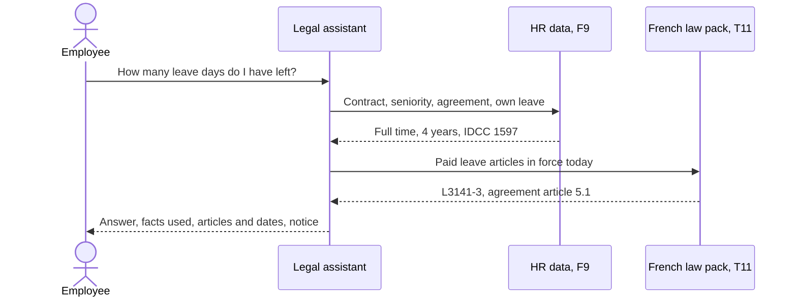

🏠 [Specs](../../../../README.md) › 🧩 [Functional capabilities](../../../README.md) ›
⚖️ [F15 Legal assistant](../../README.md) › 📝 [Use cases](../README.md) ›
📝 [Use cases: FL-F15-01 Ask a legal question](README.md) › 📝 UC-F15-01 Use the legal assistant

# 📝 UC-F15-01 Use the legal assistant

**Status:** ✅ specified

## Summary

Employees, managers, HR, the owner and accountants ask the legal assistant about the law and the sector's technical
rules, for their real situation; it warns on its own, checks documents against the law, and the administrator sets it up
(D198).

## Personas

- [U01 Employee](../../../../01-users/personas/u01-employee.md)
- [U14 Field worker](../../../../01-users/personas/u14-field-worker.md)
- [U02 Manager](../../../../01-users/personas/u02-manager.md)
- [U06 HR](../../../../01-users/personas/u06-hr.md)
- [U13 Owner](../../../../01-users/personas/u13-owner.md)
- [U05 Accounting](../../../../01-users/personas/u05-accounting.md)
- [U08 External accountant](../../../../01-users/personas/u08-external-accountant.md)
- [U07 Administrator](../../../../01-users/personas/u07-administrator.md)

## Goal

Know one's rights and the company's duties, cited and dated, without a lawyer for everyday questions.

## Trigger

A question; an action the ERP sees as a legal risk; a document to check; setting up the company.

## Frequency

Weekly per employee; daily for HR.

## Preconditions

The AI assistant is on (F1); the law pack of the country concerned is installed (France ships with SimpleERP).

## Postconditions

An answer, a warning, a check result or settings; the legal conversation stays private
([BR-F15-03](../../business-rules/br-f15-03-legal-questions-stay-private.md)).

## Main flow

1. In the AI assistant panel, the user switches to Legal (or the AI assistant routes a legal question there).
2. They ask; the AI assistant uses the facts of their situation it may read and lists them, with "general answer only"
   ([D191](../../../../06-decisions/f15-legal-assistant/d191-legal-answers-from-erp-data.md)), under the right country's
   law ([BR-F15-05](../../business-rules/br-f15-05-the-law-of-the-contract-or-the-site.md)).
3. The answer cites each article, its version and date
   ([BR-F15-01](../../business-rules/br-f15-01-every-statement-cites-the-law-in-force.md)), in the user's language with
   the original quoted ([BR-F15-04](../../business-rules/br-f15-04-the-user-s-language-the-law-s-words.md)), and ends
   with the notice or a referral ([BR-F15-02](../../business-rules/br-f15-02-information-not-advice.md)).
4. The user opens an article, asks "as of" a past date, or follows up.

## Alternative flows

- **Own rights** (U01, U14): leave, working time, overtime, notice, training, sick leave.
- **The company's duties** (U02, U06): thresholds, CSE, registers and displays, hiring and dismissal procedures, health
  and safety.
- **Commercial and tax** (U13): Code de commerce, CGI, invoicing, payment terms.
- **Tax and social** (U05, U08): contributions, tax questions.
- **Sector technical rules and standards:** for the company's sector
  ([Sector technical standards](../../../../05-non-functional/sector-technical-standards.md)).
- **Warning** (FL-F15-02): an action the ERP sees as a legal risk shows a warning
  ([BR-F15-07](../../business-rules/br-f15-07-warnings-inform-never-block.md)).
- **Document check** (FL-F15-03): HR or the owner checks a contract, a template or terms
  ([BR-F15-08](../../business-rules/br-f15-08-document-checks-list-never-rewrite.md)).
- **Set-up** (FL-F15-04, U07): countries and law packs
  ([D199](../../../../06-decisions/f15-legal-assistant/d199-law-packs.md)), warnings on or off, the provider (F1), each
  source's last pull (BR-F15-09).

Since the review of 2026-11-12 (R21), warnings, document checks, set-up, the law packs' refresh and the standards
register have their own use cases: UC-F15-02 to UC-F15-06.
- **Confidence and hand-off** (D472): every answer shows its confidence (BR-F15-16); a low one, or a referral topic,
  offers the lawyer hand-off (UC-F15-12).
- **Accountant** (U08): a tax question for a client company, with its figures (UC-F15-13).

## Error flows

- 2e. No law pack for that country: "I don't know" (BR-F15-02).
- 3e. The corpus does not cover the question: said, with a referral.
- 3e. The model or the corpus is unavailable: shown after 3 retries (BR-F3-32), following the error message pattern
  (D122).
- Set-up: an official source unreachable for a day: the last copy is used and the administrators are told (BR-F15-09).

## Business rules

- [BR-F15-01 Every statement cites the law in force](../../business-rules/br-f15-01-every-statement-cites-the-law-in-force.md)
- [BR-F15-02 Information, not advice](../../business-rules/br-f15-02-information-not-advice.md)
- [BR-F15-03 Legal questions stay private](../../business-rules/br-f15-03-legal-questions-stay-private.md)
- [BR-F15-04 The user's language, the law's words](../../business-rules/br-f15-04-the-user-s-language-the-law-s-words.md)
- [BR-F15-05 The law of the contract or the site](../../business-rules/br-f15-05-the-law-of-the-contract-or-the-site.md)
- [BR-F15-07 Warnings inform, never block](../../business-rules/br-f15-07-warnings-inform-never-block.md)
- [BR-F15-08 Document checks list, never rewrite](../../business-rules/br-f15-08-document-checks-list-never-rewrite.md)
- [BR-F15-16 Every answer shows its confidence](../../business-rules/br-f15-16-every-answer-shows-its-confidence.md)

## Entities

- [E-F15-01 Law pack](../../data/e-f15-01-law-pack.md)
- [E-F15-02 Legal warning](../../data/e-f15-02-legal-warning.md)
- [E-F15-03 Document check](../../data/e-f15-03-document-check.md)
- [E-F3-01 Conversation](../../../f03-assistant/data/e-f03-01-conversation.md), private as BR-F15-03
- [E-F15-10 Lawyer hand-off](../../data/e-f15-10-lawyer-hand-off.md)

## Permissions

Every internal persona asks; facts used are those the asker may see; HR and the owner check documents; administrators
set up.

## Notifications

Warnings to whoever acts and those who must know; administrators: a blocked law pack update.

## Audit events

A legal question was asked (never its content); warnings shown and dismissed with their reason; document checks run;
settings and law packs changed.

## AI involvement

The legal assistant feature's provider (F1, D82), local by default; retrieval from the law pack's corpus (T8, T11); the
ERP facts used are listed.

## API, MCP and A2A exposure

None in v1: legal answers only in the panel.

## Screens

- [S-F15-01 Legal answer](../../screens/01-ask-a-legal-question/s-f15-01-legal-answer.md)
- [S-F15-02 Legal warning](../../screens/02-receive-a-legal-warning/s-f15-02-legal-warning.md)
- [S-F15-03 Document check](../../screens/03-check-a-document-against-the-law/s-f15-03-document-check.md)
- [S-F15-04 Legal assistant settings](../../screens/04-set-up-the-legal-assistant/s-f15-04-legal-assistant-settings.md)
- [S-F15-11 Lawyer hand-off](../../screens/01-ask-a-legal-question/s-f15-11-lawyer-hand-off.md)

## Flowchart

See [FL-F15-01 Ask a legal question](../../flows/fl-f15-01-ask-a-legal-question.md#flowchart).

## Sequence diagram

## Acceptance criteria

1. **Given** an employee asking about leave **when** answered **then** the facts used are listed and each statement
   cites its article, version and date.
2. **Given** "as of 15 March 2025" **when** answered **then** the versions then in force are used and said.
3. **Given** a harassment question **when** answered **then** it gives rights and contacts and the referral, never a
   judgement.
4. **Given** any legal question **when** HR opens reports **then** they see counts only.
5. **Given** a Portuguese-speaking user **when** answered **then** the answer is in Portuguese and articles in French
   with an unofficial translation.
6. **Given** a schedule breaking daily rest **when** saved **then** a warning cites the rule and the save goes through.
7. **Given** warnings turned off **when** the same happens **then** nothing is shown.
8. **Given** a contract template missing a mandatory clause **when** checked **then** the clause is listed with its
   article and the template is unchanged.
9. **Given** an article amended at its official source **when** the next pull runs **then** its new version is used,
   with no one's action (D205, D206).
10. **Given** a Spanish-contract employee and no Spanish law pack **when** asking **then** the AI assistant says it does
    not know.
11. **Given** an answer relying on guidance only **when** shown **then** its confidence is "medium".
12. **Given** a low-confidence answer **when** shown **then** "Hand over to a lawyer" is offered.

## Non-functional notes

First words within 3 seconds with a local model on the reference profile
([Performance](../../../../05-non-functional/performance.md), D408); the French corpus refreshed daily (T11).

## Regulatory references

See [Regulatory](../../regulatory.md); limits in
[Legal advice limits](../../../../05-non-functional/legal-advice-limits.md).

## Related use cases

F3 (same panel); F9 (HR data); F2 (document templates); T11 (corpora).
- [UC-F15-12 Hand a question over to a lawyer](uc-f15-12-hand-a-question-over-to-a-lawyer.md)
- [UC-F15-13 Answer a client's tax question with their data](uc-f15-13-answer-a-clients-tax-question-with-their-data.md)

## Open questions

None.

---

⬆️ [Up](README.md) ·
➡️ [UC-F15-02 Receive a legal warning](../02-receive-a-legal-warning/uc-f15-02-receive-a-legal-warning.md)
