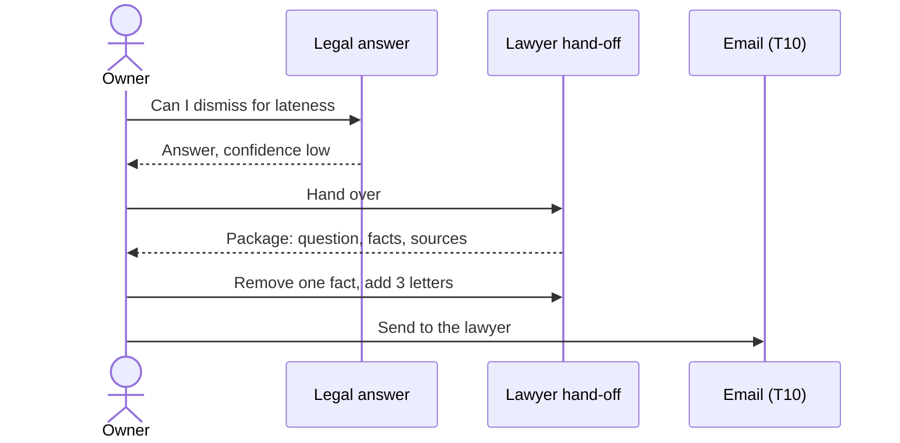

🏠 [Specs](../../../../README.md) › 🧩 [Functional capabilities](../../../README.md) ›
⚖️ [F15 Legal assistant](../../README.md) › 📝 [Use cases](../README.md) ›
📝 [Use cases: FL-F15-01 Ask a legal question](README.md) › 📝 UC-F15-12 Hand a question over to a lawyer

# 📝 UC-F15-12 Hand a question over to a lawyer

**Status:** ✅ specified

## Summary

When an answer has low confidence or the topic needs a lawyer, the asker builds a package with the question, the facts
used, the answer with its sources and confidence, and the documents they choose, and sends it to the lawyer of their
choice.

## Personas

- [U13 Owner](../../../../01-users/personas/u13-owner.md)
- [U06 Human resources](../../../../01-users/personas/u06-hr.md)
- [U01 Employee](../../../../01-users/personas/u01-employee.md)

## Goal

The lawyer starts with the facts and sources already gathered.

## Trigger

A low-confidence answer, a referral topic (BR-F15-02), or the asker's choice.

## Frequency

A few a year per company.

## Preconditions

- A legal conversation with an answer exists.

## Postconditions

- Success: the package sent; it stays private to the asker.
- Failure: the draft is kept or discarded.

## Main flow

1. On the answer (S-F15-01), the asker sees the confidence (BR-F15-16) and chooses "Hand over to a lawyer".
2. SimpleERP builds the package on Lawyer hand-off (S-F15-11): question, facts used, answer, sources and confidence.
3. The asker removes what they do not want to share and adds documents.
4. The asker types the lawyer's email and sends.
5. The package is kept in the asker's private history (BR-F15-03).

## Alternative flows

- 1a. A referral topic (dismissal, harassment): the hand-off is offered whatever the confidence, with the other contacts
  of D195.

## Error flows

- 3e. A document the asker may not see cannot be added (D191).
- 4e. The email cannot be delivered: the package stays a draft with the reason.
- Any step: a service does not answer; the call is retried first (BR-F3-32), then the message follows the error pattern
  (D122) and what was typed stays on the screen.

## Business rules

- [BR-F15-16 Every answer shows its confidence](../../business-rules/br-f15-16-every-answer-shows-its-confidence.md)
- [BR-F15-02 Information, not advice](../../business-rules/br-f15-02-information-not-advice.md)
- [BR-F15-03 Legal questions stay private](../../business-rules/br-f15-03-legal-questions-stay-private.md)

## Entities

- [E-F15-10 Lawyer hand-off](../../data/e-f15-10-lawyer-hand-off.md)

## Permissions

The asker only; nobody else sees the package (BR-F15-03).

## Notifications

- The asker when the email is delivered or bounces.

## Audit events

That a hand-off was sent, with when; never its content (BR-F15-03).

## AI involvement

The AI assistant builds the package from the conversation; it never sends it.

## API, MCP and A2A exposure

None in v1, like UC-F15-01.

## Screens

- [S-F15-11 Lawyer hand-off](../../screens/01-ask-a-legal-question/s-f15-11-lawyer-hand-off.md)
- [S-F15-01 Legal answer](../../screens/01-ask-a-legal-question/s-f15-01-legal-answer.md)

## Flowchart

See [FL-F15-01 Ask a legal question](../../flows/fl-f15-01-ask-a-legal-question.md#flowchart).

## Sequence diagram

## Acceptance criteria

1. **Given** an answer of low confidence **when** shown **then** "Hand over to a lawyer" is offered.
2. **Given** a harassment question answered with high confidence **when** shown **then** the hand-off is still offered.
3. **Given** the package **when** the owner removes a fact **then** it is not sent.
4. **Given** a package sent **when** HR opens reports **then** they see nothing of it.

## Non-functional notes

D408's targets ([Performance](../../../../05-non-functional/performance.md)): 95 % of screens within 1 second; lists
paged on the server, the first page within 1 second; reports within 5 seconds or in the background.

## Regulatory references

None.

## Related use cases

- [UC-F15-01 Use the legal assistant](uc-f15-01-use-the-legal-assistant.md)

## Open questions

None.

---

⬅️ [UC-F15-11](../06-privacy-and-ai-duties/uc-f15-11-keep-the-ai-uses-inventory-and-impact-assessments.md) ·
⬆️ [Up](README.md) · ➡️ [UC-F15-13](uc-f15-13-answer-a-clients-tax-question-with-their-data.md)
