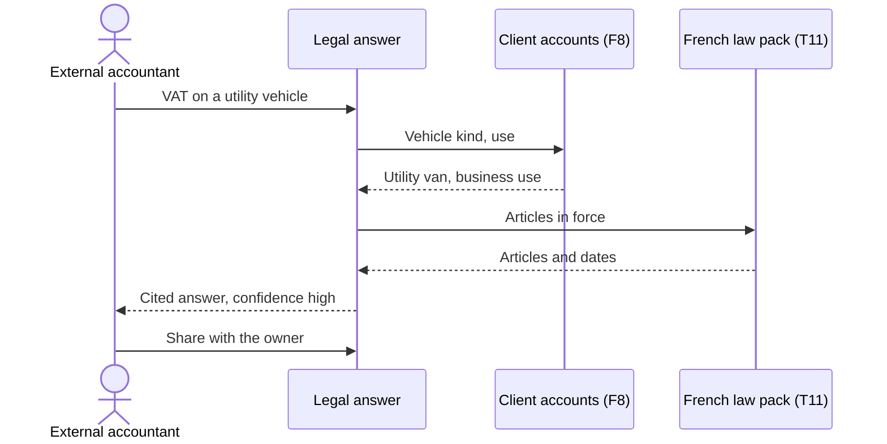

🏠 [Specs](../../../../README.md) › 🧩 [Functional capabilities](../../../README.md) ›
⚖️ [F15 Legal assistant](../../README.md) › 📝 [Use cases](../README.md) ›
📝 [Use cases: FL-F15-01 Ask a legal question](README.md) › 📝 UC-F15-13 Answer a client's tax question with their data

# 📝 UC-F15-13 Answer a client's tax question with their data

**Status:** ✅ specified

## Summary

The external accountant asks the legal assistant a tax question for a client company, answered with that client's
figures they may see, cited, and with a confidence level; the answer can be shared with the client.

## Personas

- [U08 External accountant](../../../../01-users/personas/u08-external-accountant.md)
- [U05 Accounting](../../../../01-users/personas/u05-accounting.md)

## Goal

A cited tax answer for the client's real situation, ready to share.

## Trigger

A client's question or a closing.

## Frequency

Several a month per accountant.

## Preconditions

- The accountant has access to the client company (F1, D53).

## Postconditions

- Success: the answer kept in the accountant's history, shared if chosen.
- Failure: "I don't know" with a referral.

## Main flow

1. The accountant opens the client company and the legal assistant (S-F15-01).
2. They ask: "can the client deduct the VAT on this vehicle?"
3. The AI assistant uses the client's figures the accountant may see and lists them (D191).
4. The answer cites each article in force with its version and date, and shows its confidence (BR-F15-16).
5. The accountant shares the answer with the client's owner.

## Alternative flows

- 3a. "General answer only": no client figure used.

## Error flows

- 4e. The corpus does not cover the question: "I don't know" with a referral.
- Any step: a service does not answer; the call is retried first (BR-F3-32), then the message follows the error pattern
  (D122) and what was typed stays on the screen.

## Business rules

- [BR-F15-01 Every statement cites the law in force](../../business-rules/br-f15-01-every-statement-cites-the-law-in-force.md)
- [BR-F15-16 Every answer shows its confidence](../../business-rules/br-f15-16-every-answer-shows-its-confidence.md)
- [BR-F15-05 The law of the contract or the site](../../business-rules/br-f15-05-the-law-of-the-contract-or-the-site.md)

## Entities

- [E-F15-01 Law pack](../../data/e-f15-01-law-pack.md)

## Permissions

External accountant within their client access; accounting of the company the same.

## Notifications

- The client's owner when an answer is shared.

## Audit events

That a question was asked and shared, never its content.

## AI involvement

The legal assistant's provider (F1, D82), local by default.

## API, MCP and A2A exposure

None in v1, like UC-F15-01.

## Screens

- [S-F15-01 Legal answer](../../screens/01-ask-a-legal-question/s-f15-01-legal-answer.md)

## Flowchart

See [FL-F15-01 Ask a legal question](../../flows/fl-f15-01-ask-a-legal-question.md#flowchart).

## Sequence diagram

## Acceptance criteria

1. **Given** the construction example company's utility van **when** the accountant asks about VAT recovery **then** the
   answer lists the van's facts and cites the articles in force.
2. **Given** "general answer only" **when** asked **then** no client figure is used.
3. **Given** a shared answer **when** shared **then** the client's owner is told.
4. **Given** a question outside the corpus **when** asked **then** the AI assistant says it does not know.

## Non-functional notes

D408's targets ([Performance](../../../../05-non-functional/performance.md)): 95 % of screens within 1 second; lists
paged on the server, the first page within 1 second; reports within 5 seconds or in the background.

## Regulatory references

[CR-FR-008 VAT rates](../../../../10-country-packs/france/tax-and-vat/cr-fr-008-vat-rates.md),
[CR-FR-011 VAT returns and filings](../../../../10-country-packs/france/tax-and-vat/cr-fr-011-vat-returns-and-filings.md).

## Related use cases

- [UC-F15-01 Use the legal assistant](uc-f15-01-use-the-legal-assistant.md)
- [UC-F15-09 Approve the accounts and keep the company registers](../05-duties-and-records/uc-f15-09-approve-the-accounts-and-keep-the-company-registers.md)

## Open questions

None.

---

⬅️ [UC-F15-12 Hand a question over to a lawyer](uc-f15-12-hand-a-question-over-to-a-lawyer.md) · ⬆️ [Up](README.md) ·
➡️ [UC-F15-14](../07-equity-contracts-and-disputes/uc-f15-14-keep-the-cap-table-and-share-movements.md)
