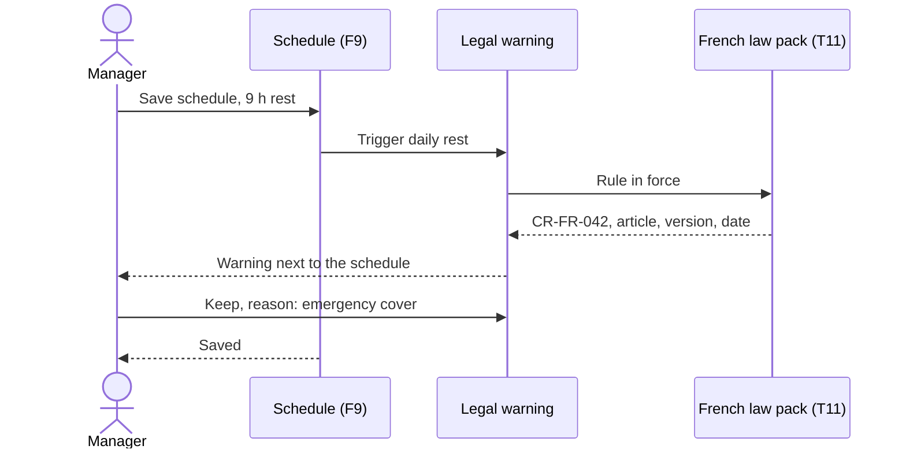

🏠 [Specs](../../../../README.md) › 🧩 [Functional capabilities](../../../README.md) ›
⚖️ [F15 Legal assistant](../../README.md) › 📝 [Use cases](../README.md) ›
📝 [Use cases: FL-F15-02 Receive a legal warning](README.md) › 📝 UC-F15-02 Receive a legal warning

# 📝 UC-F15-02 Receive a legal warning

**Status:** ✅ specified

## Summary

When a user saves an action the ERP sees as a legal risk (a trigger of the catalogue, BR-F15-17), a warning next to it
cites the rule with its article, version and date; the save always goes through, and HR or the owner are told when a
threshold is crossed.

## Personas

- [U02 Manager](../../../../01-users/personas/u02-manager.md)
- [U06 HR](../../../../01-users/personas/u06-hr.md)
- [U13 Owner](../../../../01-users/personas/u13-owner.md)
- [U01 Employee](../../../../01-users/personas/u01-employee.md)

## Goal

People know the legal risk of what they do, at the moment they do it, without being blocked.

## Trigger

A save that matches a warning trigger.

## Frequency

A few a week in a company of 50; daily for planners.

## Preconditions

- Warnings are on (D193) and the trigger is on.

## Postconditions

- Success: the warning shown and logged; dismissed with a reason or the action changed.
- Failure: no warning; the save goes through.

## Main flow

1. A manager saves a schedule in F9 giving a carer 9 hours of rest between two days.
2. simple-ERP matches the trigger "daily rest" of BR-F15-17 and shows the warning next to the schedule (S-F15-02).
3. The warning cites the rule (CR-FR-042), its article, version and date, and the facts it used (BR-F15-01).
4. The manager changes the schedule, or keeps it and dismisses the warning with a reason.
5. The save goes through either way (BR-F15-07); the dismissal and its reason are kept.

## Alternative flows

- 2a. A threshold crossed (headcount 50): HR and the owner are told as well as the person acting.
- 1a. Warnings turned off by the administrator (D193): nothing is shown; answers on demand only.
- 4a. The manager opens the explanation: a legal answer with the same sources opens (UC-F15-01).

## Error flows

- 2e. The corpus is unavailable: no warning, the save goes through, the administrators are told.
- Any step: a service does not answer; the call is retried first (BR-F3-32), then the message follows the error pattern
  (D122) and what was typed stays on the screen.

## Business rules

- [BR-F15-07 Warnings inform, never block](../../business-rules/br-f15-07-warnings-inform-never-block.md)
- [BR-F15-01 Every statement cites the law in force](../../business-rules/br-f15-01-every-statement-cites-the-law-in-force.md)
- [BR-F15-02 Information, not advice](../../business-rules/br-f15-02-information-not-advice.md)
- [BR-F15-17 Warning triggers by block](../../business-rules/br-f15-17-warning-triggers-by-block.md)

## Entities

- [E-F15-02 Legal warning](../../data/e-f15-02-legal-warning.md)
- [E-F15-11 Warning trigger](../../data/e-f15-11-warning-trigger.md)

## Permissions

Whoever acts sees the warning on their own action; managers on their team's; HR and the owner for thresholds and
contracts.

## Notifications

- HR and the owner at once for thresholds and contracts (F15 notifications).

## Audit events

Warning shown, dismissed with its reason; never another person's private data (BR-F15-07).

## AI involvement

Retrieval of the rule from the law corpus (T8, T11); no model decides to block.

## API, MCP and A2A exposure

None in v1, like UC-F15-01.

## Screens

- [S-F15-02 Legal warning](../../screens/02-receive-a-legal-warning/s-f15-02-legal-warning.md)

## Flowchart

See [FL-F15-02 Receive a legal warning](../../flows/fl-f15-02-receive-a-legal-warning.md#flowchart).

## Sequence diagram

## Acceptance criteria

1. **Given** a schedule with 9 hours of rest between two days **when** the manager saves **then** a warning cites
   CR-FR-042 with its article, version and date, and the save goes through.
2. **Given** the manager dismisses it with "emergency cover" **when** dismissed **then** the reason is kept.
3. **Given** a hire taking the headcount to 50 **when** saved **then** HR and the owner are told.
4. **Given** warnings turned off **when** the same schedule is saved **then** nothing is shown.

## Non-functional notes

D408's targets ([Performance](../../../../05-non-functional/performance.md)).

## Regulatory references

See [Regulatory](../../regulatory.md); limits in
[Legal advice limits](../../../../05-non-functional/legal-advice-limits.md).

## Related use cases

- [UC-F15-01 Use the legal assistant](../01-ask-a-legal-question/uc-f15-01-use-the-legal-assistant.md)
- [UC-F15-07 Keep the compliance calendar](../05-duties-and-records/uc-f15-07-keep-the-compliance-calendar.md)

## Open questions

None.

---

⬅️ [UC-F15-01 Use the legal assistant](../01-ask-a-legal-question/uc-f15-01-use-the-legal-assistant.md) ·
⬆️ [Up](README.md) ·
➡️ [UC-F15-03](../03-check-a-document-against-the-law/uc-f15-03-check-a-document-against-the-law.md)
