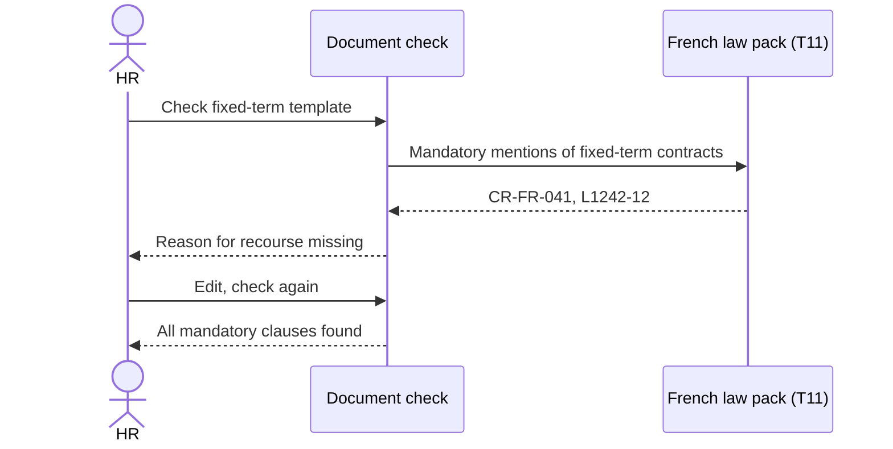

🏠 [Specs](../../../../README.md) › 🧩 [Functional capabilities](../../../README.md) ›
⚖️ [F15 Legal assistant](../../README.md) › 📝 [Use cases](../README.md) ›
📝 [Use cases: FL-F15-03 Check a document against the law](README.md) › 📝 UC-F15-03 Check a document against the law

# 📝 UC-F15-03 Check a document against the law

**Status:** ✅ specified

## Summary

HR or the owner checks a contract, a template or terms against the law in force; missing or doubtful clauses are listed
with their articles and the confidence of each finding, and the document is never rewritten.

## Personas

- [U06 HR](../../../../01-users/personas/u06-hr.md)
- [U13 Owner](../../../../01-users/personas/u13-owner.md)

## Goal

Know which clauses a document lacks or may break, before it is signed or published.

## Trigger

A new template, a contract to sign, terms to publish.

## Frequency

A few a month.

## Preconditions

- The document is readable (PDF, Word, text) and its country is known (BR-F15-05).

## Postconditions

- Success: a list of clauses found, missing and doubtful, each with its article; the document unchanged.
- Failure: the document cannot be read; the formats accepted are listed.

## Main flow

1. HR opens a contract template and chooses "Check against the law" (S-F15-03).
2. The AI assistant reads it against the law in force for its country and kind (BR-F15-05).
3. Each mandatory clause is listed as found or missing, each doubtful clause with what it may break (BR-F15-01).
4. HR edits the template themselves; the document is never rewritten (BR-F15-08).
5. HR checks again; the result is kept with its date.

## Alternative flows

- 3a. A standard cited by the document: its register entry only (BR-F15-10).
- 4a. A doubtful clause on a referral topic: the lawyer hand-off is offered (UC-F15-12).

## Error flows

- 1e. The document cannot be read: said, with the formats accepted.
- 2e. No law pack for the document's country: "I don't know" (BR-F15-02).
- Any step: a service does not answer; the call is retried first (BR-F3-32), then the message follows the error pattern
  (D122) and what was typed stays on the screen.

## Business rules

- [BR-F15-08 Document checks list, never rewrite](../../business-rules/br-f15-08-document-checks-list-never-rewrite.md)
- [BR-F15-01 Every statement cites the law in force](../../business-rules/br-f15-01-every-statement-cites-the-law-in-force.md)
- [BR-F15-02 Information, not advice](../../business-rules/br-f15-02-information-not-advice.md)
- [BR-F15-05 The law of the contract or the site](../../business-rules/br-f15-05-the-law-of-the-contract-or-the-site.md)
- [BR-F15-16 Every answer shows its confidence](../../business-rules/br-f15-16-every-answer-shows-its-confidence.md)

## Entities

- [E-F15-03 Document check](../../data/e-f15-03-document-check.md)

## Permissions

HR and the owner check documents.

## Notifications

- None.

## Audit events

Check run with the document and date; never shared with others.

## AI involvement

The legal assistant's provider (F1, D82); retrieval from the law corpus; it lists, never rewrites.

## API, MCP and A2A exposure

None in v1, like UC-F15-01.

## Screens

- [S-F15-03 Document check](../../screens/03-check-a-document-against-the-law/s-f15-03-document-check.md)

## Flowchart

See [FL-F15-03 Check a document against the law](../../flows/fl-f15-03-check-a-document-against-the-law.md#flowchart).

## Sequence diagram

## Acceptance criteria

1. **Given** a fixed-term contract template with no reason for recourse **when** checked **then** "reason for recourse
   missing" is listed with CR-FR-041 and L1242-12.
2. **Given** the same template **when** checked **then** it is unchanged.
3. **Given** a scanned image that cannot be read **when** checked **then** the formats accepted are listed.
4. **Given** terms citing NF C 15-100 **when** checked **then** only its register entry is shown.

## Non-functional notes

D408's targets ([Performance](../../../../05-non-functional/performance.md)).

## Regulatory references

See [Regulatory](../../regulatory.md); limits in
[Legal advice limits](../../../../05-non-functional/legal-advice-limits.md).

## Related use cases

- [UC-F15-01 Use the legal assistant](../01-ask-a-legal-question/uc-f15-01-use-the-legal-assistant.md)
- [UC-F15-12 Hand a question over to a lawyer](../01-ask-a-legal-question/uc-f15-12-hand-a-question-over-to-a-lawyer.md)

## Open questions

None.

---

⬅️ [UC-F15-02 Receive a legal warning](../02-receive-a-legal-warning/uc-f15-02-receive-a-legal-warning.md) ·
⬆️ [Up](README.md) ·
➡️ [UC-F15-04 Set up the legal assistant](../04-set-up-the-legal-assistant/uc-f15-04-set-up-the-legal-assistant.md)
