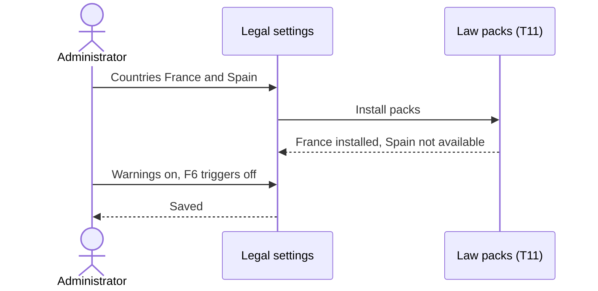

🏠 [Specs](../../../../README.md) › 🧩 [Functional capabilities](../../../README.md) ›
⚖️ [F15 Legal assistant](../../README.md) › 📝 [Use cases](../README.md) ›
📝 [Use cases: FL-F15-04 Set up the legal assistant](README.md) › 📝 UC-F15-04 Set up the legal assistant

# 📝 UC-F15-04 Set up the legal assistant

**Status:** ✅ specified

## Summary

The administrator chooses the countries and their law packs, turns warnings and each trigger on or off, and sees the AI
feature setting used by the legal assistant.

## Personas

- [U07 Administrator](../../../../01-users/personas/u07-administrator.md)

## Goal

The legal assistant covers the company's countries, with the warnings it wants.

## Trigger

F15 turned on (F21), a new site in another country.

## Frequency

Once, then rarely.

## Preconditions

- The administrator role.

## Postconditions

- Success: law packs installed; warnings set.
- Failure: the previous state kept, the reason shown.

## Main flow

1. The administrator opens the legal assistant's settings (S-F15-04).
2. They choose the countries whose law packs are installed (D199); France ships with simple-ERP.
3. They turn warnings on or off (D193), and each trigger of the catalogue (BR-F15-17).
4. They see the AI feature setting used (E-F1-09, D82), local by default.
5. They open Law packs (S-F15-05) and Standards (S-F15-06) to see what is covered.

## Alternative flows

- 2a. A country with no law pack: listed as not covered (BR-F15-05).

## Error flows

- 2e. A law pack that cannot be installed: the reason is shown and the previous state kept.
- Any step: a service does not answer; the call is retried first (BR-F3-32), then the message follows the error pattern
  (D122) and what was typed stays on the screen.

## Business rules

- [BR-F15-05 The law of the contract or the site](../../business-rules/br-f15-05-the-law-of-the-contract-or-the-site.md)
- [BR-F15-09 Law packs pull official sources on their own](../../business-rules/br-f15-09-law-packs-pull-official-sources-on-their-own.md)
- [BR-F15-17 Warning triggers by block](../../business-rules/br-f15-17-warning-triggers-by-block.md)
- [BR-F15-15 Every AI use inventoried with its risk class](../../business-rules/br-f15-15-every-ai-use-inventoried-with-its-risk-class.md)

## Entities

- [E-F15-01 Law pack](../../data/e-f15-01-law-pack.md)
- [E-F15-11 Warning trigger](../../data/e-f15-11-warning-trigger.md)

## Permissions

Administrator.

## Notifications

- Administrators when a law pack is installed or fails.

## Audit events

Countries, packs, warnings and triggers changed, with who and when.

## AI involvement

None in the set-up itself.

## API, MCP and A2A exposure

None in v1, like UC-F15-01.

## Screens

- [S-F15-04 Legal assistant settings](../../screens/04-set-up-the-legal-assistant/s-f15-04-legal-assistant-settings.md)

## Flowchart

See [FL-F15-04 Set up the legal assistant](../../flows/fl-f15-04-set-up-the-legal-assistant.md#flowchart).

## Sequence diagram

## Acceptance criteria

1. **Given** France chosen **when** saved **then** the French law pack is installed and its triggers are on.
2. **Given** Spain chosen and no Spanish pack **when** saved **then** Spain is listed as not covered.
3. **Given** warnings turned off **when** saved **then** no warning is shown anywhere.
4. **Given** the F6 triggers turned off **when** an invoice misses a mention **then** no warning is shown.

## Non-functional notes

D408's targets ([Performance](../../../../05-non-functional/performance.md)).

## Regulatory references

See [Regulatory](../../regulatory.md); limits in
[Legal advice limits](../../../../05-non-functional/legal-advice-limits.md).

## Related use cases

- [UC-F15-05 Follow the law packs' refresh](uc-f15-05-follow-the-law-packs-refresh.md)
- [UC-F15-06 Keep the standards register](uc-f15-06-keep-the-standards-register.md)
- [UC-F15-11 Keep the AI uses inventory and impact assessments](../06-privacy-and-ai-duties/uc-f15-11-keep-the-ai-uses-inventory-and-impact-assessments.md)

## Open questions

None.

---

⬅️ [UC-F15-03](../03-check-a-document-against-the-law/uc-f15-03-check-a-document-against-the-law.md) ·
⬆️ [Up](README.md) · ➡️ [UC-F15-05 Follow the law packs' refresh](uc-f15-05-follow-the-law-packs-refresh.md)
