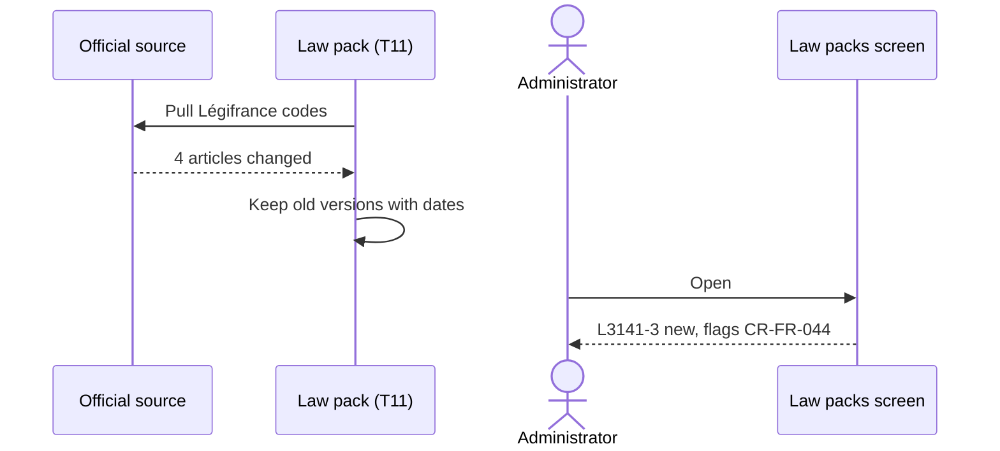

🏠 [Specs](../../../../README.md) › 🧩 [Functional capabilities](../../../README.md) ›
⚖️ [F15 Legal assistant](../../README.md) › 📝 [Use cases](../README.md) ›
📝 [Use cases: FL-F15-04 Set up the legal assistant](README.md) › 📝 UC-F15-05 Follow the law packs' refresh

# 📝 UC-F15-05 Follow the law packs' refresh

**Status:** ✅ specified

## Summary

Law packs' official texts are pulled unattended; the administrator sees on Law packs each source's last pull and what
changed, and the country-pack rules a change flagged.

## Personas

- [U07 Administrator](../../../../01-users/personas/u07-administrator.md)

## Goal

Answers always use the law in force, and the administrator knows what changed.

## Trigger

The pull schedule of each source.

## Frequency

Daily or weekly per source.

## Preconditions

- Law packs are installed.

## Postconditions

- Success: new article versions in the corpus; old ones kept with their dates.
- Failure: the last copy is used; the administrators are told.

## Main flow

1. On schedule, each official source of the installed law packs is pulled, with no human validation (BR-F15-09, D205).
2. New article versions enter the corpus; old ones are kept with their dates (BR-F15-01).
3. The administrator opens Law packs (S-F15-05) and sees each source's last pull and what changed.
4. A change that touches a country-pack rule flags it; the corrected rule ships in a signed pack update (D294, D448).
5. HR and the owner receive the monthly digest of changes for their sector and size (D204).

## Alternative flows

- 1a. Copyrighted standards are not pulled: their register entries only (BR-F15-10).

## Error flows

- 1e. An official source unreachable for a day: the last copy is used and the administrators are told (BR-F15-09).
- Any step: a service does not answer; the call is retried first (BR-F3-32), then the message follows the error pattern
  (D122) and what was typed stays on the screen.

## Business rules

- [BR-F15-09 Law packs pull official sources on their own](../../business-rules/br-f15-09-law-packs-pull-official-sources-on-their-own.md)

## Entities

- [E-F15-01 Law pack](../../data/e-f15-01-law-pack.md)
- [E-F15-12 Legal source](../../data/e-f15-12-legal-source.md)

## Permissions

Administrator reads; HR and the owner get the digest.

## Notifications

- Administrators after a day of unreachable source; HR and the owner the monthly digest.

## Audit events

Each pull with its result and changes.

## AI involvement

None in the pull; answers use the new versions.

## API, MCP and A2A exposure

None in v1, like UC-F15-01.

## Screens

- [S-F15-04 Legal assistant settings](../../screens/04-set-up-the-legal-assistant/s-f15-04-legal-assistant-settings.md)
- [S-F15-05 Law packs refresh](../../screens/04-set-up-the-legal-assistant/s-f15-05-law-packs-refresh.md)

## Flowchart

See [FL-F15-04 Set up the legal assistant](../../flows/fl-f15-04-set-up-the-legal-assistant.md#flowchart).

## Sequence diagram

## Acceptance criteria

1. **Given** L3141-3 amended at its source from 2026-11-01 **when** the next pull runs **then** its new version is used,
   with no one's action.
2. **Given** a source down for a day **when** the administrator opens Law packs **then** the last pull's date and a
   banner show.
3. **Given** a change touching CR-FR-044 **when** pulled **then** the rule is flagged.
4. **Given** "as of 15 March 2025" **when** asked **then** the old version is still available.

## Non-functional notes

D408's targets ([Performance](../../../../05-non-functional/performance.md)).

## Regulatory references

See [Regulatory](../../regulatory.md); limits in
[Legal advice limits](../../../../05-non-functional/legal-advice-limits.md).

## Related use cases

- [UC-F15-04 Set up the legal assistant](uc-f15-04-set-up-the-legal-assistant.md)
- [UC-F15-06 Keep the standards register](uc-f15-06-keep-the-standards-register.md)

## Open questions

None.

---

⬅️ [UC-F15-04 Set up the legal assistant](uc-f15-04-set-up-the-legal-assistant.md) · ⬆️ [Up](README.md) ·
➡️ [UC-F15-06 Keep the standards register](uc-f15-06-keep-the-standards-register.md)
