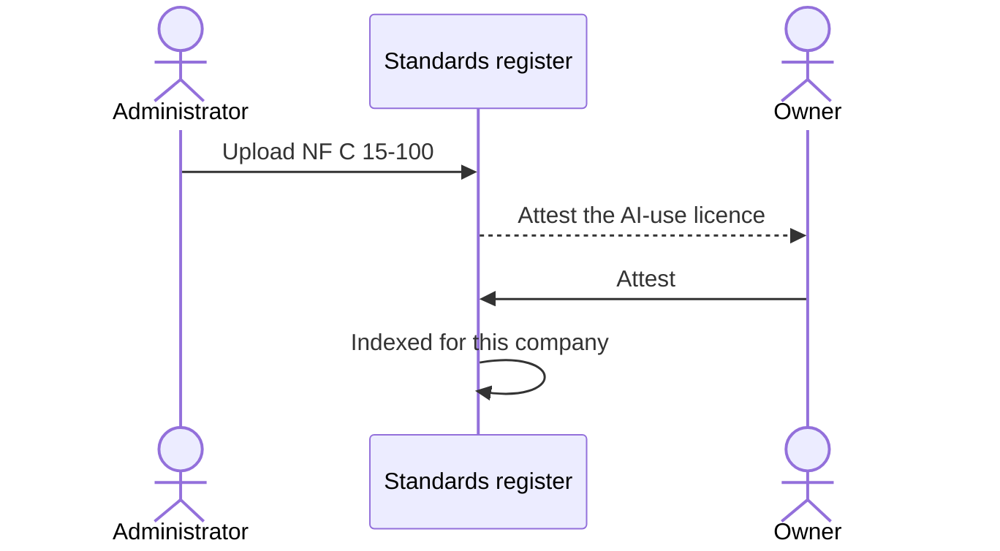

🏠 [Specs](../../../../README.md) › 🧩 [Functional capabilities](../../../README.md) ›
⚖️ [F15 Legal assistant](../../README.md) › 📝 [Use cases](../README.md) ›
📝 [Use cases: FL-F15-04 Set up the legal assistant](README.md) › 📝 UC-F15-06 Keep the standards register

# 📝 UC-F15-06 Keep the standards register

**Status:** ✅ specified

## Summary

The register of copyrighted standards holds references, never texts; the administrator uploads the company's own copy
only after the owner attests an AI-use licence, and answers say what applies and where to get it.

## Personas

- [U07 Administrator](../../../../01-users/personas/u07-administrator.md)
- [U13 Owner](../../../../01-users/personas/u13-owner.md)

## Goal

Standards known and cited lawfully.

## Trigger

A sector standard needed; a company copy bought.

## Frequency

Rare.

## Preconditions

- The register is refreshed from open sources (D448).

## Postconditions

- Success: references listed; own copies indexed after attestation.
- Failure: the upload refused without attestation.

## Main flow

1. Register entries are refreshed from open sources: ISO Open Data and the legal texts that cite a standard (D448).
2. The administrator opens Standards (S-F15-06) and sees those that apply to the sector.
3. The AI assistant answers what applies and where to get it, without quoting the standard (BR-F15-10).
4. The administrator uploads the company's own copy; the owner attests the AI-use licence; it is indexed for the company
   only.

## Alternative flows

- 4a. No attestation: only the reference and the clause titles are indexed.
- 1a. A standard made free by its owner for reuse: indexed in full.

## Error flows

- 4e. The attestation is withdrawn: the copy is removed from the index.
- Any step: a service does not answer; the call is retried first (BR-F3-32), then the message follows the error pattern
  (D122) and what was typed stays on the screen.

## Business rules

- [BR-F15-10 Standards as a register, own copies opt-in](../../business-rules/br-f15-10-standards-as-a-register-own-copies-opt-in.md)

## Entities

- [E-F15-04 Standard register entry](../../data/e-f15-04-standard-register-entry.md)

## Permissions

Administrator uploads; the owner attests.

## Notifications

- The owner when an attestation is asked.

## Audit events

Uploads, attestations and withdrawals.

## AI involvement

Answers cite references only, or the company's attested copy.

## API, MCP and A2A exposure

None in v1, like UC-F15-01.

## Screens

- [S-F15-04 Legal assistant settings](../../screens/04-set-up-the-legal-assistant/s-f15-04-legal-assistant-settings.md)
- [S-F15-06 Standards register](../../screens/04-set-up-the-legal-assistant/s-f15-06-standards-register.md)

## Flowchart

See [FL-F15-04 Set up the legal assistant](../../flows/fl-f15-04-set-up-the-legal-assistant.md#flowchart).

## Sequence diagram

## Acceptance criteria

1. **Given** NF C 15-100 applies to the construction example company **when** the register opens **then** its reference,
   edition and status show, with no text.
2. **Given** an upload attested by the owner **when** indexed **then** answers may cite its clauses for this company
   only.
3. **Given** no attestation **when** uploaded **then** only references and clause titles are indexed.
4. **Given** the attestation withdrawn **when** withdrawn **then** the copy leaves the index.

## Non-functional notes

D408's targets ([Performance](../../../../05-non-functional/performance.md)).

## Regulatory references

See [Regulatory](../../regulatory.md); limits in
[Legal advice limits](../../../../05-non-functional/legal-advice-limits.md).

## Related use cases

- [UC-F15-04 Set up the legal assistant](uc-f15-04-set-up-the-legal-assistant.md)
- [UC-F15-03 Check a document against the law](../03-check-a-document-against-the-law/uc-f15-03-check-a-document-against-the-law.md)

## Open questions

None.

---

⬅️ [UC-F15-05 Follow the law packs' refresh](uc-f15-05-follow-the-law-packs-refresh.md) · ⬆️ [Up](README.md) ·
➡️ [UC-F15-07 Keep the compliance calendar](../05-duties-and-records/uc-f15-07-keep-the-compliance-calendar.md)
