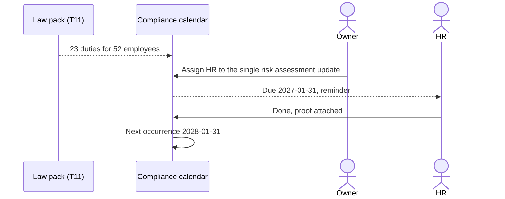

🏠 [Specs](../../../../README.md) › 🧩 [Functional capabilities](../../../README.md) ›
⚖️ [F15 Legal assistant](../../README.md) › 📝 [Use cases](../README.md) ›
📝 [Use cases: FL-F15-05 Duties and records](README.md) › 📝 UC-F15-07 Keep the compliance calendar

# 📝 UC-F15-07 Keep the compliance calendar

**Status:** 🔄 waiting for the owner

## Summary

The owner, HR and accounting see the company's dated legal duties in one calendar, generated from the law pack for its
size, sector and form; each duty has an owner and reminders, and the AI assistant explains it with its source.

## Personas

- [U13 Owner](../../../../01-users/personas/u13-owner.md)
- [U06 Human resources](../../../../01-users/personas/u06-hr.md), who owns the HR duties
- [U05 Accounting](../../../../01-users/personas/u05-accounting.md), who owns the tax and accounting duties

## Goal

No legal duty forgotten, each one done on time with its proof.

## Trigger

F15 set up; the headcount or the sector changing; each day for reminders.

## Frequency

Daily reminders; a few duties a month; the owner reviews the calendar monthly.

## Preconditions

- The law pack of the company's country is installed (UC-F15-04).
- The company's size, sector and legal form are known (F1, F9).

## Postconditions

- Success: every duty planned with an owner; done duties with their proof.
- Failure: overdue duties shown in red and their owners told.

## Main flow

1. SimpleERP generates the duties for the company from the law pack: filings, registers, mandatory displays and
   trainings, inspections, the approval of the accounts.
2. The owner opens the Compliance calendar (S-F15-07) and assigns an owner to each duty.
3. Each owner is reminded before the due date (BR-F15-11).
4. The owner of a duty marks it done and attaches the proof.
5. SimpleERP plans the next occurrence of recurring duties.

## Alternative flows

- 1a. The headcount crosses 50 (CR-FR-046): new duties are added and HR and the owner are told.
- 2a. The external accountant is the owner of the tax duties of a client company (U08).
- 4a. The owner asks the AI assistant what a duty means: the answer cites its source (UC-F15-01).

## Error flows

- 3e. The due date passes undone: the duty turns overdue; its owner and the owner of the company are told.
- 1e. No law pack for a site's country: its duties are not generated and the site is listed as not covered.
- Any step: a service does not answer; the call is retried first (BR-F3-32), then the message follows the error pattern
  (D122) and what was typed stays on the screen.

## Business rules

- [BR-F15-11 Every dated duty has an owner and reminders](../../business-rules/br-f15-11-every-dated-duty-has-an-owner-and-reminders.md)
- [BR-F15-01 Every statement cites the law in force](../../business-rules/br-f15-01-every-statement-cites-the-law-in-force.md)
- [BR-F15-17 Warning triggers by block](../../business-rules/br-f15-17-warning-triggers-by-block.md)

## Entities

- [E-F15-05 Compliance duty](../../data/e-f15-05-compliance-duty.md)
- [E-F15-01 Law pack](../../data/e-f15-01-law-pack.md)
- [E-F15-14 Corporate filing](../../data/e-f15-14-corporate-filing.md)

## Permissions

Owner: assigns and sees all duties. HR, accounting, external accountant: their duties and those they own. Employees
never see the calendar.

## Notifications

- Each owner of a duty (Proposed) 30 and 7 days before the due date, and when overdue; the owner of the company of every
  overdue duty.

## Audit events

Duty generated, assigned, done with its proof, overdue, with who and when.

## AI involvement

The AI assistant may explain a duty with its source and draft the document it needs; it never marks a duty done.

## API, MCP and A2A exposure

Duties read through the API (T5) and as an iCalendar feed per owner (Proposed).

## Screens

- [S-F15-07 Compliance calendar](../../screens/05-duties-and-records/s-f15-07-compliance-calendar.md)

## Flowchart

See [FL-F15-05 Duties and records](../../flows/fl-f15-05-duties-and-records.md#flowchart).

## Sequence diagram

## Acceptance criteria

1. **Given** the restaurant example company with 52 employees **when** the calendar is generated **then** the duties of
   a company of 50 or more appear, each with its source and due date.
2. **Given** the single risk assessment update due on 2027-01-31 owned by HR **when** 2027-01-01 comes **then** HR is
   reminded.
3. **Given** that duty undone on 2027-02-01 **when** the day comes **then** it is overdue and HR and the owner are told.
4. **Given** HR marks it done with a PDF **when** saved **then** the next occurrence is planned for 2028-01-31.

## Non-functional notes

D408's targets ([Performance](../../../../05-non-functional/performance.md)): 95 % of screens within 1 second; lists
paged on the server, the first page within 1 second; reports within 5 seconds or in the background.

## Regulatory references

Thresholds:
[CR-FR-046 Headcount thresholds](../../../../10-country-packs/france/labour/cr-fr-046-headcount-thresholds.md); risk
assessment:
[CR-FR-076 Occupational risk assessment](../../../../10-country-packs/france/labour/cr-fr-076-occupational-risk-assessment.md);
the full list of dated duties: (Proposed) to read per law pack.

## Related use cases

- [UC-F15-08 Track contract renewal and notice dates](uc-f15-08-track-contract-renewal-and-notice-dates.md)
- [UC-F15-09 Approve the accounts and keep the company registers](uc-f15-09-approve-the-accounts-and-keep-the-company-registers.md)
- [UC-F15-01 Use the legal assistant](../01-ask-a-legal-question/uc-f15-01-use-the-legal-assistant.md)

## Open questions

None.

---

⬅️ [UC-F15-06 Keep the standards register](../04-set-up-the-legal-assistant/uc-f15-06-keep-the-standards-register.md) ·
⬆️ [Up](README.md) ·
➡️ [UC-F15-08 Track contract renewal and notice dates](uc-f15-08-track-contract-renewal-and-notice-dates.md)
