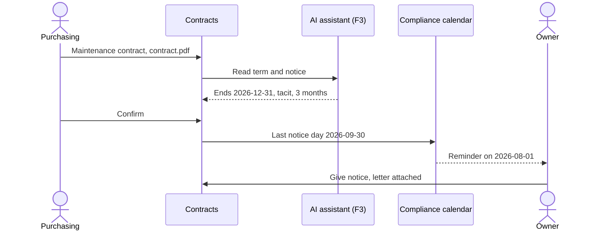

🏠 [Specs](../../../../README.md) › 🧩 [Functional capabilities](../../../README.md) ›
⚖️ [F15 Legal assistant](../../README.md) › 📝 [Use cases](../README.md) ›
📝 [Use cases: FL-F15-05 Duties and records](README.md) › 📝 UC-F15-08 Track contract renewal and notice dates

# 📝 UC-F15-08 Track contract renewal and notice dates

**Status:** 🔄 waiting for the owner

## Summary

The owner or purchasing records the company's contracts (leases, insurance, suppliers, maintenance) with their term and
notice; simple-ERP computes the last day to give notice and reminds before it, so that no contract renews by surprise.

## Personas

- [U13 Owner](../../../../01-users/personas/u13-owner.md)
- [U04 Purchasing and stock](../../../../01-users/personas/u04-purchasing.md), who records supplier and maintenance
  contracts

## Goal

Each renewal decided on purpose before the last notice day.

## Trigger

A contract signed or found; the reminder before a last notice day.

## Frequency

A few contracts a month to record; reminders weekly.

## Preconditions

- The other party exists as a partner (F6 or F7).

## Postconditions

- Success: the contract recorded with its last notice day and reminders.
- Failure: the contract shows "notice unknown" until completed.

## Main flow

1. Purchasing opens Contracts (S-F15-08) and adds a contract with its document.
2. The AI assistant reads the document and proposes the term, renewal kind and notice period, for purchasing to confirm.
3. simple-ERP computes the last notice day (BR-F15-12) and adds it to the compliance calendar.
4. The owner is reminded before that day and decides: renew, renegotiate or give notice.
5. When notice is given, the letter is attached and the contract ends at its term.

## Alternative flows

- 2a. A commercial lease with notice at each 3-year term: each term's last notice day is computed.
- 4a. The owner asks the AI assistant whether notice can still be given: the answer cites its source (UC-F15-01).

## Error flows

- 2e. The document cannot be read: the fields are entered by hand.
- 4e. The last notice day passes: the contract renews by its terms and the calendar shows the new term.
- Any step: a service does not answer; the call is retried first (BR-F3-32), then the message follows the error pattern
  (D122) and what was typed stays on the screen.

## Business rules

- [BR-F15-12 Notice dates computed before renewals](../../business-rules/br-f15-12-notice-dates-computed-before-renewals.md)
- [BR-F15-11 Every dated duty has an owner and reminders](../../business-rules/br-f15-11-every-dated-duty-has-an-owner-and-reminders.md)

## Entities

- [E-F15-06 Contract record](../../data/e-f15-06-contract-record.md)
- [E-F15-05 Compliance duty](../../data/e-f15-05-compliance-duty.md)

## Permissions

Owner and purchasing record and decide; accounting reads; other roles do not see contracts.

## Notifications

- The owner and the person who recorded the contract (Proposed) 60 and 15 days before the last notice day.

## Audit events

Contract recorded, changed, notice given, renewed, with who and when.

## AI involvement

The AI assistant reads the document to propose its dates; it never sends a notice.

## API, MCP and A2A exposure

Through the API (T5) and as AI assistant tools (T6), with the caller's rights (BR-F3-34).

## Screens

- [S-F15-08 Contracts](../../screens/05-duties-and-records/s-f15-08-contracts.md)

## Flowchart

See [FL-F15-05 Duties and records](../../flows/fl-f15-05-duties-and-records.md#flowchart).

## Sequence diagram

## Acceptance criteria

1. **Given** a maintenance contract ending on 2026-12-31 with tacit renewal and 3 months' notice **when** recorded
   **then** the last notice day is 2026-09-30.
2. **Given** that contract **when** 2026-08-01 comes **then** the owner is reminded.
3. **Given** no notice given by 2026-09-30 **when** the day passes **then** the contract shows renewed to 2027-12-31.
4. **Given** an unreadable scan **when** added **then** the fields are entered by hand.

## Non-functional notes

D408's targets ([Performance](../../../../05-non-functional/performance.md)): 95 % of screens within 1 second; lists
paged on the server, the first page within 1 second; reports within 5 seconds or in the background.

## Regulatory references

Tacit renewal and notice: (Proposed) to read for the France pack (Code de la consommation L215-1 for consumer contracts,
commercial leases in the Code de commerce).

## Related use cases

- [UC-F15-07 Keep the compliance calendar](uc-f15-07-keep-the-compliance-calendar.md)
- [UC-F15-03 Check a document against the law](../03-check-a-document-against-the-law/uc-f15-03-check-a-document-against-the-law.md)

## Open questions

None.

---

⬅️ [UC-F15-07 Keep the compliance calendar](uc-f15-07-keep-the-compliance-calendar.md) · ⬆️ [Up](README.md) ·
➡️ [UC-F15-09](uc-f15-09-approve-the-accounts-and-keep-the-company-registers.md)
