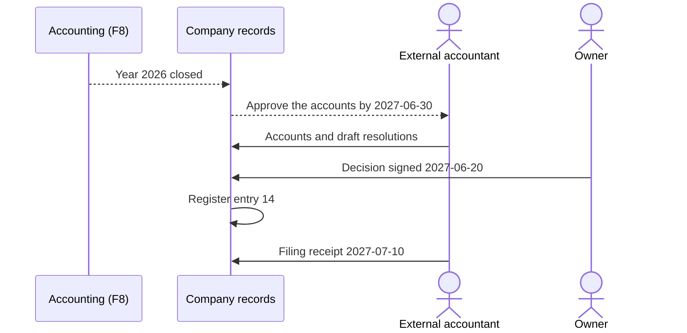

🏠 [Specs](../../../../README.md) › 🧩 [Functional capabilities](../../../README.md) ›
⚖️ [F15 Legal assistant](../../README.md) › 📝 [Use cases](../README.md) ›
📝 [Use cases: FL-F15-05 Duties and records](README.md) › 📝 UC-F15-09 Approve the accounts and keep the company registers

# 📝 UC-F15-09 Approve the accounts and keep the company registers

**Status:** ✅ specified, ⚖️ lawyer review before launch (D574)

## Summary

After the year end, the owner and the external accountant prepare and hold the approval of the accounts, record the
decision in the register, file what must be filed, and keep the beneficial-owner declaration up to date.

## Personas

- [U13 Owner](../../../../01-users/personas/u13-owner.md)
- [U08 External accountant](../../../../01-users/personas/u08-external-accountant.md), who prepares the accounts and the
  filings

## Goal

The yearly company-law duties done on time, with the registers complete.

## Trigger

The financial year closed in F8; a change of shareholders.

## Frequency

Yearly, plus each change of beneficial owners.

## Preconditions

- The legal form and the year end are set (F1).
- The year is closed in F8.

## Postconditions

- Success: the decision registered, the filings done, the duties marked done.
- Failure: the duty turns overdue.

## Main flow

1. The year closes in F8; SimpleERP creates the duty "approve the accounts" with its due date (BR-F15-13).
2. The external accountant prepares the accounts and the draft resolutions on Company records (S-F15-09).
3. The owner holds the meeting or the sole shareholder's decision; the minutes are signed and attached.
4. SimpleERP numbers the decision in the register and creates the filing duty.
5. The accountant files the accounts and attaches the receipt; the duties are marked done.

## Alternative flows

- 3a. A company with several shareholders: the notice of the meeting is sent to each with the documents.
- 1a. A change of beneficial owner: a declaration duty is created.

## Error flows

- 1e. The accounts are not ready by the due date: the duty turns overdue and the AI assistant explains the extension
  request to the court that
  [CR-FR-221](../../../../10-country-packs/france/company/cr-fr-221-general-meetings.md) reads.
- 4e. Minutes not signed: the decision stays "held" and is not numbered.
- Any step: a service does not answer; the call is retried first (BR-F3-32), then the message follows the error pattern
  (D122) and what was typed stays on the screen.

## Business rules

- [BR-F15-13 Company-law deadlines kept](../../business-rules/br-f15-13-company-law-deadlines-kept.md)
- [BR-F15-11 Every dated duty has an owner and reminders](../../business-rules/br-f15-11-every-dated-duty-has-an-owner-and-reminders.md)

## Entities

- [E-F15-07 Corporate decision](../../data/e-f15-07-corporate-decision.md)
- [E-F15-05 Compliance duty](../../data/e-f15-05-compliance-duty.md)

## Permissions

Owner: holds and signs. External accountant: prepares and files for client companies. Accounting reads.

## Notifications

- The owner and the external accountant at the year close and 30 days before the due date.

## Audit events

Decision prepared, held, registered; filings; with who and when.

## AI involvement

The AI assistant may draft the resolutions from the accounts for the accountant to check; it never signs.

## API, MCP and A2A exposure

Through the API (T5) and as AI assistant tools (T6), with the caller's rights (BR-F3-34).

## Screens

- [S-F15-09 Company records](../../screens/05-duties-and-records/s-f15-09-company-records.md)

## Flowchart

See [FL-F15-05 Duties and records](../../flows/fl-f15-05-duties-and-records.md#flowchart).

## Sequence diagram

## Acceptance criteria

1. **Given** the year 2026 closed on 2027-03-15 **when** closed **then** the duty "approve the accounts" is due on
   2027-06-30.
2. **Given** the sole shareholder's signed decision on 2027-06-20 **when** attached **then** it is register entry 14.
3. **Given** no decision by 2027-07-01 **when** the day comes **then** the duty is overdue and the owner is told.
4. **Given** a new shareholder holding 30 % **when** recorded **then** a beneficial-owner declaration duty is created.

## Non-functional notes

D408's targets ([Performance](../../../../05-non-functional/performance.md)): 95 % of screens within 1 second; lists
paged on the server, the first page within 1 second; reports within 5 seconds or in the background.

## Regulatory references

Approval of accounts within six months of the close (SARL):
[CR-FR-221 Shareholders' general meetings](../../../../10-country-packs/france/company/cr-fr-221-general-meetings.md). Minutes: an SARL's
give the date, place, chair, partners present and shares, documents, debate, resolutions and votes, signed by the
managers and the chair (R223-24), an SA's are kept on a special register at the registered office (R225-106), and the
accounts are filed within one month of approval, two months online (L232-22), as CR-FR-221 states. Beneficial owners:
(⚖️ lawyer review before launch, D574) to read for the France pack: Code monétaire et financier L561-46. Identifiers:
[CR-FR-001 Company identifiers](../../../../10-country-packs/france/company/cr-fr-001-company-identifiers.md).

## Related use cases

- [UC-F15-07 Keep the compliance calendar](uc-f15-07-keep-the-compliance-calendar.md)
- [UC-F15-13 Answer a client's tax question with their data](../01-ask-a-legal-question/uc-f15-13-answer-a-clients-tax-question-with-their-data.md)

## Open questions

None.

---

⬅️ [UC-F15-08 Track contract renewal and notice dates](uc-f15-08-track-contract-renewal-and-notice-dates.md) ·
⬆️ [Up](README.md) ·
➡️ [UC-F15-10 Answer a data-subject request](../06-privacy-and-ai-duties/uc-f15-10-answer-a-data-subject-request.md)
