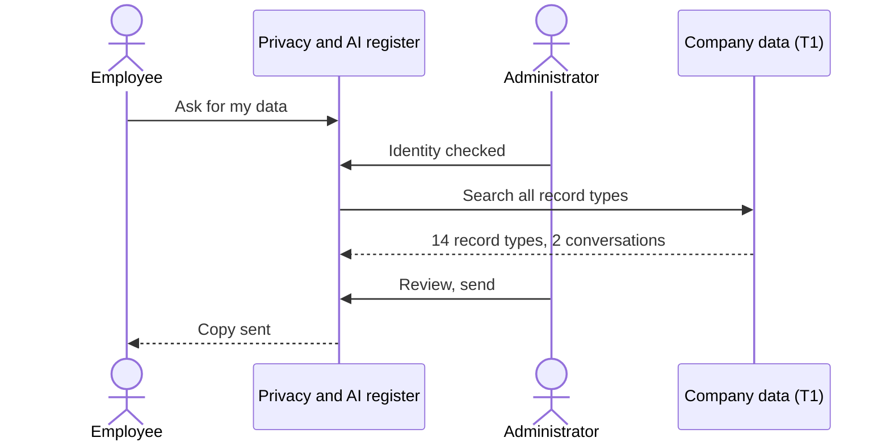

🏠 [Specs](../../../../README.md) › 🧩 [Functional capabilities](../../../README.md) ›
⚖️ [F15 Legal assistant](../../README.md) › 📝 [Use cases](../README.md) ›
📝 [Use cases: FL-F15-06 Privacy and AI duties](README.md) › 📝 UC-F15-10 Answer a data-subject request

# 📝 UC-F15-10 Answer a data-subject request

**Status:** ✅ specified

## Summary

A person asks the company for a copy of their data or its erasure; the administrator checks their identity, SimpleERP
finds the data everywhere it is, and the answer goes out within one month.

## Personas

- [U07 Administrator](../../../../01-users/personas/u07-administrator.md)
- [U06 Human resources](../../../../01-users/personas/u06-hr.md), who handles employees' and candidates' requests
- [U01 Employee](../../../../01-users/personas/u01-employee.md), who asks for their own data
- [U09 Customer](../../../../01-users/personas/u09-customer.md), who asks as a customer

## Goal

The person answered within the legal month, completely.

## Trigger

A request by email, by the portal or from the employee's space.

## Frequency

A few a year in a small company.

## Preconditions

- The requester can be identified.

## Postconditions

- Success: the copy sent or the data erased, except what the law keeps.
- Failure: the request overdue; the administrator and the owner told.

## Main flow

1. The request arrives; the administrator records it on Privacy and AI register (S-F15-10); the due date is set one
   month later (BR-F15-14).
2. The administrator checks the identity.
3. SimpleERP searches every record type, file and assistant conversation for the person's data.
4. The administrator reviews what was found and what the law requires to keep.
5. SimpleERP sends the copy or erases the data, search indexes included, and tells the person.

## Alternative flows

- 1a. An employee asks from their space: identity is already checked.
- 5a. Erasure of a former employee: payslips and HR records the law keeps are kept and the person is told which and why
  (CR-FR-047).

## Error flows

- 2e. The identity cannot be checked: the person is asked for proof; the month runs from the proof.
- 5e. The due date passes: the request is overdue; the administrator and the owner are told.
- Any step: a service does not answer; the call is retried first (BR-F3-32), then the message follows the error pattern
  (D122) and what was typed stays on the screen.

## Business rules

- [BR-F15-14 Data-subject requests answered within one month](../../business-rules/br-f15-14-data-subject-requests-answered-within-one-month.md)

## Entities

- [E-F15-08 Data-subject request](../../data/e-f15-08-data-subject-request.md)

## Permissions

Administrator and HR handle; the owner reads; the requester sees their own request.

## Notifications

- The administrator at each new request and 7 days before the due date; the requester when answered.

## Audit events

Request, identity check, search, answer, with who and when; never the copy's content.

## AI involvement

The AI assistant may summarise what was found; it never decides what to keep.

## API, MCP and A2A exposure

Through the API (T5) and as AI assistant tools (T6), with the caller's rights (BR-F3-34).

## Screens

- [S-F15-10 Privacy and AI register](../../screens/06-privacy-and-ai-duties/s-f15-10-privacy-and-ai-register.md)

## Flowchart

See [FL-F15-06 Privacy and AI duties](../../flows/fl-f15-06-privacy-and-ai-duties.md#flowchart).

## Sequence diagram

## Acceptance criteria

1. **Given** Sophie Bernard asks for her data on 2026-11-12 from her space **when** the administrator sends the copy on
   2026-11-30 **then** the request is answered within the month.
2. **Given** an erasure asked by a former employee **when** done **then** her payslips are kept and she is told why.
3. **Given** an email request with no proof of identity **when** recorded **then** the person is asked for proof and the
   due date waits.
4. **Given** the request still open on 2026-12-13 **when** the day comes **then** it is overdue and the owner is told.

## Non-functional notes

D408's targets ([Performance](../../../../05-non-functional/performance.md)): 95 % of screens within 1 second; lists
paged on the server, the first page within 1 second; reports within 5 seconds or in the background.

## Regulatory references

[CR-FR-051 Access and erasure](../../../../10-country-packs/france/data-protection/cr-fr-051-access-and-erasure.md),
[CR-FR-047 HR records retention](../../../../10-country-packs/france/labour/cr-fr-047-hr-records-retention.md).

## Related use cases

- [UC-F15-11 Keep the AI uses inventory and impact assessments](uc-f15-11-keep-the-ai-uses-inventory-and-impact-assessments.md)
- [UC-F15-07 Keep the compliance calendar](../05-duties-and-records/uc-f15-07-keep-the-compliance-calendar.md)

## Open questions

None.

---

⬅️ [UC-F15-09](../05-duties-and-records/uc-f15-09-approve-the-accounts-and-keep-the-company-registers.md) ·
⬆️ [Up](README.md) · ➡️ [UC-F15-11](uc-f15-11-keep-the-ai-uses-inventory-and-impact-assessments.md)
