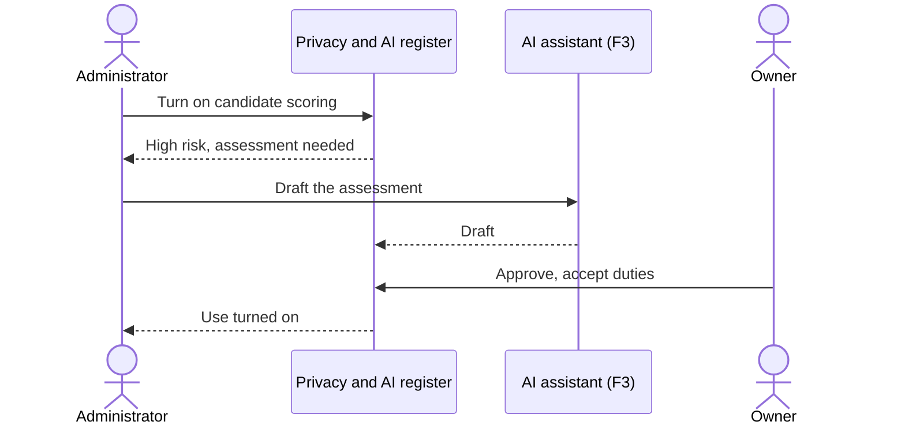

🏠 [Specs](../../../../README.md) › 🧩 [Functional capabilities](../../../README.md) ›
⚖️ [F15 Legal assistant](../../README.md) › 📝 [Use cases](../README.md) ›
📝 [Use cases: FL-F15-06 Privacy and AI duties](README.md) ›
📝 UC-F15-11 Keep the AI uses inventory and impact assessments

# 📝 UC-F15-11 Keep the AI uses inventory and impact assessments

**Status:** 🔄 waiting for the owner

## Summary

Each AI feature the company turns on appears in its AI uses inventory with purpose, provider, data and risk class;
high-risk uses stay off until the deployer duties are accepted and an impact assessment approved.

## Personas

- [U07 Administrator](../../../../01-users/personas/u07-administrator.md)
- [U13 Owner](../../../../01-users/personas/u13-owner.md), who approves impact assessments

## Goal

The company knows every AI use it makes and has met its duties for each.

## Trigger

An AI feature turned on or changed (F1); a yearly review.

## Frequency

At each change; yearly review.

## Preconditions

- AI feature settings exist (F1, D82).

## Postconditions

- Success: an inventory line per use; assessments approved where needed.
- Failure: a high-risk use stays off.

## Main flow

1. The administrator turns on an AI feature; simple-ERP adds its line to the inventory on Privacy and AI register
   (S-F15-10) (BR-F15-15).
2. simple-ERP fills purpose, provider, data and the risk class from the feature.
3. For a high-risk use, the administrator drafts the impact assessment with the AI assistant's help.
4. The owner approves the assessment and accepts the deployer duties (CR-FR-058).
5. The use is turned on; the inventory shows it with its assessment.

## Alternative flows

- 3a. A limited-risk use (the AI assistant): no assessment; people are told they deal with an AI (CR-FR-056).

## Error flows

- 1e. A high-risk use is turned on without an approved assessment: it stays off with the reason.
- 4e. The owner refuses: the use stays off.
- Any step: a service does not answer; the call is retried first (BR-F3-32), then the message follows the error pattern
  (D122) and what was typed stays on the screen.

## Business rules

- [BR-F15-15 Every AI use inventoried with its risk class](../../business-rules/br-f15-15-every-ai-use-inventoried-with-its-risk-class.md)

## Entities

- [E-F15-09 AI use](../../data/e-f15-09-ai-use.md)
- [E-F15-13 Data protection impact assessment](../../data/e-f15-13-data-protection-impact-assessment.md)

## Permissions

Administrator drafts; owner approves; the inventory is read by HR and the owner.

## Notifications

- The owner when an assessment waits for approval; the administrator when approved.

## Audit events

Inventory lines, assessments drafted and approved, uses turned on or off.

## AI involvement

The AI assistant may draft the impact assessment from the feature's settings; the owner approves it.

## API, MCP and A2A exposure

Through the API (T5) and as AI assistant tools (T6), with the caller's rights (BR-F3-34).

## Screens

- [S-F15-10 Privacy and AI register](../../screens/06-privacy-and-ai-duties/s-f15-10-privacy-and-ai-register.md)

## Flowchart

See [FL-F15-06 Privacy and AI duties](../../flows/fl-f15-06-privacy-and-ai-duties.md#flowchart).

## Sequence diagram

## Acceptance criteria

1. **Given** the AI assistant on the local model **when** turned on **then** a limited-risk line appears with no
   assessment.
2. **Given** candidate scoring **when** the administrator turns it on **then** it stays off until an assessment is
   approved.
3. **Given** the owner approves the assessment on 2026-11-20 **when** approved **then** scoring turns on and the
   inventory shows the assessment.
4. **Given** the yearly review **when** opened **then** every AI use is listed with provider and risk class.

## Non-functional notes

D408's targets ([Performance](../../../../05-non-functional/performance.md)): 95 % of screens within 1 second; lists
paged on the server, the first page within 1 second; reports within 5 seconds or in the background.

## Regulatory references

[CR-FR-056](../../../../10-country-packs/france/ai-and-recording/cr-fr-056-people-know-they-deal-with-an-ai.md),
[CR-FR-057](../../../../10-country-packs/france/ai-and-recording/cr-fr-057-human-oversight.md),
[CR-FR-058](../../../../10-country-packs/france/ai-and-recording/cr-fr-058-high-risk-ai-in-employment.md),
[CR-FR-048 Record of processing](../../../../10-country-packs/france/data-protection/cr-fr-048-record-of-processing.md);
impact assessment: (Proposed) to read.

## Related use cases

- [UC-F15-10 Answer a data-subject request](uc-f15-10-answer-a-data-subject-request.md)
- [UC-F15-04 Set up the legal assistant](../04-set-up-the-legal-assistant/uc-f15-04-set-up-the-legal-assistant.md)

## Open questions

None.

---

⬅️ [UC-F15-10 Answer a data-subject request](uc-f15-10-answer-a-data-subject-request.md) · ⬆️ [Up](README.md) ·
➡️ [UC-F15-12](../01-ask-a-legal-question/uc-f15-12-hand-a-question-over-to-a-lawyer.md)
