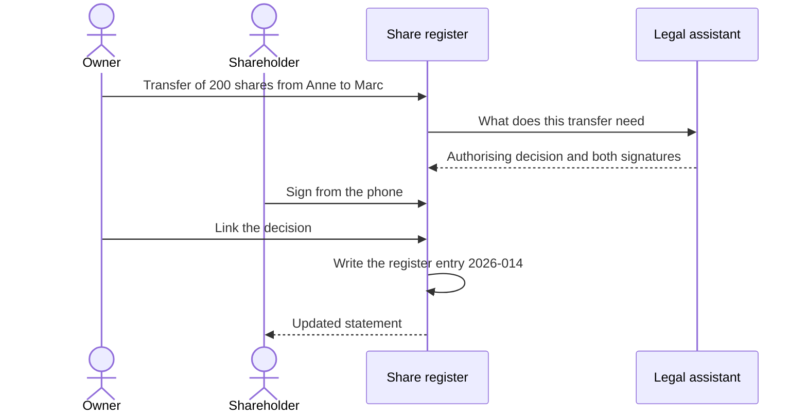

🏠 [Specs](../../../../README.md) › 🧩 [Functional capabilities](../../../README.md) ›
⚖️ [F15 Legal assistant](../../README.md) › 📝 [Use cases](../README.md) ›
📝 [Use cases: FL-F15-07 Equity, contracts, meetings and disputes](README.md) ›
📝 UC-F15-14 Keep the cap table and share movements

# 📝 UC-F15-14 Keep the cap table and share movements

**Status:** 🔄 waiting for the owner

## Summary

The owner keeps the company's share register and cap table: who holds how many shares of which class, every issue,
transfer and cancellation as a dated line of the share-movement register, and the table that results. A shareholder sees
their own holding and signs a transfer from a phone.

## Personas

- [U13 Owner](../../../../01-users/personas/u13-owner.md)
- [U50 Shareholder](../../../../01-users/personas/u50-shareholder.md)

## Goal

The company always knows who owns it, every change is written in the register before it counts, and each shareholder
sees their own position.

## Trigger

Shares are issued (incorporation, a capital increase), sold or given, or a shareholder asks for their statement.

## Frequency

A few movements a year in a small company; a statement on request.

## Preconditions

- The company's legal form and share classes are set
  ([E-F1-01 Company](../../../f01-administration/data/e-f01-01-company.md)).
- The shareholders exist as holders: people or companies with an identity
  ([E-F6-01 Customer record](../../../f06-customers-and-sales/data/e-f06-01-customer-record.md)).
- The decision that authorises an issue or approves a transfer is recorded
  ([E-F15-07 Corporate decision](../../data/e-f15-07-corporate-decision.md)).

## Postconditions

- **Succeeded:** each movement is a line of the register ([E-F15-15 Shareholding](../../data/e-f15-15-shareholding.md))
  that is Registered once its entry is written; the cap table shows the new holdings; the holder receives their
  statement.
- **Failed:** the movement stays Proposed or Approved and does not change the table; the missing approval or signature
  is listed.

## Main flow

1. The owner opens the cap table
   ([S-F15-12 Cap table](../../screens/07-equity-contracts-and-disputes/s-f15-12-cap-table.md)) and sees the holders,
   the classes, the shares, the percentage of capital and of votes.
2. The owner records a movement: an issue, a transfer from one holder to another, or a cancellation, with the date, the
   quantity and the price.
3. The legal assistant lists what the movement needs: the approval of the company or of the other shareholders and the
   company's decision that authorises it
   [BR-F15-18](../../business-rules/br-f15-18-the-share-movement-register-is-written-before-a-transfer-is-final.md).
4. The seller and the buyer sign the transfer, the shareholder from their phone; the owner links the decision that
   authorises it.
5. simple-ERP writes the entry in the share-movement register with its number and date; only then is the movement
   Registered and the cap table updated.
6. The holders receive their updated statement; the corporate filing is prepared when the movement requires it
   ([E-F15-14 Corporate filing](../../data/e-f15-14-corporate-filing.md)).

## Alternative flows

- 2a. A holder asks for their statement: the owner or the holder prints their holding with its history.
- 3a. The company's statutes give the other shareholders a right of first refusal: the transfer waits until the delay
  has passed or each has waived.
- 5a. A movement is entered in error: it is cancelled by a new line, and the old line stays visible.

## Error flows

- 3e. The decision that authorises the movement is missing: the movement stays Proposed and the missing decision is
  named.
- 4e. One of the signatures is missing after the delay: the owner is reminded; the transfer is not Registered.
- 5e. The movement would take a holder below zero shares: it is refused with the holder's balance.
- Any step: a service does not answer; the call is retried first
  ([BR-F3-32](../../../f03-assistant/business-rules/br-f03-32-retry-before-an-error.md)), then the message follows the
  error pattern ([D122](../../../../06-decisions/ux/d122-error-message-standard.md)) and what the user typed stays on
  the screen.

## Business rules

- [BR-F15-18](../../business-rules/br-f15-18-the-share-movement-register-is-written-before-a-transfer-is-final.md)
- [BR-F15-13](../../business-rules/br-f15-13-company-law-deadlines-kept.md)
- [BR-F15-02 Information, not advice](../../business-rules/br-f15-02-information-not-advice.md)

## Entities

- [E-F15-15 Shareholding](../../data/e-f15-15-shareholding.md): created, changed
- [E-F15-07 Corporate decision](../../data/e-f15-07-corporate-decision.md): read, the decision that authorises it
- [E-F15-14 Corporate filing](../../data/e-f15-14-corporate-filing.md): created, the filing when needed
- [E-F15-06 Contract record](../../data/e-f15-06-contract-record.md): read, the pact or the statutes as a contract
  record

## Permissions

Owner prepares and registers. The professional reads the register. A shareholder reads their own holding and
signs their own transfer ([U50 Shareholder](../../../../01-users/personas/u50-shareholder.md)).

## Notifications

The shareholder, by email and on their phone: a transfer to sign, the new statement. The owner: a signature missing
after 7 days.

## Audit events

Each movement proposed, approved, signed and registered; each cancellation; each statement given, with who and when. The
register is never edited: a correction is a new line.

## AI involvement

No AI step of its own. The AI assistant may open the screen and prefill it from the user's words; the user checks and
confirms ([BR-F3-07](../../../f03-assistant/business-rules/br-f03-07-no-deletes-no-irreversible-acts.md)).

## API, MCP and A2A exposure

T5 operations of the capability for the personas above: create, read, update and list. The MCP tool of the
capability may read and propose, never confirm alone. No A2A skill.

## Screens

- [S-F15-12 Cap table](../../screens/07-equity-contracts-and-disputes/s-f15-12-cap-table.md)

## Flowchart

See
[FL-F15-07 Equity, contracts, meetings and disputes](../../flows/fl-f15-07-equity-contracts-and-disputes.md#flowchart).

## Sequence diagram

## Acceptance criteria

1. **Given** a transfer of 200 shares **when** the register entry is not written **then** the movement is not Registered
   and the cap table is unchanged.
2. **Given** a movement with its decision and both signatures **when** the owner registers it **then** the entry gets
   its number and date and the table is updated.
3. **Given** a holder with 100 shares **when** a transfer of 150 is proposed **then** it is refused with the balance.
4. **Given** a shareholder on a phone **when** they open their holding **then** they see only their own shares and their
   history.

## Non-functional notes

The screen answers within 2 seconds for 10,000 records; every change is audited.

## Regulatory references

A company keeps a register of share movements, written in order and dated, and a transfer of shares is only
effective against the company once it is written in that register; the holder may ask for a statement of their holding.
The France-pack rule on the register is written later. Related:
[CR-FR-001](../../../../10-country-packs/france/company/cr-fr-001-company-identifiers.md),
[CR-FR-203](../../../../10-country-packs/france/digital/cr-fr-203-software-copyright-assignment.md).

- France-pack rule, (Proposed) until its law is read:
  [CR-FR-214 The share-movement register](../../../../10-country-packs/france/company/cr-fr-214-share-movement-register.md)

## Related use cases

- [UC-F15-15 Grant and vest employee equity](uc-f15-15-grant-and-vest-employee-equity.md)
- [UC-F15-09](../05-duties-and-records/uc-f15-09-approve-the-accounts-and-keep-the-company-registers.md)
- [UC-F15-15 Grant and vest employee equity](uc-f15-15-grant-and-vest-employee-equity.md)
- [UC-F15-16 Simulate a fundraising dilution](uc-f15-16-simulate-a-fundraising-dilution.md)
- [UC-F15-18 Run a shareholders' general meeting](uc-f15-18-run-a-shareholders-general-meeting.md)

## Open questions

None.

---

⬅️ [UC-F15-13](../01-ask-a-legal-question/uc-f15-13-answer-a-clients-tax-question-with-their-data.md) ·
⬆️ [Up](README.md) · ➡️ [UC-F15-15 Grant and vest employee equity](uc-f15-15-grant-and-vest-employee-equity.md)
