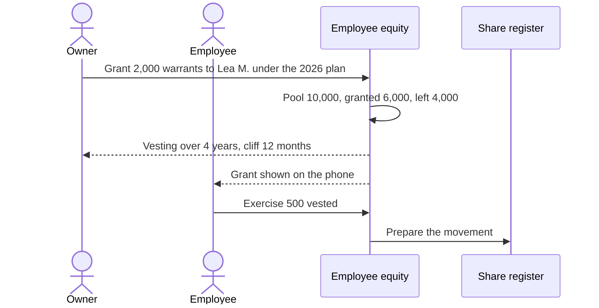

🏠 [Specs](../../../../README.md) › 🧩 [Functional capabilities](../../../README.md) ›
⚖️ [F15 Legal assistant](../../README.md) › 📝 [Use cases](../README.md) ›
📝 [Use cases: FL-F15-07 Equity, contracts, meetings and disputes](README.md) ›
📝 UC-F15-15 Grant and vest employee equity

# 📝 UC-F15-15 Grant and vest employee equity

**Status:** 🔄 waiting for the owner

## Summary

The owner grants employees and officers equity under a plan the shareholders approved: share warrants for founders and
employees (BSPCE), free shares, or options. Each grant has its vesting schedule, its price, its exercise and its end;
the employee reads their grants and vesting from a phone.

## Personas

- [U13 Owner](../../../../01-users/personas/u13-owner.md)
- [U01 Employee](../../../../01-users/personas/u01-employee.md)

## Goal

Employees share in the company's value through grants that follow the approved plan, and nobody is granted more than the
plan allows.

## Trigger

The owner decides to grant equity (a hire, a promotion, a retention plan), or a vesting date comes.

## Frequency

A few grants a year; a vesting step each month or quarter for every active grant.

## Preconditions

- A plan approved by the shareholders exists, with its ceiling, its duration and its kind of instrument
  ([E-F15-07 Corporate decision](../../data/e-f15-07-corporate-decision.md),
  [E-F15-19 General meeting](../../data/e-f15-19-general-meeting.md)).
- The beneficiary is an employee or an officer with a contract
  ([E-F9-02 Contract](../../../f09-hr-and-projects/data/e-f09-02-contract.md)).
- The share register and the classes are kept ([UC-F15-14](uc-f15-14-keep-the-cap-table-and-share-movements.md)).

## Postconditions

- **Succeeded:** the grant is saved ([E-F15-16 Equity grant](../../data/e-f15-16-equity-grant.md)) under its plan, with
  its vesting dates; vested and exercised quantities follow each step; an exercise creates a movement of the register.
- **Failed:** no grant is created; the plan's exhausted pool or expired date is shown.

## Main flow

1. The owner opens the employee equity screen
   ([S-F15-13](../../screens/07-equity-contracts-and-disputes/s-f15-13-employee-equity.md)) and sees each plan with its
   pool, the granted quantity and what is left.
2. The owner creates a grant: the employee, the plan, the instrument, the quantity, the strike price when there is one
   and the grant date.
3. SimpleERP checks the grant against the plan: the quantity within the pool, the date within the plan's duration, the
   beneficiary of an allowed kind
   ([BR-F15-19](../../business-rules/br-f15-19-grants-follow-the-plan-approved-by-shareholders.md)).
4. The owner sets the vesting: an initial cliff and then regular steps; SimpleERP computes the dates.
5. On each vesting date the vested quantity grows; the employee sees it on their phone.
6. When the employee exercises or the shares are delivered, SimpleERP prepares the register movement
   ([UC-F15-14](uc-f15-14-keep-the-cap-table-and-share-movements.md)) and the payroll entry for what is taxable
   ([UC-F13-17](../../../f13-payroll/use-cases/04-events/uc-f13-17-handle-benefits.md)).

## Alternative flows

- 2a. A grant is cancelled before it vests: the quantity returns to the plan's pool.
- 5a. The employee leaves: unvested quantities lapse; the vested ones follow the leaver rules of the plan.
- 6a. The company is sold: the plan's acceleration clause vests the grants on the sale date.

## Error flows

- 3e. The quantity goes over the pool: the grant is refused with the quantity left.
- 3f. The plan's period has ended: the grant is refused with the end date.
- 6e. The strike price is not paid: the exercise stays Pending and the payroll officer is told.
- Any step: a service does not answer; the call is retried first
  ([BR-F3-32](../../../f03-assistant/business-rules/br-f03-32-retry-before-an-error.md)), then the message follows the
  error pattern ([D122](../../../../06-decisions/ux/d122-error-message-standard.md)) and what the user typed stays on
  the screen.

## Business rules

- [BR-F15-19](../../business-rules/br-f15-19-grants-follow-the-plan-approved-by-shareholders.md)
- [BR-F15-18](../../business-rules/br-f15-18-the-share-movement-register-is-written-before-a-transfer-is-final.md)
- [BR-F13-14 Benefits valued](../../../f13-payroll/business-rules/br-f13-14-benefits-valued.md)

## Entities

- [E-F15-16 Equity grant](../../data/e-f15-16-equity-grant.md): created, changed
- [E-F15-07 Corporate decision](../../data/e-f15-07-corporate-decision.md): read, the shareholders' approval of the plan
- [E-F15-15 Shareholding](../../data/e-f15-15-shareholding.md): created, the movement on delivery
- [E-F13-26 Employee benefit](../../../f13-payroll/data/e-f13-26-employee-benefit.md): read, the benefit valued for
  payroll
- [E-F9-02 Contract](../../../f09-hr-and-projects/data/e-f09-02-contract.md): read, the beneficiary's contract

## Permissions

Owner grants. HR reads the grants of their employees without the strike price. The employee reads their own
grants. The professional reads everything.

## Notifications

The employee, on their phone: a grant, a vesting step, an expiry in 90 days. The owner: a vesting date, a plan ending in
90 days.

## Audit events

Each plan, grant, vesting step, exercise, lapse and cancellation, with who, when and the quantity.

## AI involvement

No AI step of its own. The AI assistant may open the screen and prefill it from the user's words; the user checks and
confirms ([BR-F3-07](../../../f03-assistant/business-rules/br-f03-07-no-deletes-no-irreversible-acts.md)).

## API, MCP and A2A exposure

T5 operations of the capability for the personas above: create, read, update and list. The MCP tool of the
capability may read and propose, never confirm alone. No A2A skill.

## Screens

- [S-F15-13](../../screens/07-equity-contracts-and-disputes/s-f15-13-employee-equity.md)

## Flowchart

See
[FL-F15-07 Equity, contracts, meetings and disputes](../../flows/fl-f15-07-equity-contracts-and-disputes.md#flowchart).

## Sequence diagram

## Acceptance criteria

1. **Given** a plan with 4,000 left **when** the owner grants 5,000 **then** the grant is refused with 4,000 left.
2. **Given** a plan that ended on 2026-06-30 **when** the owner grants on 2026-11-14 **then** the grant is refused with
   the end date.
3. **Given** a grant with a cliff of 12 months **when** 11 months pass **then** nothing has vested.
4. **Given** an employee who leaves **when** the date is recorded **then** their unvested quantity lapses and returns to
   the pool.

## Non-functional notes

The screen answers within 2 seconds for 10,000 records; every change is audited.

## Regulatory references

Share warrants for founders and employees (BSPCE) and free shares are allowed only under a plan approved by
the shareholders, within its ceiling and period, for the kinds of beneficiaries the plan names, and carry tax and
social-contribution consequences. The France-pack rule on the conditions of each instrument is written later. Related:
[CR-FR-114](../../../../10-country-packs/france/labour/cr-fr-114-staff-meals-benefit.md).

- France-pack rule, (Proposed) until its law is read:
  [CR-FR-215 BSPCE and free shares](../../../../10-country-packs/france/company/cr-fr-215-bspce-and-free-shares.md)

## Related use cases

- [UC-F15-14](uc-f15-14-keep-the-cap-table-and-share-movements.md)
- [UC-F15-16 Simulate a fundraising dilution](uc-f15-16-simulate-a-fundraising-dilution.md)
- [UC-F15-14](uc-f15-14-keep-the-cap-table-and-share-movements.md)
- [UC-F15-16 Simulate a fundraising dilution](uc-f15-16-simulate-a-fundraising-dilution.md)
- [UC-F13-17](../../../f13-payroll/use-cases/04-events/uc-f13-17-handle-benefits.md)
- [UC-F9-01](../../../f09-hr-and-projects/use-cases/01-people/uc-f09-01-manage-employee-records-and-contracts.md)

## Open questions

None.

---

⬅️ [UC-F15-14 Keep the cap table and share movements](uc-f15-14-keep-the-cap-table-and-share-movements.md) ·
⬆️ [Up](README.md) · ➡️ [UC-F15-16 Simulate a fundraising dilution](uc-f15-16-simulate-a-fundraising-dilution.md)
