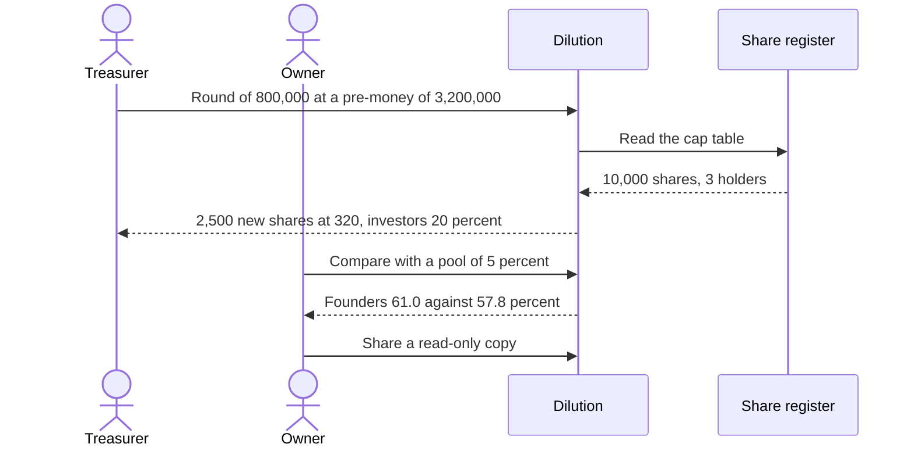

🏠 [Specs](../../../../README.md) › 🧩 [Functional capabilities](../../../README.md) ›
⚖️ [F15 Legal assistant](../../README.md) › 📝 [Use cases](../README.md) ›
📝 [Use cases: FL-F15-07 Equity, contracts, meetings and disputes](README.md) ›
📝 UC-F15-16 Simulate a fundraising dilution

# 📝 UC-F15-16 Simulate a fundraising dilution

**Status:** ✅ specified

## Summary

The owner and the treasurer simulate a fundraising round before it happens: the amount raised, the valuation before the
money, the price of a new share, the pool for employees and the cap table after the round, with each holder's dilution.
A simulation is a draft that never changes the register.

## Personas

- [U13 Owner](../../../../01-users/personas/u13-owner.md)
- [U31 Treasurer](../../../../01-users/personas/u31-treasurer.md)

## Goal

The founders see who owns what after the round and what each term costs them, before they sign anything.

## Trigger

An investor proposes terms, or the company plans a raise.

## Frequency

A few simulations for each round, several rounds over the life of the company.

## Preconditions

- The cap table is current ([UC-F15-14](uc-f15-14-keep-the-cap-table-and-share-movements.md)).
- The share classes and any employee pool are recorded ([E-F15-16 Equity grant](../../data/e-f15-16-equity-grant.md)).

## Postconditions

- **Succeeded:** the round is saved ([E-F15-17 Funding round](../../data/e-f15-17-funding-round.md)) as a simulation
  with its cap table after the round and the dilution of each holder; it can be shared with the investors as a read-only
  copy.
- **Failed:** no simulation is saved; the terms that cannot work (a negative price) are listed.

## Main flow

1. The treasurer opens the dilution screen
   ([S-F15-14 Dilution](../../screens/07-equity-contracts-and-disputes/s-f15-14-dilution.md)) and creates a round: the
   name, the amount, the valuation before the money and the date.
2. SimpleERP computes the price per new share, the new shares and the percentage the investors take.
3. The treasurer adds the investors and their amounts, and an employee pool top-up before or after the money.
4. SimpleERP shows the cap table before and after, and each holder's dilution; the owner changes the terms and compares
   scenarios side by side.
5. The owner shares a read-only copy with the investors, or saves the scenario chosen.
6. When the round happens, the real subscriptions are recorded as movements of the register
   ([UC-F15-14](uc-f15-14-keep-the-cap-table-and-share-movements.md)) and the simulation is marked Executed.

## Alternative flows

- 2a. The investors ask for the pool before the money: the founders' dilution is shown against the pool after.
- 4a. A convertible instrument is simulated: it converts at the round and its shares are added to the table.
- 5a. The investors need the table as a file: the copy is exported without any holder's personal data.

## Error flows

- 2e. The valuation or the amount is zero or negative: the simulation is refused with the field.
- 3e. The investors' amounts exceed the round: the excess is shown and the round is not saved until fixed.
- 6e. The register does not hold the real subscriptions: the simulation stays Shared and is not Executed.
- Any step: a service does not answer; the call is retried first
  ([BR-F3-32](../../../f03-assistant/business-rules/br-f03-32-retry-before-an-error.md)), then the message follows the
  error pattern ([D122](../../../../06-decisions/ux/d122-error-message-standard.md)) and what the user typed stays on
  the screen.

## Business rules

- [BR-F15-20](../../business-rules/br-f15-20-simulations-never-change-the-register.md)
- [BR-F15-18](../../business-rules/br-f15-18-the-share-movement-register-is-written-before-a-transfer-is-final.md)
- [BR-F15-02 Information, not advice](../../business-rules/br-f15-02-information-not-advice.md)

## Entities

- [E-F15-17 Funding round](../../data/e-f15-17-funding-round.md): created, changed
- [E-F15-15 Shareholding](../../data/e-f15-15-shareholding.md): read, the cap table before the round
- [E-F15-16 Equity grant](../../data/e-f15-16-equity-grant.md): read, the employee pool

## Permissions

Owner and treasurer simulate. The professional reads. Investors read a shared copy that shows no personal
data of private holders.

## Notifications

The owner, in the app: a shared copy was opened by an investor.

## Audit events

Each simulation created, changed, shared and executed; each copy shared and with whom.

## AI involvement

No AI step of its own. The AI assistant may open the screen and prefill it from the user's words; the user checks and
confirms ([BR-F3-07](../../../f03-assistant/business-rules/br-f03-07-no-deletes-no-irreversible-acts.md)).

## API, MCP and A2A exposure

T5 operations of the capability for the personas above: create, read, update and list. The MCP tool of the
capability may read and propose, never confirm alone. No A2A skill.

## Screens

- [S-F15-14 Dilution](../../screens/07-equity-contracts-and-disputes/s-f15-14-dilution.md)

## Flowchart

See
[FL-F15-07 Equity, contracts, meetings and disputes](../../flows/fl-f15-07-equity-contracts-and-disputes.md#flowchart).

## Sequence diagram

## Acceptance criteria

1. **Given** a round of 800,000 at a pre-money of 3,200,000 **when** the treasurer saves it **then** the investors hold
   20 percent and every other holder is diluted by 20 percent.
2. **Given** a saved simulation **when** the register is looked at **then** it is unchanged
   ([BR-F15-20](../../business-rules/br-f15-20-simulations-never-change-the-register.md)).
3. **Given** an investors' total above the round **when** the treasurer saves **then** the excess is shown and the save
   is refused.
4. **Given** a copy shared with investors **when** they open it **then** they see the table without the holders'
   personal data.

## Non-functional notes

The screen answers within 2 seconds for 10,000 records; every change is audited.

## Regulatory references

A capital increase needs a decision of the shareholders and, for the new shares, subscription papers; the
simulation is not one of them and carries no legal weight. The France-pack rule is written later. Related:
[CR-FR-203](../../../../10-country-packs/france/digital/cr-fr-203-software-copyright-assignment.md).

## Related use cases

- [UC-F15-15 Grant and vest employee equity](uc-f15-15-grant-and-vest-employee-equity.md)
- [UC-F15-17](uc-f15-17-draft-a-contract-from-the-clause-library.md)
- [UC-F15-15 Grant and vest employee equity](uc-f15-15-grant-and-vest-employee-equity.md)
- [UC-F15-18 Run a shareholders' general meeting](uc-f15-18-run-a-shareholders-general-meeting.md)
- [UC-F8-19](../../../f08-accounting/use-cases/06-benchmark-additions/uc-f08-19-plan-and-forecast.md)

## Open questions

None.

---

⬅️ [UC-F15-15 Grant and vest employee equity](uc-f15-15-grant-and-vest-employee-equity.md) · ⬆️ [Up](README.md) ·
➡️ [UC-F15-17 Draft a contract from the clause library](uc-f15-17-draft-a-contract-from-the-clause-library.md)
