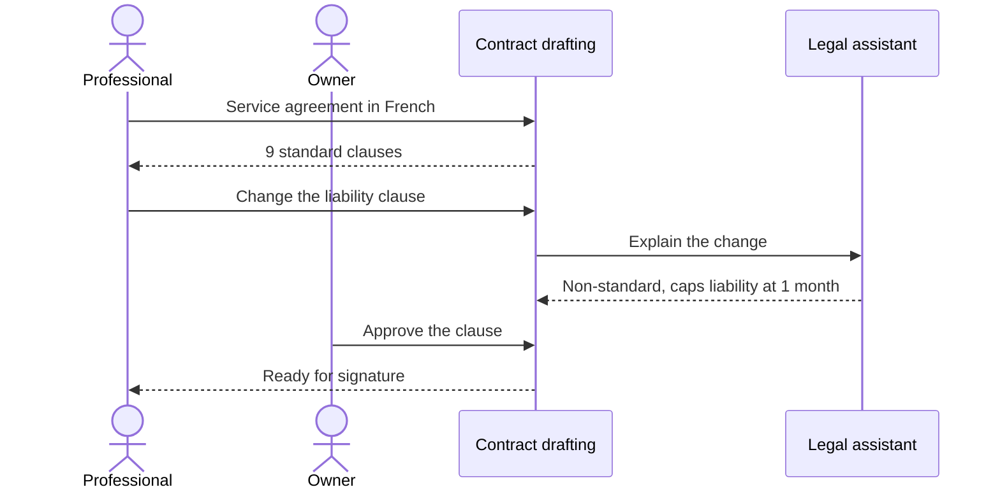

🏠 [Specs](../../../../README.md) › 🧩 [Functional capabilities](../../../README.md) ›
⚖️ [F15 Legal assistant](../../README.md) › 📝 [Use cases](../README.md) ›
📝 [Use cases: FL-F15-07 Equity, contracts, meetings and disputes](README.md) ›
📝 UC-F15-17 Draft a contract from the clause library

# 📝 UC-F15-17 Draft a contract from the clause library

**Status:** ✅ specified

## Summary

A professional drafts a contract from the company's clause library: each clause has its approved text, its variants and
the kinds of contract it fits. A clause changed in a draft becomes non-standard and needs legal approval before the
contract can go to signature.

## Personas

- [U36 Professional](../../../../01-users/personas/u36-professional.md)
- [U13 Owner](../../../../01-users/personas/u13-owner.md)

## Goal

Contracts are written fast from approved wording, and any departure from that wording is seen and approved by a person
responsible for the law.

## Trigger

A deal needs a contract (a service agreement, a supplier contract, a lease), or a clause is revised.

## Frequency

Several drafts a month in a company with regular contracts.

## Preconditions

- The clause library holds approved clauses for the contract kind ([E-F15-18 Clause](../../data/e-f15-18-clause.md)).
- The contract's parties and terms are known ([E-F15-06 Contract record](../../data/e-f15-06-contract-record.md)).

## Postconditions

- **Succeeded:** the contract draft is saved with its clauses; every non-standard clause is listed and approved before
  sending; the signed contract becomes a contract record with its renewal and notice dates
  ([UC-F15-08](../05-duties-and-records/uc-f15-08-track-contract-renewal-and-notice-dates.md)).
- **Failed:** the draft stays a draft; the non-standard clauses without approval are listed.

## Main flow

1. The professional opens the contract drafting screen
   ([S-F15-15](../../screens/07-equity-contracts-and-disputes/s-f15-15-contract-drafting.md)) and chooses the kind of
   contract and the language.
2. SimpleERP proposes the standard clauses of the kind, in order, with the parties' data filled in.
3. The professional picks a variant of a clause, adds a clause from the library or changes a clause's text.
4. A changed or added free text is marked non-standard; the legal assistant explains the point and cites the law
   ([BR-F15-01](../../business-rules/br-f15-01-every-statement-cites-the-law-in-force.md)).
5. The professional asks for approval; the owner or the lawyer approves each non-standard clause or rejects it
   ([BR-F15-21](../../business-rules/br-f15-21-non-standard-clauses-need-legal-approval.md)).
6. The approved contract is exported for signature
   ([UC-F6-04](../../../f06-customers-and-sales/use-cases/02-quote-to-order/uc-f06-04-accept-or-sign-a-quote.md)); once
   signed it is kept as a contract record.

## Alternative flows

- 2a. The professional starts from a past contract: the clauses are matched with the library and the differences are
  marked non-standard.
- 5a. The company has no lawyer: the approval is the owner's, recorded as a waiver of the legal review, and the legal
  assistant states that it gives information, not advice
  ([BR-F15-02](../../business-rules/br-f15-02-information-not-advice.md)).
- 5b. The clause needs a lawyer's opinion: a hand-off is created
  ([UC-F15-12](../01-ask-a-legal-question/uc-f15-12-hand-a-question-over-to-a-lawyer.md)).

## Error flows

- 4e. A clause cites a law that is no longer in force: the clause is flagged and a revision is proposed.
- 5e. A non-standard clause is rejected: the contract cannot be exported until it is replaced.
- 6e. The signature service does not answer: the export stays ready and is retried.
- Any step: a service does not answer; the call is retried first
  ([BR-F3-32](../../../f03-assistant/business-rules/br-f03-32-retry-before-an-error.md)), then the message follows the
  error pattern ([D122](../../../../06-decisions/ux/d122-error-message-standard.md)) and what the user typed stays on
  the screen.

## Business rules

- [BR-F15-21](../../business-rules/br-f15-21-non-standard-clauses-need-legal-approval.md)
- [BR-F15-08](../../business-rules/br-f15-08-document-checks-list-never-rewrite.md)
- [BR-F15-02 Information, not advice](../../business-rules/br-f15-02-information-not-advice.md)

## Entities

- [E-F15-18 Clause](../../data/e-f15-18-clause.md): created, changed
- [E-F15-06 Contract record](../../data/e-f15-06-contract-record.md): created, the contract record once signed
- [E-F15-10 Lawyer hand-off](../../data/e-f15-10-lawyer-hand-off.md): created, a lawyer hand-off when needed

## Permissions

Professional drafts. Owner and the lawyer approve non-standard clauses. Sales reads the approved clauses and
starts drafts of the kinds they sell.

## Notifications

The approver, in the app: a clause to approve. The professional: approved or rejected with the reason.

## Audit events

Each draft, each clause added, changed, approved or rejected, with who, when and the wording before and after; each
export.

## AI involvement

The legal assistant proposes the clauses of the kind and explains a non-standard clause; it never approves one and never
presents its text as legal advice ([BR-F15-02](../../business-rules/br-f15-02-information-not-advice.md)).

## API, MCP and A2A exposure

T5 operations of the capability for the personas above: create, read, update and list. The MCP tool of the
capability may read and propose, never confirm alone. No A2A skill.

## Screens

- [S-F15-15](../../screens/07-equity-contracts-and-disputes/s-f15-15-contract-drafting.md)

## Flowchart

See
[FL-F15-07 Equity, contracts, meetings and disputes](../../flows/fl-f15-07-equity-contracts-and-disputes.md#flowchart).

## Sequence diagram

## Acceptance criteria

1. **Given** a standard clause kept as it is **when** the contract is exported **then** no approval is asked.
2. **Given** a clause whose text was changed **when** the professional exports **then** the export is refused until the
   clause is approved.
3. **Given** a clause that cites a repealed law **when** the draft is opened **then** the clause is flagged with a
   proposed revision.
4. **Given** a company with no lawyer **when** the owner approves **then** the approval is recorded as a waiver of legal
   review.

## Non-functional notes

The screen answers within 2 seconds for 10,000 records; every change is audited.

## Regulatory references

Some contract terms are limited by law (late-payment terms, liability limits towards consumers, notice
periods); the library flags a clause that departs from a limit. The France-pack rule is
[CR-FR-265 Contract terms the law limits](../../../../10-country-packs/france/consumer/cr-fr-265-unfair-contract-terms.md). Related:
[CR-FR-018](../../../../10-country-packs/france/invoicing/cr-fr-018-payment-terms-cap.md),
[CR-FR-019](../../../../10-country-packs/france/invoicing/cr-fr-019-late-payment-penalties.md),
[CR-FR-175](../../../../10-country-packs/france/trade/cr-fr-175-unfair-b2b-practices.md).

## Related use cases

- [UC-F15-16 Simulate a fundraising dilution](uc-f15-16-simulate-a-fundraising-dilution.md)
- [UC-F15-18 Run a shareholders' general meeting](uc-f15-18-run-a-shareholders-general-meeting.md)
- [UC-F15-14](uc-f15-14-keep-the-cap-table-and-share-movements.md)
- [UC-F15-18 Run a shareholders' general meeting](uc-f15-18-run-a-shareholders-general-meeting.md)
- [UC-F15-08](../05-duties-and-records/uc-f15-08-track-contract-renewal-and-notice-dates.md)
- [UC-F9-19](../../../f09-hr-and-projects/use-cases/01-people/uc-f09-19-edit-contract-templates.md)

## Open questions

None.

---

⬅️ [UC-F15-16 Simulate a fundraising dilution](uc-f15-16-simulate-a-fundraising-dilution.md) · ⬆️ [Up](README.md) ·
➡️ [UC-F15-18 Run a shareholders' general meeting](uc-f15-18-run-a-shareholders-general-meeting.md)
