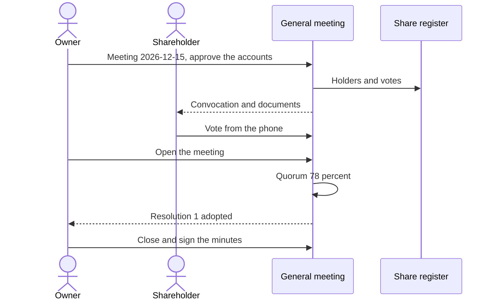

🏠 [Specs](../../../../README.md) › 🧩 [Functional capabilities](../../../README.md) ›
⚖️ [F15 Legal assistant](../../README.md) › 📝 [Use cases](../README.md) ›
📝 [Use cases: FL-F15-07 Equity, contracts, meetings and disputes](README.md) ›
📝 UC-F15-18 Run a shareholders' general meeting

# 📝 UC-F15-18 Run a shareholders' general meeting

**Status:** ✅ specified

## Summary

The owner convenes and runs a shareholders' general meeting: the convocation with its notice period, the agenda and
documents, the check of quorum, the vote on each resolution before and during the meeting (from the shareholder's
phone), the majority, the minutes and the filings that follow.

## Personas

- [U13 Owner](../../../../01-users/personas/u13-owner.md)
- [U50 Shareholder](../../../../01-users/personas/u50-shareholder.md)

## Goal

The meeting is called in time, counts only valid votes, and ends with minutes that are signed and decisions the company
can act on.

## Trigger

A yearly meeting to approve the accounts
([UC-F15-09](../05-duties-and-records/uc-f15-09-approve-the-accounts-and-keep-the-company-registers.md)), or a decision
that only the shareholders may take (a capital increase, a plan, a change of statutes).

## Frequency

At least once a year; more for decisions outside the yearly cycle.

## Preconditions

- The register is current, with each holder's shares and votes
  ([UC-F15-14](uc-f15-14-keep-the-cap-table-and-share-movements.md)).
- The agenda and the draft resolutions are ready; the accounts are available when they are on the agenda.

## Postconditions

- **Succeeded:** the meeting is saved ([E-F15-19 General meeting](../../data/e-f15-19-general-meeting.md)) with its
  convocation, its quorum, each resolution's votes and result, and its minutes; each adopted resolution becomes a
  corporate decision ([E-F15-07 Corporate decision](../../data/e-f15-07-corporate-decision.md)).
- **Failed:** the meeting is Adjourned or Cancelled; no resolution counts as adopted.

## Main flow

1. The owner opens the shareholder meetings screen
   ([S-F15-16](../../screens/07-equity-contracts-and-disputes/s-f15-16-shareholder-meetings.md)), creates a meeting and
   writes the agenda and the draft resolutions, each with the majority it needs.
2. SimpleERP computes the latest date to send the convocation from the notice period and sends it with the documents to
   every holder of the register.
3. Shareholders vote before the meeting from their phone, give a proxy, or attend and vote at the meeting.
4. At the opening SimpleERP counts the shares present and represented and checks the quorum
   ([BR-F15-22](../../business-rules/br-f15-22-votes-count-only-within-quorum-and-majority.md)).
5. For each resolution SimpleERP counts the votes within the quorum, compares them with the majority required and shows
   adopted or rejected.
6. The owner closes the meeting; the minutes are drafted from the results, signed and kept, and the decisions and
   filings are created.

## Alternative flows

- 2a. All the shareholders agree to waive the notice: the owner records the waiver and holds the meeting at once.
- 3a. A decision may be taken by written consultation: the votes are collected by the deadline instead of a session.
- 4a. The quorum is not reached at the first meeting: a second meeting is convened with its own (lower) quorum where the
  statutes allow.

## Error flows

- 2e. The convocation is late: the owner is shown the date missed and the choices (postpone, collect waivers).
- 4e. The quorum is not reached and no second meeting is allowed: the meeting is Adjourned and no vote counts.
- 5e. A holder voted twice (phone and proxy): the later vote of the holder stands and the earlier is listed.
- Any step: a service does not answer; the call is retried first
  ([BR-F3-32](../../../f03-assistant/business-rules/br-f03-32-retry-before-an-error.md)), then the message follows the
  error pattern ([D122](../../../../06-decisions/ux/d122-error-message-standard.md)) and what the user typed stays on
  the screen.

## Business rules

- [BR-F15-22](../../business-rules/br-f15-22-votes-count-only-within-quorum-and-majority.md)
- [BR-F15-13](../../business-rules/br-f15-13-company-law-deadlines-kept.md)
- [BR-F15-18](../../business-rules/br-f15-18-the-share-movement-register-is-written-before-a-transfer-is-final.md)

## Entities

- [E-F15-19 General meeting](../../data/e-f15-19-general-meeting.md): created, changed
- [E-F15-07 Corporate decision](../../data/e-f15-07-corporate-decision.md): created, one decision per adopted resolution
- [E-F15-14 Corporate filing](../../data/e-f15-14-corporate-filing.md): created, the filings that follow
- [E-F15-15 Shareholding](../../data/e-f15-15-shareholding.md): read, the shares and votes of each holder

## Permissions

Owner convenes and closes. The professional drafts the minutes. A shareholder reads their documents and votes
([U50 Shareholder](../../../../01-users/personas/u50-shareholder.md)).

## Notifications

The shareholder, by email and on their phone: the convocation, a reminder 3 days before, the vote closing and the
result. The owner: the quorum reached or not.

## Audit events

Each meeting, convocation, document sent, vote cast and changed, proxy, quorum check and result, with who and when; the
minutes and their signatures.

## AI involvement

No AI step of its own. The AI assistant may open the screen and prefill it from the user's words; the user checks and
confirms ([BR-F3-07](../../../f03-assistant/business-rules/br-f03-07-no-deletes-no-irreversible-acts.md)).

## API, MCP and A2A exposure

T5 operations of the capability for the personas above: create, read, update and list. The MCP tool of the
capability may read and propose, never confirm alone. No A2A skill.

## Screens

- [S-F15-16](../../screens/07-equity-contracts-and-disputes/s-f15-16-shareholder-meetings.md)

## Flowchart

See
[FL-F15-07 Equity, contracts, meetings and disputes](../../flows/fl-f15-07-equity-contracts-and-disputes.md#flowchart).

## Sequence diagram

## Acceptance criteria

1. **Given** a meeting needing a quorum of 25 percent with 78 percent present **when** the owner opens it **then** the
   quorum is reached and the votes count.
2. **Given** a quorum of 25 percent with 10 percent present **when** the owner opens it **then** the meeting is
   Adjourned and no vote counts.
3. **Given** a resolution needing two thirds with 65 percent in favour **when** the votes are counted **then** the
   resolution is rejected.
4. **Given** a shareholder with a phone **when** the vote is open **then** they see the resolutions and their own voting
   right only.

## Non-functional notes

The screen answers within 2 seconds for 10,000 records; every change is audited.

## Regulatory references

A general meeting is convened by a notice that respects a minimum delay, sets an agenda and sends the
documents; it decides only if its quorum is reached and each resolution passes its own majority (simple for ordinary
decisions, higher for changes of the statutes); its minutes are signed and kept, and some decisions are filed with the
register of companies. The France-pack rule is listed below. Related:
[CR-FR-146](../../../../10-country-packs/france/real-estate/cr-fr-146-co-ownership-assembly.md) for the co-owners'
assembly, [CR-FR-001](../../../../10-country-packs/france/company/cr-fr-001-company-identifiers.md).

- France-pack rule:
  [CR-FR-221 Shareholders' general meetings](../../../../10-country-packs/france/company/cr-fr-221-general-meetings.md)

## Related use cases

- [UC-F15-17](uc-f15-17-draft-a-contract-from-the-clause-library.md)
- [UC-F15-19 Keep the company's IP portfolio](uc-f15-19-keep-the-companys-ip-portfolio.md)
- [UC-F15-14](uc-f15-14-keep-the-cap-table-and-share-movements.md)
- [UC-F15-15 Grant and vest employee equity](uc-f15-15-grant-and-vest-employee-equity.md)
- [UC-F15-09](../05-duties-and-records/uc-f15-09-approve-the-accounts-and-keep-the-company-registers.md)
- [UC-F15-07](../05-duties-and-records/uc-f15-07-keep-the-compliance-calendar.md)

## Open questions

None.

---

⬅️ [UC-F15-17 Draft a contract from the clause library](uc-f15-17-draft-a-contract-from-the-clause-library.md) ·
⬆️ [Up](README.md) · ➡️ [UC-F15-19 Keep the company's IP portfolio](uc-f15-19-keep-the-companys-ip-portfolio.md)
