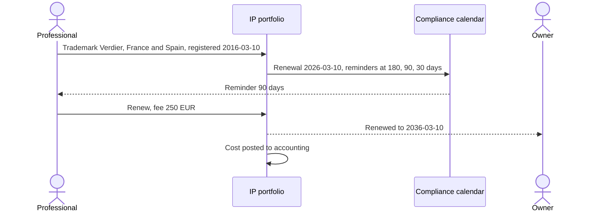

🏠 [Specs](../../../../README.md) › 🧩 [Functional capabilities](../../../README.md) ›
⚖️ [F15 Legal assistant](../../README.md) › 📝 [Use cases](../README.md) ›
📝 [Use cases: FL-F15-07 Equity, contracts, meetings and disputes](README.md) ›
📝 UC-F15-19 Keep the company's IP portfolio

# 📝 UC-F15-19 Keep the company's IP portfolio

**Status:** ✅ specified

## Summary

A professional keeps the company's own intellectual property: trademarks, patents, designs, domain names and registered
software, each with its owner, countries, filing and registration dates, renewal date and cost. Renewals are warned long
before their deadline.

## Personas

- [U36 Professional](../../../../01-users/personas/u36-professional.md)

## Goal

The company does not lose a right because a renewal date passed, and knows what it owns and where.

## Trigger

A right is filed or registered, a renewal comes near, or a right is bought or sold.

## Frequency

A few rights a year in a small company; a check of the whole portfolio each quarter.

## Preconditions

- The company's own legal entity exists ([E-F1-01 Company](../../../f01-administration/data/e-f01-01-company.md)).
- The compliance calendar and its reminders work
  ([UC-F15-07](../05-duties-and-records/uc-f15-07-keep-the-compliance-calendar.md)).

## Postconditions

- **Succeeded:** each right is saved ([E-F15-20 IP right](../../data/e-f15-20-ip-right.md)) with its renewal date and
  reminders; renewals are paid and recorded; the portfolio shows the rights by type and country.
- **Failed:** a right is saved as unconfirmed with its missing facts; no reminder is sent for an unknown date.

## Main flow

1. The professional opens the IP portfolio
   ([S-F15-17 IP portfolio](../../screens/07-equity-contracts-and-disputes/s-f15-17-ip-portfolio.md)) and adds a right:
   the type, the name, the countries, the filing number and date.
2. When the right is registered the professional records the registration date and the renewal date.
3. simple-ERP computes the reminder dates before the renewal deadline and adds them to the compliance calendar with an
   owner ([BR-F15-23](../../business-rules/br-f15-23-renewals-are-warned-before-their-deadline.md)).
4. As each reminder arrives, the professional decides to renew, let go or sell, and the decision is recorded.
5. The renewal fee is paid and the new renewal date is set; the cost is posted to accounting.
6. The portfolio shows the rights by type, country and state, and the yearly cost of renewals.

## Alternative flows

- 1a. A domain name registered through the company's hosting is read from the hosted domains and kept as a right
  [UC-F18-20](../../../f18-hosted-websites-and-domains/use-cases/05-run-the-site/uc-f18-20-watch-uptime-renewals-and-expiry.md).
- 4a. A right is not renewed on purpose: it is marked Lapsed with the decision.
- 5a. A right is sold or licensed: the buyer or licensee and the date are recorded.

## Error flows

- 2e. The registration is refused by the office: the right is marked Refused with the reason.
- 3e. The renewal date is unknown: the right shows Unconfirmed and a reminder asks the professional to find it.
- 5e. The fee is paid after the deadline: the right shows Lapsed with the date and the grace period, if any.
- Any step: a service does not answer; the call is retried first
  ([BR-F3-32](../../../f03-assistant/business-rules/br-f03-32-retry-before-an-error.md)), then the message follows the
  error pattern ([D122](../../../../06-decisions/ux/d122-error-message-standard.md)) and what the user typed stays on
  the screen.

## Business rules

- [BR-F15-23](../../business-rules/br-f15-23-renewals-are-warned-before-their-deadline.md)
- [BR-F15-11](../../business-rules/br-f15-11-every-dated-duty-has-an-owner-and-reminders.md)
- [BR-F15-12](../../business-rules/br-f15-12-notice-dates-computed-before-renewals.md)

## Entities

- [E-F15-20 IP right](../../data/e-f15-20-ip-right.md): created, changed
- [E-F15-05 Compliance duty](../../data/e-f15-05-compliance-duty.md): created, the renewal duties of the calendar
- [E-F8-03 Journal entry](../../../f08-accounting/data/e-f08-03-journal-entry.md): created, the fee posted

## Permissions

Professional and owner. Marketing reads the trademarks. The accountant reads the costs.

## Notifications

The professional and the owner, by email and in the app: a renewal in 180, 90 and 30 days, and the day it passes.

## Audit events

Each right added, changed, renewed, lapsed, sold or licensed, with who, when and the dates; each reminder.

## AI involvement

No AI step of its own. The AI assistant may open the screen and prefill it from the user's words; the user checks and
confirms ([BR-F3-07](../../../f03-assistant/business-rules/br-f03-07-no-deletes-no-irreversible-acts.md)).

## API, MCP and A2A exposure

T5 operations of the capability for the personas above: create, read, update and list. The MCP tool of the
capability may read and propose, never confirm alone. No A2A skill.

## Screens

- [S-F15-17 IP portfolio](../../screens/07-equity-contracts-and-disputes/s-f15-17-ip-portfolio.md)

## Flowchart

See
[FL-F15-07 Equity, contracts, meetings and disputes](../../flows/fl-f15-07-equity-contracts-and-disputes.md#flowchart).

## Sequence diagram

## Acceptance criteria

1. **Given** a trademark renewing on 2026-03-10 **when** 180 days before the date **then** the professional and the
   owner are warned.
2. **Given** a renewal paid on time **when** the professional records it **then** the right shows the next renewal date.
3. **Given** a right with no renewal date **when** the portfolio is opened **then** it shows Unconfirmed and a reminder
   asks for the date.
4. **Given** a renewal date that passes without a payment **when** the day ends **then** the right is marked Lapsed with
   the date.

## Non-functional notes

The screen answers within 2 seconds for 10,000 records; every change is audited.

## Regulatory references

Trademarks, designs and patents are protected only while their renewal fees are paid on time, with a short
grace period in some offices; the dates differ by right and country, so each right keeps its own dates. The France-pack
rule is written later. Related:
[CR-FR-203](../../../../10-country-packs/france/digital/cr-fr-203-software-copyright-assignment.md),
[CR-FR-204](../../../../10-country-packs/france/digital/cr-fr-204-ai-generated-works.md),
[CR-FR-197](../../../../10-country-packs/france/digital/cr-fr-197-fr-domain-eligibility.md).

## Related use cases

- [UC-F15-18 Run a shareholders' general meeting](uc-f15-18-run-a-shareholders-general-meeting.md)
- [UC-F15-20 Keep the litigation register](uc-f15-20-keep-the-litigation-register.md)
- [UC-F15-07](../05-duties-and-records/uc-f15-07-keep-the-compliance-calendar.md)
- [UC-F15-08](../05-duties-and-records/uc-f15-08-track-contract-renewal-and-notice-dates.md)
- [UC-F18-20](../../../f18-hosted-websites-and-domains/use-cases/05-run-the-site/uc-f18-20-watch-uptime-renewals-and-expiry.md)

## Open questions

None.

---

⬅️ [UC-F15-18 Run a shareholders' general meeting](uc-f15-18-run-a-shareholders-general-meeting.md) ·
⬆️ [Up](README.md) · ➡️ [UC-F15-20 Keep the litigation register](uc-f15-20-keep-the-litigation-register.md)
