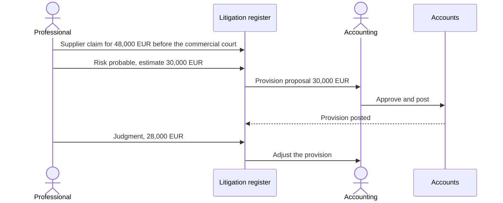

🏠 [Specs](../../../../README.md) › 🧩 [Functional capabilities](../../../README.md) ›
⚖️ [F15 Legal assistant](../../README.md) › 📝 [Use cases](../README.md) ›
📝 [Use cases: FL-F15-07 Equity, contracts, meetings and disputes](README.md) ›
📝 UC-F15-20 Keep the litigation register

# 📝 UC-F15-20 Keep the litigation register

**Status:** ✅ specified

## Summary

A professional keeps the register of the company's disputes: each case with its counterparty, its court or body, its
lawyer, its hearings, the amount at stake and the risk of losing. When a loss becomes probable, a provision is proposed
to accounting.

## Personas

- [U36 Professional](../../../../01-users/personas/u36-professional.md)
- [U05 Accounting](../../../../01-users/personas/u05-accounting.md)

## Goal

The company knows every dispute it is in, what it could cost, and the accounts show the risk in time.

## Trigger

A claim, a summons or a letter before action is received or sent.

## Frequency

A few disputes a year in a small company.

## Preconditions

- The professional holds the right to read legal records
  ([BR-F15-03](../../business-rules/br-f15-03-legal-questions-stay-private.md)).
- The accounting book that will carry a provision exists
  ([UC-F8-01](../../../f08-accounting/use-cases/01-set-up-and-post/uc-f08-01-set-up-the-books.md)).

## Postconditions

- **Succeeded:** the dispute is saved ([E-F15-21 Dispute](../../data/e-f15-21-dispute.md)) with its hearings, its
  documents and its risk; a provision proposal is in accounting when the loss is probable; each change is audited.
- **Failed:** the dispute is saved as Open with the missing facts; no provision is proposed.

## Main flow

1. The professional opens the litigation register
   ([S-F15-18 Litigation](../../screens/07-equity-contracts-and-disputes/s-f15-18-litigation.md)) and adds a dispute:
   the counterparty, the subject, the court, the amount claimed and the lawyer.
2. The professional links the documents (the summons, the contract, the letters) and the hearing dates, which go to the
   compliance calendar.
3. The professional and the lawyer assess the risk: remote, possible or probable, with a reason and an estimate of the
   loss.
4. When the risk is probable and the loss can be estimated, SimpleERP creates a provision proposal for accounting
   ([BR-F15-24](../../business-rules/br-f15-24-a-probable-loss-gets-a-provision-proposal-in-f8.md)).
5. Accounting reviews and approves the provision; the entry is posted by accounting, never by the legal side.
6. As the case moves (hearing, judgment, appeal, settlement) the professional updates it; the provision is adjusted or
   reversed.

## Alternative flows

- 3a. The lawyer's estimate is a range: the proposal uses the amount the professional chooses and states the range.
- 6a. The case settles: the settlement amount replaces the estimate and the provision is adjusted.
- 6b. The company wins: the provision is reversed and the dispute is closed.

## Error flows

- 3e. The risk is probable and no estimate is given: no proposal is created and the dispute is listed as needing an
  estimate.
- 5e. Accounting rejects the proposal: the dispute keeps its risk and the reason is shown.
- 6e. A hearing date passes with no update: the professional is reminded.
- Any step: a service does not answer; the call is retried first
  ([BR-F3-32](../../../f03-assistant/business-rules/br-f03-32-retry-before-an-error.md)), then the message follows the
  error pattern ([D122](../../../../06-decisions/ux/d122-error-message-standard.md)) and what the user typed stays on
  the screen.

## Business rules

- [BR-F15-24](../../business-rules/br-f15-24-a-probable-loss-gets-a-provision-proposal-in-f8.md)
- [BR-F15-11](../../business-rules/br-f15-11-every-dated-duty-has-an-owner-and-reminders.md)
- [BR-F15-03](../../business-rules/br-f15-03-legal-questions-stay-private.md)

## Entities

- [E-F15-21 Dispute](../../data/e-f15-21-dispute.md): created, changed
- [E-F8-03 Journal entry](../../../f08-accounting/data/e-f08-03-journal-entry.md): created, the provision proposal as a
  draft entry
- [E-F15-05 Compliance duty](../../data/e-f15-05-compliance-duty.md): created, the hearing dates as duties

## Permissions

Professional and owner. Accounting reads the risk and the estimate and approves the provision
([U05 Accounting](../../../../01-users/personas/u05-accounting.md)). The lawyer reads and comments through a
hand-off.

## Notifications

The professional: a hearing in 14 days. Accounting: a provision proposal. The owner: a dispute turned probable.

## Audit events

Each dispute, hearing, risk assessment, estimate, proposal and decision, with who, when and the reason.

## AI involvement

No AI step of its own. The AI assistant may open the screen and prefill it from the user's words; the user checks and
confirms ([BR-F3-07](../../../f03-assistant/business-rules/br-f03-07-no-deletes-no-irreversible-acts.md)).

## API, MCP and A2A exposure

T5 operations of the capability for the personas above: create, read, update and list. The MCP tool of the
capability may read and propose, never confirm alone. No A2A skill.

## Screens

- [S-F15-18 Litigation](../../screens/07-equity-contracts-and-disputes/s-f15-18-litigation.md)

## Flowchart

See
[FL-F15-07 Equity, contracts, meetings and disputes](../../flows/fl-f15-07-equity-contracts-and-disputes.md#flowchart).

## Sequence diagram

## Acceptance criteria

1. **Given** a dispute whose risk is probable with an estimate of 30,000 EUR **when** the professional saves **then** a
   provision proposal of 30,000 EUR appears in accounting.
2. **Given** a probable dispute with no estimate **when** the professional saves **then** no proposal is created and the
   missing estimate is listed.
3. **Given** a proposal that accounting rejected **when** the register is opened **then** the reason is shown and the
   risk is unchanged.
4. **Given** a won case **when** the professional closes it **then** the provision is reversed.

## Non-functional notes

The screen answers within 2 seconds for 10,000 records; every change is audited.

## Regulatory references

A probable loss from a dispute that can be estimated is recognised as a provision in the accounts of the
period; a possible one is disclosed in the notes. The treatment follows the book's standard
([CR-FR-064](../../../../10-country-packs/france/accounting/cr-fr-064-accounting-frameworks.md)). The France-pack rule
on litigation provisions is [CR-FR-267 Provisions for litigation](../../../../10-country-packs/france/accounting/cr-fr-267-litigation-provisions.md).

## Related use cases

- [UC-F15-19 Keep the company's IP portfolio](uc-f15-19-keep-the-companys-ip-portfolio.md)
- [UC-F15-17](uc-f15-17-draft-a-contract-from-the-clause-library.md)
- [UC-F15-12](../01-ask-a-legal-question/uc-f15-12-hand-a-question-over-to-a-lawyer.md)
- [UC-F8-26](../../../f08-accounting/use-cases/08-year-end-duties/uc-f08-26-provision-doubtful-debts.md)
- [UC-F8-10](../../../f08-accounting/use-cases/05-close-report-and-consolidate/uc-f08-10-close-the-period-and-the-year.md)

## Open questions

None.

---

⬅️ [UC-F15-19 Keep the company's IP portfolio](uc-f15-19-keep-the-companys-ip-portfolio.md) · ⬆️ [Up](README.md)
