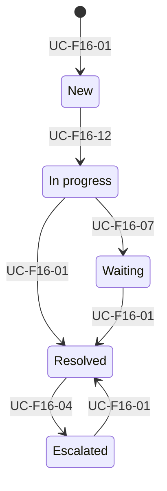

🏠 [Specs](../../../README.md) › 🧩 [Functional capabilities](../../README.md) ›
🎧 [F16 Customer support agents](../README.md) › 🗃️ [Data](README.md) › 🗃️ E-F16-01 Customer request

# 🗃️ E-F16-01 Customer request

**Status:** ✅ specified

## Purpose

A request from a customer, on any channel.

## Fields

| Name | Type | Required | Validation | Default | Example | Personal data | Custom fields |
|---|---|---|---|---|---|---|---|
| channel | email, portal, form, chat, social, phone | yes | - | - | email | no | no |
| customer | customer | no | matched | - | Durand SA | no | no |
| intent | intent | no | classified | - | Late-delivery refund | no | no |
| handled by | agent, person | yes | - | - | agent | no | no |
| state | new, in progress, waiting, resolved, escalated | yes | - | new | resolved | no | no |
| judge score | percent | no | - | - | 97 % | no | no |

## Relations

As its use cases. Each customer request becomes one
[E-F16-12 Work request](e-f16-12-work-request.md)
([BR-F16-13](../business-rules/br-f16-13-every-request-becomes-a-work-request.md)).

## Lifecycle

## Indexes and search

By intent, state, date.

## Retention

Requests 3 years after closing; reviews as their request.

## Audit

Every change and action.

## Import and export

Past requests imported to analyse intents.

## Used by

- [UC-F16-01](../use-cases/01-resolve-a-request/uc-f16-01-resolve-a-customer-request-automatically.md)
- [UC-F16-04](../use-cases/03-review-and-monitor/uc-f16-04-review-correct-and-escalate.md)
- [UC-F16-07 Set service levels and follow targets](../use-cases/04-human-agent-workspace/uc-f16-07-set-service-levels-and-follow-targets.md)
- [UC-F16-08 Support requests in the agent workspace](../use-cases/04-human-agent-workspace/uc-f16-08-work-requests-in-the-agent-workspace.md)
- [UC-F16-09 Rate the answer and measure satisfaction](../use-cases/05-customer-side/uc-f16-09-rate-the-answer-and-measure-satisfaction.md)
- [UC-F16-11 Handle a request in the customer's language](../use-cases/04-human-agent-workspace/uc-f16-11-handle-a-request-in-the-customers-language.md)
- [UC-F16-12 Follow a request's status](../use-cases/05-customer-side/uc-f16-12-follow-a-requests-status.md)
- [UC-F16-13 Ask for a person](../use-cases/05-customer-side/uc-f16-13-ask-for-a-person.md)
- [UC-F16-16 Turn any customer request into a work request](../use-cases/06-take-in-every-request/uc-f16-16-turn-any-request-into-a-work-request.md)

## Open questions

None.

---

⬆️ [Up](README.md) · ➡️ [E-F16-02 Intent](e-f16-02-intent.md)
