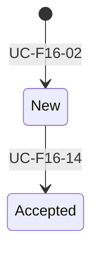

🏠 [Specs](../../../README.md) › 🧩 [Functional capabilities](../../README.md) ›
🎧 [F16 Customer support agents](../README.md) › 🗃️ [Data](README.md) › 🗃️ E-F16-02 Intent

# 🗃️ E-F16-02 Intent

**Status:** ✅ specified

## Purpose

A kind of request with its procedure and mode.

## Fields

| Name | Type | Required | Validation | Default | Example | Personal data | Custom fields |
|---|---|---|---|---|---|---|---|
| name | text | yes | unique | - | Late-delivery refund | no | no |
| procedure | versioned text | yes | - | - | v4 | no | no |
| allowed actions | connector actions | yes | REQ-T12-04 | - | refund, reply | no | no |
| limits | rules | no | - | - | refund at most the amount paid | no | no |
| mode | human, shadow, automatic | yes | BR-F16-01 | human | shadow | no | no |
| driver | workflow, agent | yes | D238 | agent | agent | no | no |
| accuracy | percent over cases | yes | - | - | 99.1 % over 212 | no | no |

## Relations

As its use cases.

## Lifecycle

## Indexes and search

By intent, state, date.

## Retention

Requests 3 years after closing; reviews as their request.

## Audit

Every change and action.

## Import and export

Past requests imported to analyse intents.

## Used by

- [UC-F16-02](../use-cases/02-automate-an-intent/uc-f16-02-write-and-test-a-procedure.md)
- [UC-F16-03](../use-cases/02-automate-an-intent/uc-f16-03-roll-an-intent-out.md)
- [UC-F16-05](../use-cases/03-review-and-monitor/uc-f16-05-monitor-resolution-and-accuracy.md)
- [UC-F16-14 Discover intents from past requests](../use-cases/02-automate-an-intent/uc-f16-14-discover-intents-from-past-requests.md)

## Open questions

None.

---

⬅️ [E-F16-01 Customer request](e-f16-01-customer-request.md) · ⬆️ [Up](README.md) ·
➡️ [E-F16-03 Resolution review](e-f16-03-resolution-review.md)
