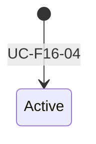

🏠 [Specs](../../../README.md) › 🧩 [Functional capabilities](../../README.md) ›
🎧 [F16 Customer support agents](../README.md) › 🗃️ [Data](README.md) › 🗃️ E-F16-03 Resolution review

# 🗃️ E-F16-03 Resolution review

**Status:** ✅ specified

## Purpose

A person's check of a resolution.

## Fields

| Name | Type | Required | Validation | Default | Example | Personal data | Custom fields |
|---|---|---|---|---|---|---|---|
| request | customer request | yes | - | - | #4812 | no | no |
| reason | sample, low score, escalation | yes | - | - | sample | no | no |
| outcome | approved, corrected | yes | - | - | corrected | no | no |
| correction | text | when corrected | - | - | Refund 40 EUR, not 60 | no | no |

## Relations

As its use cases.

## Lifecycle

## Indexes and search

By intent, state, date.

## Retention

Requests 3 years after closing; reviews as their request.

## Audit

Every change and action.

## Import and export

Past requests imported to analyse intents.

## Used by

- [UC-F16-04](../use-cases/03-review-and-monitor/uc-f16-04-review-correct-and-escalate.md)
- [UC-F16-05](../use-cases/03-review-and-monitor/uc-f16-05-monitor-resolution-and-accuracy.md)

## Open questions

None.

---

⬅️ [E-F16-02 Intent](e-f16-02-intent.md) · ⬆️ [Up](README.md) ·
➡️ [E-F16-04 Helpdesk connection](e-f16-04-helpdesk-connection.md)
