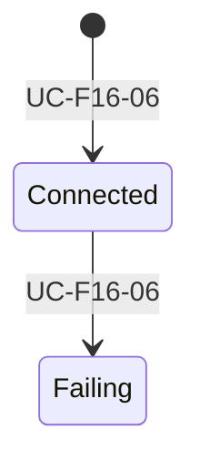

🏠 [Specs](../../../README.md) › 🧩 [Functional capabilities](../../README.md) ›
🎧 [F16 Customer support agents](../README.md) › 🗃️ [Data](README.md) › 🗃️ E-F16-04 Helpdesk connection

# 🗃️ E-F16-04 Helpdesk connection

**Status:** ✅ specified

## Purpose

The built-in inbox or an outside helpdesk.

## Fields

| Name | Type | Required | Validation | Default | Example | Personal data | Custom fields |
|---|---|---|---|---|---|---|---|
| kind | built-in, Zendesk, Intercom, HubSpot, Freshdesk, Notion | yes | - | built-in | Zendesk | no | no |
| credential | vault handle | when outside | D240 | - | zendesk-support | no | no |
| state | connected, failing | yes | - | connected | connected | no | no |

## Relations

As its use cases.

## Lifecycle

## Indexes and search

By intent, state, date.

## Retention

Requests 3 years after closing; reviews as their request.

## Audit

Every change and action.

## Import and export

Past requests imported to analyse intents.

## Used by

- [UC-F16-06](../use-cases/01-resolve-a-request/uc-f16-06-connect-the-helpdesk-and-back-office-tools.md)

## Open questions

None.

---

⬅️ [E-F16-03 Resolution review](e-f16-03-resolution-review.md) · ⬆️ [Up](README.md) ·
➡️ [E-F16-05 Service-level policy](e-f16-05-service-level-policy.md)
