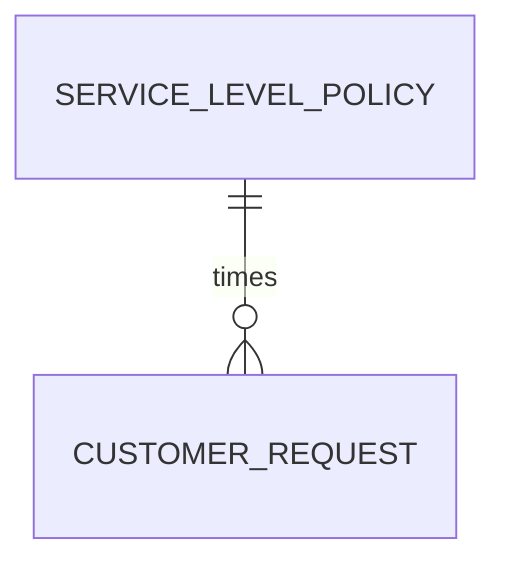
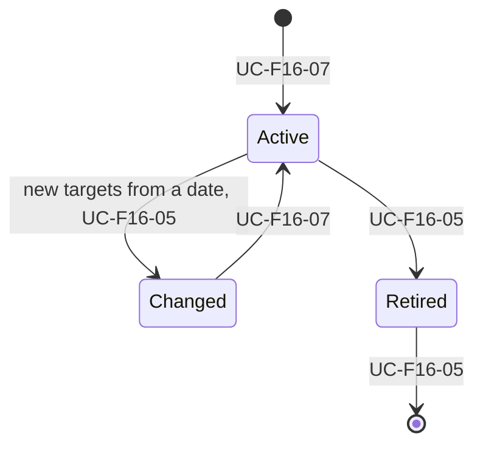

🏠 [Specs](../../../README.md) › 🧩 [Functional capabilities](../../README.md) ›
🎧 [F16 Customer support agents](../README.md) › 🗃️ [Data](README.md) › 🗃️ E-F16-05 Service-level policy

# 🗃️ E-F16-05 Service-level policy

**Status:** 🔄 waiting for the owner

## Purpose

The targets of a priority: first response and resolution, counted in business hours.

## Fields

| Name | Type | Required | Validation | Default | Example | Personal data | Custom fields |
|---|---|---|---|---|---|---|---|
| name | text | yes | unique | - | Normal | no | no |
| priority | choice | yes | low, normal, high, urgent | normal | normal | no | no |
| first response | duration | yes | above 0 | (Proposed) 4 business hours | 4 h | no | no |
| resolution | duration | yes | above first response | (Proposed) 2 business days | 16 h | no | no |
| business hours | text | yes | - | Monday to Friday 9 to 18 | Mon to Fri 9 to 18 | no | no |

## Relations

## Lifecycle

## Indexes and search

By name and priority.

## Retention

Every version kept while requests timed by it are kept.

## Audit

Every creation and change, with who, when, the old and the new value.

## Import and export

CSV and JSON export through the API (T5); no bulk import.

## Used by

- [UC-F16-07 Set service levels and follow targets](../use-cases/04-human-agent-workspace/uc-f16-07-set-service-levels-and-follow-targets.md)
- [UC-F16-05 Monitor resolution and accuracy](../use-cases/03-review-and-monitor/uc-f16-05-monitor-resolution-and-accuracy.md)

## Open questions

None.

---

⬅️ [E-F16-04 Helpdesk connection](e-f16-04-helpdesk-connection.md) · ⬆️ [Up](README.md) ·
➡️ [E-F16-06 Queue](e-f16-06-queue.md)
