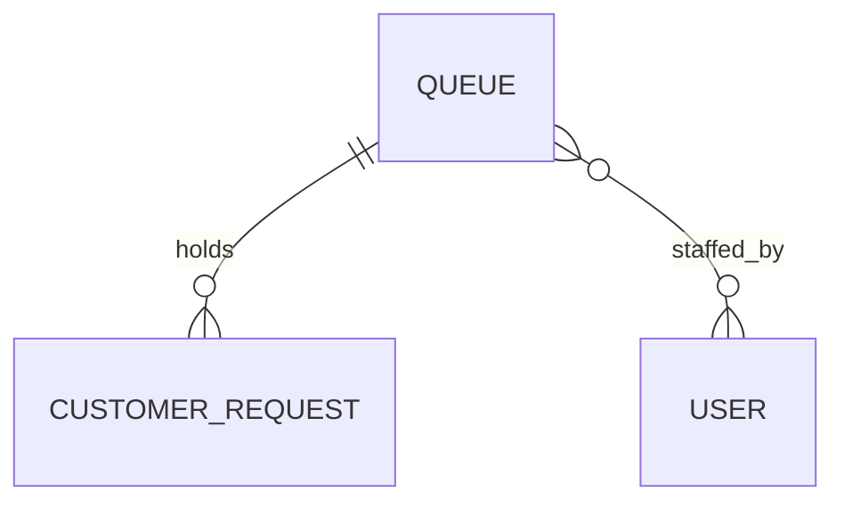
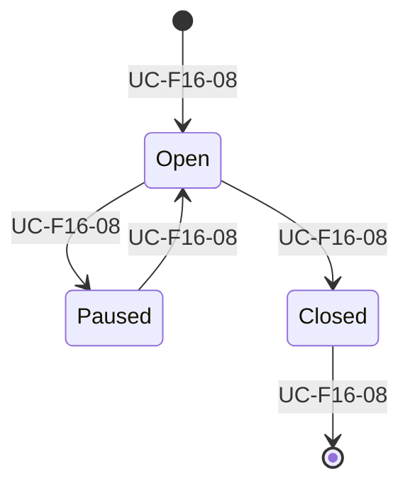

🏠 [Specs](../../../README.md) › 🧩 [Functional capabilities](../../README.md) ›
🎧 [F16 Customer support agents](../README.md) › 🗃️ [Data](README.md) › 🗃️ E-F16-06 Queue

# 🗃️ E-F16-06 Queue

**Status:** ✅ specified

## Purpose

A list of requests for people, with the rule that assigns them.

## Fields

| Name | Type | Required | Validation | Default | Example | Personal data | Custom fields |
|---|---|---|---|---|---|---|---|
| name | text | yes | unique | - | Refunds, Spanish | no | no |
| filter | text | yes | intents, languages, priorities | - | refund intents, language es | no | no |
| assignment | choice | yes | round robin, least busy, manual | least busy | round robin | no | no |
| members | list | yes | office workers | - | Ana, Paul | no | no |

## Relations

## Lifecycle

## Indexes and search

By name and member.

## Retention

As long as it exists.

## Audit

Every creation and change, with who, when, the old and the new value.

## Import and export

CSV and JSON export through the API (T5); no bulk import.

## Used by

- [UC-F16-08 Support requests in the agent workspace](../use-cases/04-human-agent-workspace/uc-f16-08-work-requests-in-the-agent-workspace.md)

## Open questions

None.

---

⬅️ [E-F16-05 Service-level policy](e-f16-05-service-level-policy.md) · ⬆️ [Up](README.md) ·
➡️ [E-F16-07 Macro](e-f16-07-macro.md)
