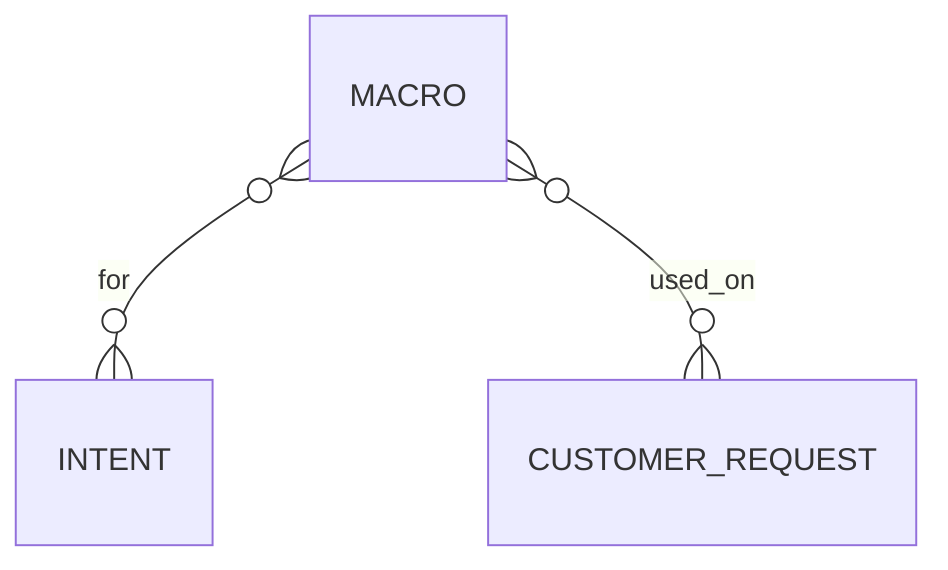
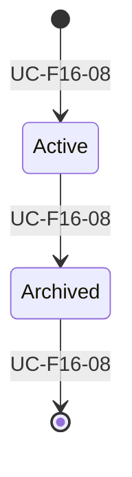

🏠 [Specs](../../../README.md) › 🧩 [Functional capabilities](../../README.md) ›
🎧 [F16 Customer support agents](../README.md) › 🗃️ [Data](README.md) › 🗃️ E-F16-07 Macro

# 🗃️ E-F16-07 Macro

**Status:** ✅ specified

## Purpose

A saved answer with placeholders an office worker inserts and adapts.

## Fields

| Name | Type | Required | Validation | Default | Example | Personal data | Custom fields |
|---|---|---|---|---|---|---|---|
| title | text | yes | unique | - | Refund sent | no | no |
| text | text | yes | placeholders allowed | - | Hello {first name}, your refund of {amount} was sent. | no | no |
| intents | list | no | - | - | late-delivery refund | no | no |
| languages | list | yes | - | company language | fr, en, es | no | no |

### Canned replies (D566)

From [E-F16-17 Canned reply](e-f16-17-canned-reply.md), merged here
([D566](../../../06-decisions/foundations/d566-answers-of-2026-11-15-after-the-benchmark-gap-round.md), F16). A canned
reply is a macro whose action is to send a text: the reply text, a language, and typed variables filled from the request
and its records. The text of the macro is the reply text; the variables are checked by
[BR-F16-19](../business-rules/br-f16-19-variables-come-from-the-request-never-guessed.md).

| Name | Type | Required | Validation | Default | Example | Personal data | Custom fields |
|---|---|---|---|---|---|---|---|
| variables | list of names and record sources | yes, when the text has placeholders | every placeholder is a variable known to the library, each with a source field | - | first name, order, new date | no | no |
| sends text | yes or no | yes | a macro that sends a text needs a language and variables | no | yes | no | no |
| uses | number | yes | 0 or more | 0 | 412 | no | no |
| owner | user (E-F1-03) | yes | a support lead | the creator | Sana K. | yes | no |

- The title is unique per intent and language, the intent of a canned reply being one of the macro's intents.
- Each variable is filled from the request and its records; sending is blocked while one is missing or restricted
  (BR-F16-19), and the agent chooses between several candidates, never a guess.
- The states of a canned reply map onto those of a macro: Draft is the lead's form before saving, Active is Active, and
  Retired is Archived; an Active reply that is edited stays Active, and the approval of the lead is the save
  ([UC-F16-23](../use-cases/07-live-chat-voice-and-contracts/uc-f16-23-use-canned-replies.md)).
- Retention: an archived reply is kept as long as any request that used it.
- Audit: every use, with who or what, when and the variables filled, besides the creations and changes above.
- Import and export: the library is exported and imported as a file; imported macros that send a text start
  Archived until the lead activates them.

## Relations

- [E-F16-01 Customer request](e-f16-01-customer-request.md): the request and its records fill the variables.

## Lifecycle

## Indexes and search

By title, intent and language.

## Retention

As long as it exists.

## Audit

Every creation and change, with who, when, the old and the new value.

## Import and export

CSV and JSON export through the API (T5); no bulk import.

## Used by

- [UC-F16-08 Support requests in the agent workspace](../use-cases/04-human-agent-workspace/uc-f16-08-work-requests-in-the-agent-workspace.md)
- [UC-F16-23 Use canned replies](../use-cases/07-live-chat-voice-and-contracts/uc-f16-23-use-canned-replies.md)

## Open questions

None.

---

⬅️ [E-F16-06 Queue](e-f16-06-queue.md) · ⬆️ [Up](README.md) ·
➡️ [E-F16-08 Satisfaction rating](e-f16-08-satisfaction-rating.md)
