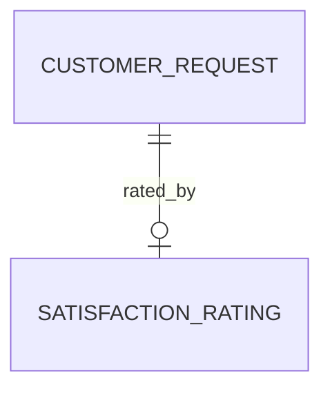
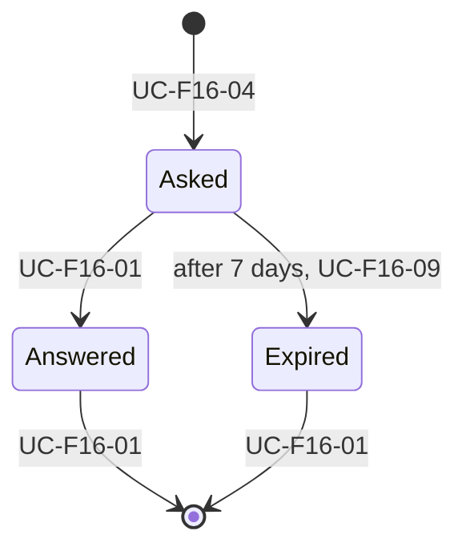

🏠 [Specs](../../../README.md) › 🧩 [Functional capabilities](../../README.md) ›
🎧 [F16 Customer support agents](../README.md) › 🗃️ [Data](README.md) › 🗃️ E-F16-08 Satisfaction rating

# 🗃️ E-F16-08 Satisfaction rating

**Status:** ✅ specified

## Purpose

A customer's score and comment on a resolved request.

## Fields

| Name | Type | Required | Validation | Default | Example | Personal data | Custom fields |
|---|---|---|---|---|---|---|---|
| request | link | yes | a resolved request | - | 5512 | no | no |
| score | number | yes | 1 to 5 | - | 2 | no | no |
| comment | text | no | 500 characters | - | still not refunded | yes | no |
| handled by | choice | yes | agent, person | from the request | agent | no | no |

## Relations

## Lifecycle

## Indexes and search

By intent, score, period and handler.

## Retention

As the request.

## Audit

Every creation and change, with who, when, the old and the new value.

## Import and export

CSV and JSON export through the API (T5); no bulk import.

## Used by

- [UC-F16-09 Rate the answer and measure satisfaction](../use-cases/05-customer-side/uc-f16-09-rate-the-answer-and-measure-satisfaction.md)
- [UC-F16-01 Resolve a customer request automatically](../use-cases/01-resolve-a-request/uc-f16-01-resolve-a-customer-request-automatically.md)
- [UC-F16-04 Review, correct and escalate](../use-cases/03-review-and-monitor/uc-f16-04-review-correct-and-escalate.md)
- [UC-F16-05 Monitor resolution and accuracy](../use-cases/03-review-and-monitor/uc-f16-05-monitor-resolution-and-accuracy.md)

## Open questions

None.

---

⬅️ [E-F16-07 Macro](e-f16-07-macro.md) · ⬆️ [Up](README.md) ·
➡️ [E-F16-09 Help-centre article](e-f16-09-help-centre-article.md)
