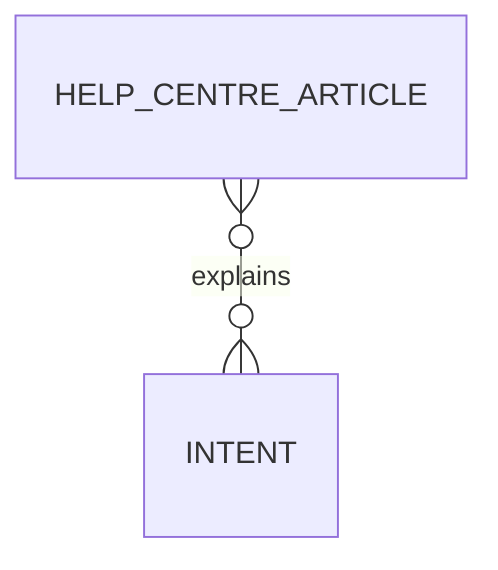
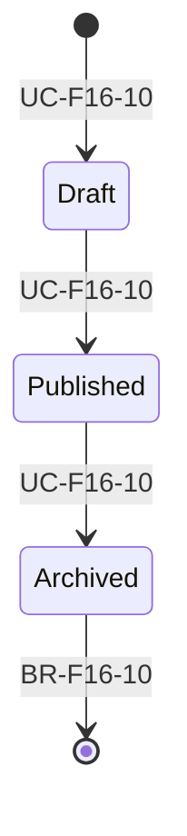

🏠 [Specs](../../../README.md) › 🧩 [Functional capabilities](../../README.md) ›
🎧 [F16 Customer support agents](../README.md) › 🗃️ [Data](README.md) › 🗃️ E-F16-09 Help-centre article

# 🗃️ E-F16-09 Help-centre article

**Status:** 🔄 waiting for the owner

## Purpose

A public article of the help centre, in one or more languages.

## Fields

| Name | Type | Required | Validation | Default | Example | Personal data | Custom fields |
|---|---|---|---|---|---|---|---|
| title | text | yes | - | - | When will my refund arrive? | no | no |
| body | text | yes | no customer data (BR-F16-10) | - | Refunds reach your account within 5 business days. | no | no |
| language | choice | yes | supported languages | company language | fr | no | no |
| status | choice | yes | draft, published, archived | draft | published | no | no |
| updated | date | yes | - | now | 2026-11-12 | no | no |
| helpful | number | no | count of votes | 0 | 41 | no | no |

## Relations

## Lifecycle

## Indexes and search

Full text in each language; by intent and status.

## Retention

Archived articles kept (Proposed) 2 years.

## Audit

Every creation and change, with who, when, the old and the new value.

## Import and export

Import from HTML or Markdown files; export.

## Used by

- [UC-F16-10 Publish the help centre](../use-cases/05-customer-side/uc-f16-10-publish-the-help-centre.md)

## Open questions

None.

---

⬅️ [E-F16-08 Satisfaction rating](e-f16-08-satisfaction-rating.md) · ⬆️ [Up](README.md) ·
➡️ [E-F16-10 Intent candidate](e-f16-10-intent-candidate.md)
