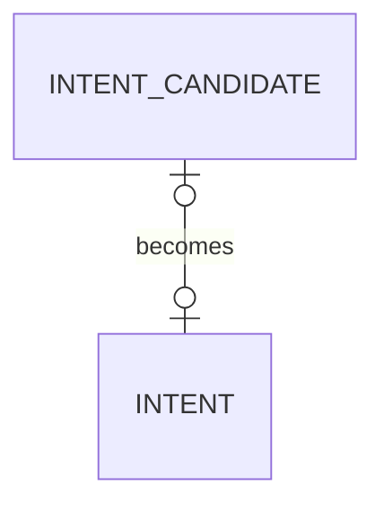
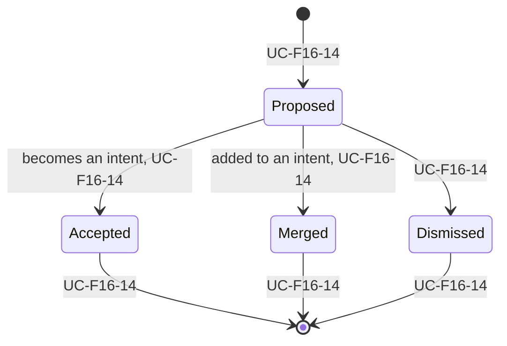

🏠 [Specs](../../../README.md) › 🧩 [Functional capabilities](../../README.md) ›
🎧 [F16 Customer support agents](../README.md) › 🗃️ [Data](README.md) › 🗃️ E-F16-10 Intent candidate

# 🗃️ E-F16-10 Intent candidate

**Status:** ✅ specified

## Purpose

A group of past requests the discovery found alike, proposed as a new intent.

## Fields

| Name | Type | Required | Validation | Default | Example | Personal data | Custom fields |
|---|---|---|---|---|---|---|---|
| label | text | yes | - | proposed | Change of delivery address | no | no |
| requests | count | yes | - | - | 186 in 90 days | no | no |
| examples | list | yes | 5 requests | - | 5512, 5530 | yes | no |
| share handled by people | percent | yes | - | computed | 92 % | no | no |
| status | choice | yes | proposed, accepted, merged, dismissed | proposed | accepted | no | no |

## Relations

## Lifecycle

## Indexes and search

By size and status.

## Retention

1 year after its decision.

## Audit

Every creation and change, with who, when, the old and the new value.

## Import and export

CSV and JSON export through the API (T5); no bulk import.

## Used by

- [UC-F16-14 Discover intents from past requests](../use-cases/02-automate-an-intent/uc-f16-14-discover-intents-from-past-requests.md)

## Open questions

None.

---

⬅️ [E-F16-09 Help-centre article](e-f16-09-help-centre-article.md) · ⬆️ [Up](README.md) ·
➡️ [E-F16-11 Fraud signal](e-f16-11-fraud-signal.md)
