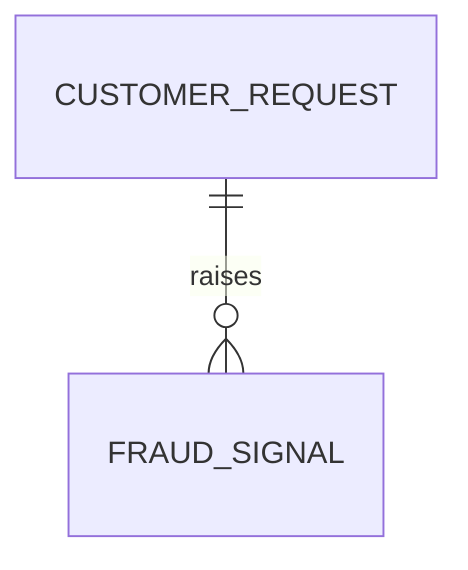
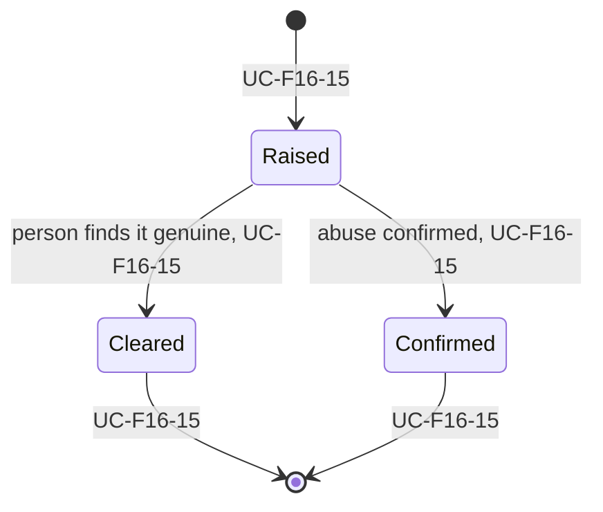

🏠 [Specs](../../../README.md) › 🧩 [Functional capabilities](../../README.md) ›
🎧 [F16 Customer support agents](../README.md) › 🗃️ [Data](README.md) › 🗃️ E-F16-11 Fraud signal

# 🗃️ E-F16-11 Fraud signal

**Status:** 🔄 waiting for the owner

## Purpose

A sign that a request or customer may be abusing refunds, attached to the request it stops.

## Fields

| Name | Type | Required | Validation | Default | Example | Personal data | Custom fields |
|---|---|---|---|---|---|---|---|
| request | link | yes | a request | - | 5601 | no | no |
| kind | choice | yes | refund rate, new high-value account, contradicting proof | - | refund rate | no | no |
| evidence | text | yes | - | - | 4 refunds in 60 days | yes | no |
| decision | choice | when reviewed | genuine, abuse | - | genuine | no | no |

## Relations

## Lifecycle

## Indexes and search

By customer, kind and decision.

## Retention

(Proposed) 3 years, then anonymised.

## Audit

Every creation and change, with who, when, the old and the new value.

## Import and export

CSV and JSON export through the API (T5); no bulk import.

## Used by

- [UC-F16-15 Detect refund abuse and fraud signals](../use-cases/03-review-and-monitor/uc-f16-15-detect-refund-abuse-and-fraud-signals.md)

## Open questions

None.

---

⬅️ [E-F16-10 Intent candidate](e-f16-10-intent-candidate.md) · ⬆️ [Up](README.md) ·
➡️ [E-F16-12 Work request](e-f16-12-work-request.md)
