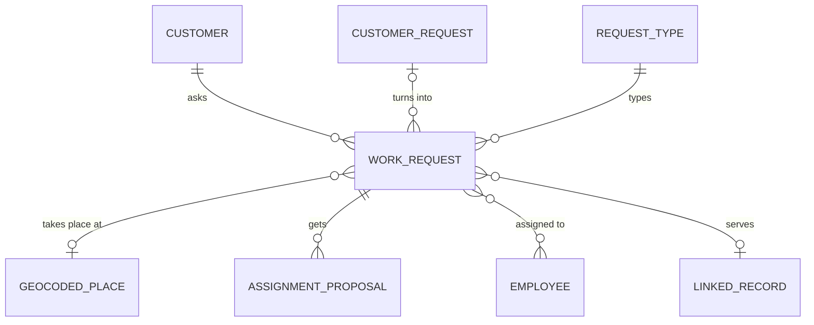
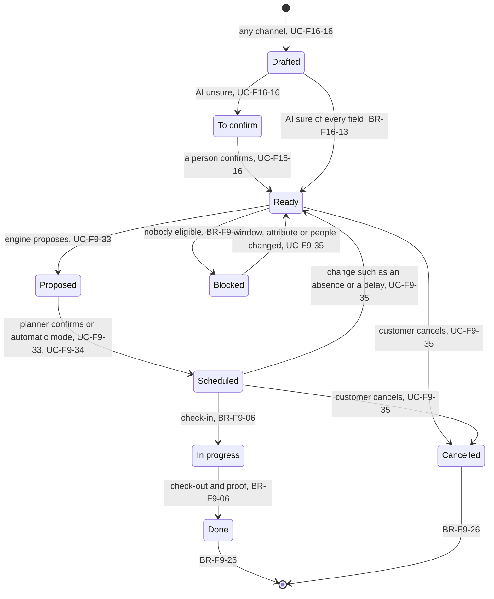

🏠 [Specs](../../../README.md) › 🧩 [Functional capabilities](../../README.md) ›
🎧 [F16 Customer support agents](../README.md) › 🗃️ [Data](README.md) › 🗃️ E-F16-12 Work request

# 🗃️ E-F16-12 Work request

**Status:** 🔄 draft (GH-2 step S4b, from VD-30, VD-31 / D512, D513)

## Purpose

One piece of work a customer asked for, ready to be scheduled, whatever the channel it came from and whatever its kind:
a service or an intervention, an order to fulfil and deliver, a project or an engagement, a booking or an appointment.
The AI drafts it from the customer's words and a person confirms it when the AI is unsure. It is the single input of
scheduling (decided by the owner on 2026-11-13, VD-30 and VD-31).

## Fields

| Name | Type | Required | Validation | Default | Example | Personal data | Custom fields |
|---|---|---|---|---|---|---|---|
| number | text | yes | unique in the company | next number | WR-2026-004812 | no | - |
| channel | list | yes | portal, email, phone, chat, order, contract, care plan, API | - | email | no | - |
| customer | customer | yes | matched or created | - | Mme Leroy | yes | - |
| request type | E-F2-25 | yes | published type | AI's choice | Home help visit | no | - |
| place | E-T13-01 | yes for work on site | geocoded | customer's address | 12 rue des Lilas, Lyon | yes | - |
| time window | from, to | yes | from before to | - | 2026-12-08 09:00 to 11:00 | no | - |
| duration | minutes | yes | more than 0 | the type's | 90 | no | - |
| needs | text | no | - | - | Shower help, speaks Italian | maybe | - |
| attribute changes | list | no | logged, reason given | none | + Italian, preferred | no | - |
| priority | low, normal, urgent | yes | - | normal | urgent | no | - |
| linked record | any record | no | - | - | Care plan visit 2291 | no | - |
| source | message or record | no | - | - | Email of 2026-12-01 | maybe | - |
| drafted by | AI, person | yes | - | - | AI | no | - |
| AI confidence | percent per field | no | - | - | type 98 %, window 64 % | no | - |
| confirmed by | user | no | when the AI was unsure | - | Claire (coordinator) | yes | - |
| assigned to | employees | no | from E-F9-28 | - | Lea (carer) | yes | - |
| state | list | yes | the lifecycle below | drafted | scheduled | no | - |
| cancel reason | text | no | when cancelled | - | Customer in hospital | maybe | - |

Custom fields are allowed per request type (D101).

Two details:
- "attribute changes" holds what the planner added or relaxed on this one request (VD-28); a legal requirement can never
  be relaxed ([BR-F9-26](../../f09-hr-and-projects/business-rules/br-f09-26-legal-requirements-never-relaxed.md)).
- The arrival time the customer sees is computed during the visit's window and never stored (VD-21).

## Relations

- [E-F16-01 Customer request](e-f16-01-customer-request.md): a support request may turn into one or more work requests.
- [E-F2-25 Request type](../../f02-no-code-configuration/data/e-f02-25-request-type.md): the attributes, weights,
  duration and objectives that apply.
- [E-F9-28 Assignment proposal](../../f09-hr-and-projects/data/e-f09-28-assignment-proposal.md): one per scheduling run.
- [E-T13-01 Geocoded place](../../../03-technical/t13-maps-and-geodata/data/e-t13-01-geocoded-place.md): the place,
  shown on the map for roles with the map right
  ([BR-F1-32](../../f01-administration/business-rules/br-f01-32-map-right-for-planners-and-managers.md)).
- The linked record: an order, a ticket, a care plan visit, an engagement or a booking.

## Lifecycle

The screens show the states as: Drafted, To confirm, Ready, Blocked, Proposed, Scheduled, In progress, Done, Cancelled.

## Indexes and search

- Unique: number.
- Search: number, customer, place, needs.
- Filters and facets: state, request type, channel, priority, customer, assigned person, window, linked record type.
- Map layout of the list view for roles with the map right (D501, D502).

## Retention

(Proposed) As its linked record when it has one; otherwise 3 years after Done or Cancelled, like customer requests
([E-F16-01](e-f16-01-customer-request.md)), then deleted.

## Audit

Created (channel, drafted by the AI or a person), confirmed, every field changed, every attribute added or relaxed with
its reason ([BR-F9-34](../../f09-hr-and-projects/business-rules/br-f09-34-overrides-logged-with-a-reason.md)), every
state change, every assignment and override.

## Import and export

- Created through the API (T5) and the connectors (T12) as well as the screens.
- (Proposed) Export as CSV and XLSX from the list view, audited (D489).

## Used by

- [UC-F16-16](../use-cases/06-take-in-every-request/uc-f16-16-turn-any-request-into-a-work-request.md)
- [UC-F16-17](../use-cases/06-take-in-every-request/uc-f16-17-follow-the-arrival-of-a-visit.md)
- [UC-F9-33](../../f09-hr-and-projects/use-cases/12-schedule-customer-requests/uc-f09-33-schedule-a-work-request.md)
- [UC-F9-34](../../f09-hr-and-projects/use-cases/12-schedule-customer-requests/uc-f09-34-run-the-automatic-scheduling.md)
- [UC-F9-35](../../f09-hr-and-projects/use-cases/12-schedule-customer-requests/uc-f09-35-re-plan-after-a-change.md)
- [UC-F9-36](../../f09-hr-and-projects/use-cases/12-schedule-customer-requests/uc-f09-36-see-work-and-places-on-a-map.md)

## Open questions

None.

---

⬅️ [E-F16-11 Fraud signal](e-f16-11-fraud-signal.md) · ⬆️ [Up](README.md) ·
➡️ [E-F16-13 Forum post](e-f16-13-forum-post.md)
