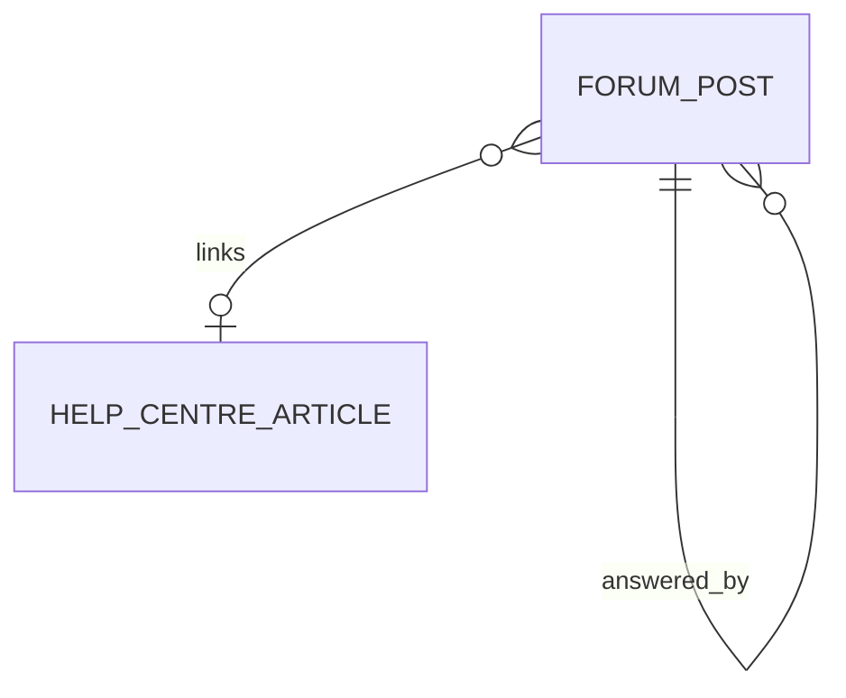
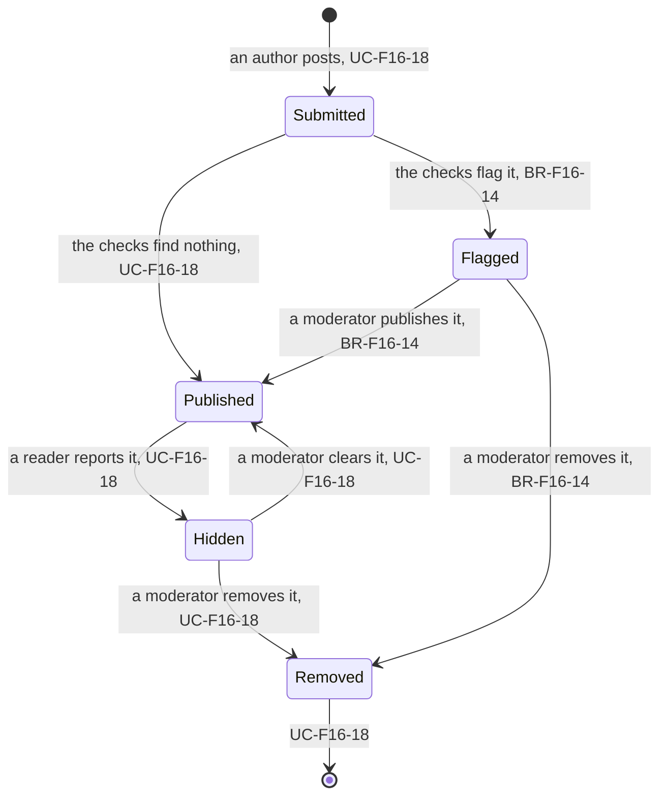

🏠 [Specs](../../../README.md) › 🧩 [Functional capabilities](../../README.md) ›
🎧 [F16 Customer support agents](../README.md) › 🗃️ [Data](README.md) › 🗃️ E-F16-13 Forum post

# 🗃️ E-F16-13 Forum post

**Status:** ✅ specified

## Purpose

A post of the community forum: a question, an answer or a comment, with its state and votes
([D535](../../../06-decisions/f16-customer-support-agents/d535-benchmark-gaps-f16-customer-support-agents.md)).

## Fields

| Name | Type | Required | Validation | Default | Example | Personal data | Custom fields |
|---|---|---|---|---|---|---|---|
| kind | question, answer, comment | yes | one of the three | - | question | no | no |
| author | portal account or staff | yes | a signed-in person | - | Julien R. | yes | no |
| category | list | yes | a category of the forum | - | Delivery | no | no |
| title | text | no | required for a question | - | How do I change my address? | no | no |
| body | text | yes | at most 5,000 characters | - | I moved last week ... | yes | no |
| parent | forum post | no | required for an answer | - | the question | no | no |
| language | language | yes | the post's language | - | French | no | no |
| votes | number | yes | 0 or more | 0 | 14 | no | no |
| flag reason | text | no | set by the checks or a reader | - | personal data | no | no |
| state | Submitted, Published, Flagged, Removed, Hidden | yes | the lifecycle below | Submitted | Published | no | no |
| owner | user | yes | a user of the company | the creator | Claire P. | yes | no |

## Relations

- [E-F16-09 Help-centre article](e-f16-09-help-centre-article.md)
- [E-F16-01 Customer request](e-f16-01-customer-request.md)

## Lifecycle

## Indexes and search

By category, kind, author, state, language and votes.

## Retention

A published post is kept while the forum exists; a removed post's text is deleted after 90 days, its author's
identity stays for the authorities as long as the law asks.

## Audit

Every post, edit, flag, decision, hiding, removal and appeal, with who or what, when and the reason.

## Import and export

No import. A customer can export their own posts.

## Used by

- [UC-F16-18](../use-cases/07-live-chat-voice-and-contracts/uc-f16-18-run-the-community-forum.md)

## Open questions

None.

---

⬅️ [E-F16-12 Work request](e-f16-12-work-request.md) · ⬆️ [Up](README.md) ·
➡️ [E-F16-14 Chat session](e-f16-14-chat-session.md)
