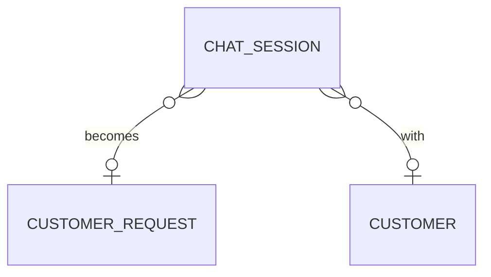
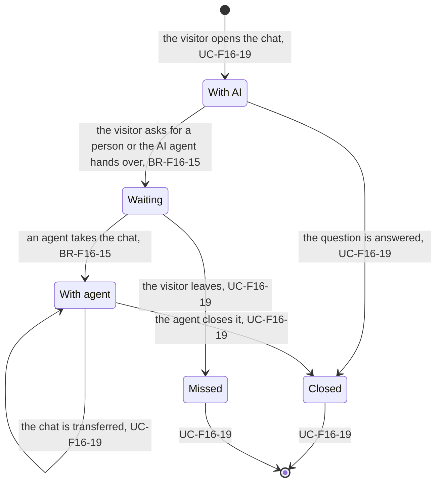

🏠 [Specs](../../../README.md) › 🧩 [Functional capabilities](../../README.md) ›
🎧 [F16 Customer support agents](../README.md) › 🗃️ [Data](README.md) › 🗃️ E-F16-14 Chat session

# 🗃️ E-F16-14 Chat session

**Status:** ✅ specified

## Purpose

A live chat between a visitor and the AI agent or a person, from its first message to its closing
([D535](../../../06-decisions/f16-customer-support-agents/d535-benchmark-gaps-f16-customer-support-agents.md)).

## Fields

| Name | Type | Required | Validation | Default | Example | Personal data | Custom fields |
|---|---|---|---|---|---|---|---|
| visitor | customer record or anonymous | yes | a signed-in customer or a visitor code | - | Julien R. | yes | no |
| page | link | no | a page of the site | - | /orders | no | no |
| language | language | yes | detected or chosen | - | French | no | no |
| started at | date and time | yes | - | now | 2026-11-14 10:42 | no | no |
| handled by | AI agent or user | yes | - | AI agent | AI agent | no | no |
| handed over at | date and time | no | after the start | - | 2026-11-14 10:44 | no | no |
| outcome | answered, handed over, request created, missed | no | one of the four | - | handed over | no | no |
| rating | number | no | 1 to 5 | - | 5 | no | no |
| state | With AI, Waiting, With agent, Closed, Missed | yes | the lifecycle below | With AI | Waiting | no | no |
| owner | user | yes | a user of the company | the creator | Claire P. | yes | no |

## Relations

- [E-F16-01 Customer request](e-f16-01-customer-request.md)
- [E-F16-06 Queue](e-f16-06-queue.md)
- [E-F6-01 Customer record](../../f06-customers-and-sales/data/e-f06-01-customer-record.md)

## Lifecycle

## Indexes and search

By visitor, language, state, handled by and date.

## Retention

Transcripts are kept 1 year after the closing, then the text is deleted and the counts stay.

## Audit

Every message, handover, transfer, closing, rating and AI action, with who or what and when.

## Import and export

No import. A customer receives the transcript of their chat on request.

## Used by

- [UC-F16-19](../use-cases/07-live-chat-voice-and-contracts/uc-f16-19-answer-website-visitors-in-live-chat.md)

## Open questions

None.

---

⬅️ [E-F16-13 Forum post](e-f16-13-forum-post.md) · ⬆️ [Up](README.md) · ➡️ [E-F16-15 Outreach](e-f16-15-outreach.md)
