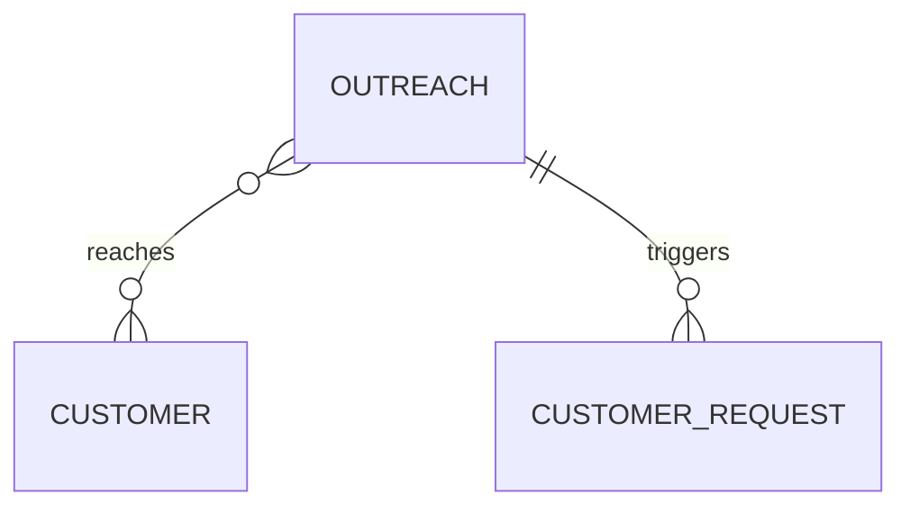
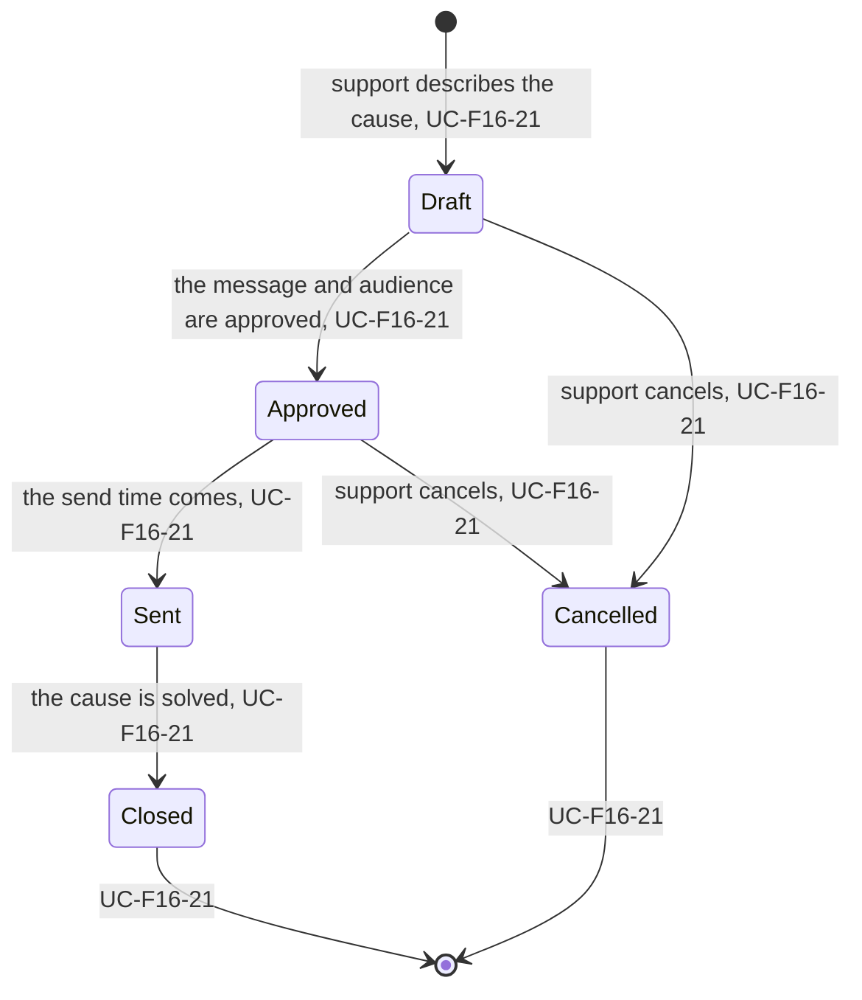

🏠 [Specs](../../../README.md) › 🧩 [Functional capabilities](../../README.md) ›
🎧 [F16 Customer support agents](../README.md) › 🗃️ [Data](README.md) › 🗃️ E-F16-15 Outreach

# 🗃️ E-F16-15 Outreach

**Status:** ✅ specified

## Purpose

A proactive message to the customers a known cause affects, with its audience, channel and results
([D535](../../../06-decisions/f16-customer-support-agents/d535-benchmark-gaps-f16-customer-support-agents.md)).

## Fields

| Name | Type | Required | Validation | Default | Example | Personal data | Custom fields |
|---|---|---|---|---|---|---|---|
| cause | text | yes | a known incident, delay or defect | - | Batch 7 delayed 3 days | no | no |
| audience query | selection on records | yes | never the whole list | - | orders of batch 7 | no | no |
| audience size | number | yes | computed, 1 or more | - | 214 | no | no |
| channel | email, SMS, in-app | yes | one or more | email | email | no | no |
| message | text with variables | yes | variables from the customer's records | - | Hello {first name}, order {order} ... | no | no |
| send time | date and time | yes | outside quiet hours | - | 2026-11-15 09:00 | no | no |
| approved by | user (E-F1-03) | no | required above the limit | - | Sana K. | yes | no |
| sent, delivered, replies | three numbers | no | 0 or more | 0 | 214, 208, 31 | no | no |
| state | Draft, Approved, Sent, Cancelled, Closed | yes | the lifecycle below | Draft | Approved | no | no |
| owner | user | yes | a user of the company | the creator | Claire P. | yes | no |

## Relations

- [E-F16-01 Customer request](e-f16-01-customer-request.md)
- [E-F16-07 Macro](e-f16-07-macro.md)

## Lifecycle

## Indexes and search

By cause, state, channel and send time.

## Retention

Kept 3 years with its counts; the audience list is kept 1 year.

## Audit

Every cause, selection, approval, send, failure and reply, with who, when and the counts.

## Import and export

No import. The outcome is exported as a CSV without the message bodies of customers.

## Used by

- [UC-F16-21](../use-cases/07-live-chat-voice-and-contracts/uc-f16-21-warn-customers-before-they-ask.md)

## Open questions

None.

---

⬅️ [E-F16-14 Chat session](e-f16-14-chat-session.md) · ⬆️ [Up](README.md) ·
➡️ [E-F16-16 Support contract](e-f16-16-support-contract.md)
