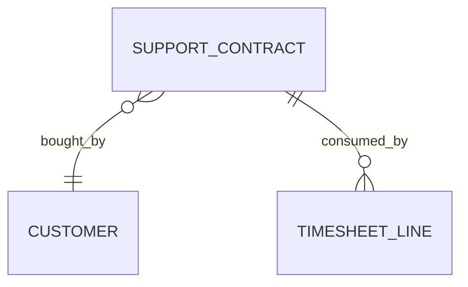
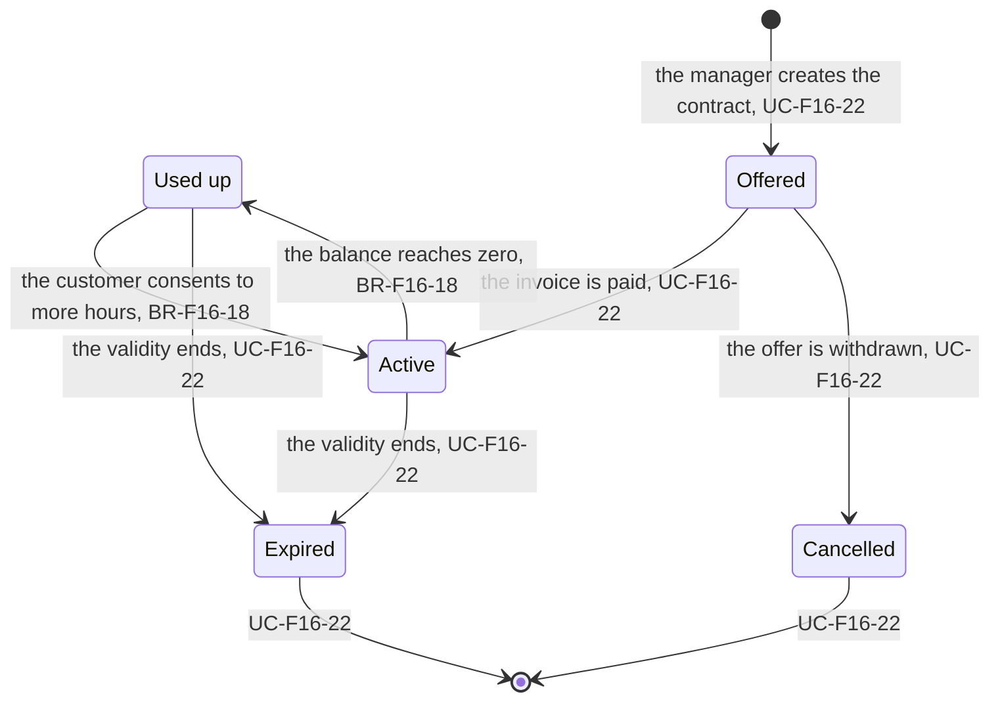

🏠 [Specs](../../../README.md) › 🧩 [Functional capabilities](../../README.md) ›
🎧 [F16 Customer support agents](../README.md) › 🗃️ [Data](README.md) › 🗃️ E-F16-16 Support contract

# 🗃️ E-F16-16 Support contract

**Status:** ✅ specified

## Purpose

A prepaid support contract: a block of hours bought by a customer, with its balance and its validity
([D535](../../../06-decisions/f16-customer-support-agents/d535-benchmark-gaps-f16-customer-support-agents.md)).

## Fields

| Name | Type | Required | Validation | Default | Example | Personal data | Custom fields |
|---|---|---|---|---|---|---|---|
| customer | customer record (E-F6-01) | yes | a customer of the company | - | Atelier Verdier | yes | no |
| hours bought | number | yes | above 0 | - | 20 | no | no |
| hours used | number | yes | 0 to the hours bought plus consented extras | 0 | 1.5 | no | no |
| rate | amount per hour | yes | 0 or more | - | 90 EUR | no | no |
| price | amount | yes | hours times rate | - | 1,800 EUR | no | no |
| valid until | date | yes | after the start | 12 months | 2027-11-14 | no | no |
| consented extra hours | number | no | 0 or more | 0 | 0 | no | no |
| invoice | invoice (E-F6-05) | no | paid before Active | - | INV-0412 | no | no |
| state | Offered, Active, Used up, Expired, Cancelled | yes | the lifecycle below | Offered | Active | no | no |
| owner | user | yes | a user of the company | the creator | Claire P. | yes | no |

## Relations

- [E-F6-01 Customer record](../../f06-customers-and-sales/data/e-f06-01-customer-record.md)
- [E-F6-05 Invoice](../../f06-customers-and-sales/data/e-f06-05-invoice.md)
- [E-F9-17 Timesheet line](../../f09-hr-and-projects/data/e-f09-17-timesheet-line.md)

## Lifecycle

## Indexes and search

By customer, state, validity and balance.

## Retention

Kept 10 years like invoices
([CR-FR-002](../../../10-country-packs/france/accounting/cr-fr-002-accounting-records-kept-ten-years.md)).

## Audit

Every sale, payment, booking, consent and expiry, with who, when and the hours.

## Import and export

No import. The bookings of a contract are exported as a statement for the customer.

## Used by

- [UC-F16-22](../use-cases/07-live-chat-voice-and-contracts/uc-f16-22-sell-prepaid-support-hours.md)

## Open questions

None.

---

⬅️ [E-F16-15 Outreach](e-f16-15-outreach.md) · ⬆️ [Up](README.md) ·
➡️ [E-F16-17 Canned reply](e-f16-17-canned-reply.md)
