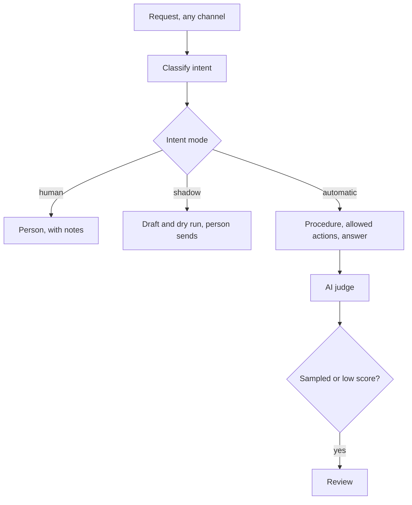

🏠 [Specs](../../../README.md) › 🧩 [Functional capabilities](../../README.md) ›
🎧 [F16 Customer support agents](../README.md) › 🔀 [Flows](README.md) › 🔀 FL-F16-01 Resolve a request

# 🔀 FL-F16-01 Resolve a request

**Status:** ✅ specified

## Summary

Covers UC-F16-01, UC-F16-06.

## Personas

See each use case.

- [U16 Office worker](../../../01-users/personas/u16-office-worker.md), acting in the chart, step 36i (Proposed)

## Flowchart

## Sequence diagram

See each use case.

## Steps

| Step | Persona | Screen | Use case | What happens |
|---|---|---|---|---|
| 1 | See [UC-F16-01](../use-cases/01-resolve-a-request/uc-f16-01-resolve-a-customer-request-automatically.md) | [S-F16-01](../screens/01-resolve-a-request/s-f16-01-request-inbox.md) | [UC-F16-01](../use-cases/01-resolve-a-request/uc-f16-01-resolve-a-customer-request-automatically.md) | Resolve a customer request automatically |
| 2 | See [UC-F16-06](../use-cases/01-resolve-a-request/uc-f16-06-connect-the-helpdesk-and-back-office-tools.md) | [S-F16-06](../screens/01-resolve-a-request/s-f16-06-support-connections.md) | [UC-F16-06](../use-cases/01-resolve-a-request/uc-f16-06-connect-the-helpdesk-and-back-office-tools.md) | Connect the helpdesk and back-office tools |

### Entities and screens

| Entity | States in this flow | Shown at step and screen | Aggregated view |
|---|---|---|---|
| [E-F16-01 Customer request](../data/e-f16-01-customer-request.md) | New, In progress, Resolved, Waiting, Escalated | 1 [S-F16-01](../screens/01-resolve-a-request/s-f16-01-request-inbox.md) | Customer requests |
| [E-F16-02 Intent](../data/e-f16-02-intent.md) | New, Accepted | Shown elsewhere: [S-F16-03 Intent rollout](../screens/02-automate-an-intent/s-f16-03-intent-rollout.md) | Intents |
| [E-F3-02 Assistant answer](../../f03-assistant/data/e-f03-02-assistant-answer.md) | Recorded | Shown elsewhere: [S-F3-01 Assistant panel](../../f03-assistant/screens/01-ask-the-assistant/s-f03-01-assistant-panel.md) | Assistant answers |
| [E-F16-03 Resolution review](../data/e-f16-03-resolution-review.md) | Active | Shown elsewhere: [S-F16-04 Review queue](../screens/03-review-and-monitor/s-f16-04-review-queue.md) | Resolution reviews |

## Errors

As each use case.

## Images

Every step and error, for each persona taking part, in light and dark mode (D120). Steps are numbered as in the Steps
table; E rows are the error cases.

| Step | Persona | Device | Light | Dark |
|---|---|---|---|---|
| 1 | U16 | desktop | [light](../images/01-resolve-a-request/u16-office-worker/1-inbox-with-agents-desktop-light.png) | [dark](../images/01-resolve-a-request/u16-office-worker/1-inbox-with-agents-desktop-dark.png) |
| 2 | U16 | desktop | [light](../images/01-resolve-a-request/u16-office-worker/2-audit-trail-desktop-light.png) | [dark](../images/01-resolve-a-request/u16-office-worker/2-audit-trail-desktop-dark.png) |
| 3 | U07 | desktop | [light](../images/01-resolve-a-request/u07-administrator/3-connections-desktop-light.png) | [dark](../images/01-resolve-a-request/u07-administrator/3-connections-desktop-dark.png) |
| E1 | U16 | desktop | [light](../images/01-resolve-a-request/u16-office-worker/e1-tool-down-escalated-desktop-light.png) | [dark](../images/01-resolve-a-request/u16-office-worker/e1-tool-down-escalated-desktop-dark.png) |
| E1 | U16 | phone | [light](../images/01-resolve-a-request/u16-office-worker/e1-tool-down-escalated-phone-light.png) | [dark](../images/01-resolve-a-request/u16-office-worker/e1-tool-down-escalated-phone-dark.png) |

## Open questions

None.

---

⬆️ [Up](README.md) · ➡️ [FL-F16-02 Automate an intent](fl-f16-02-automate-an-intent.md)
