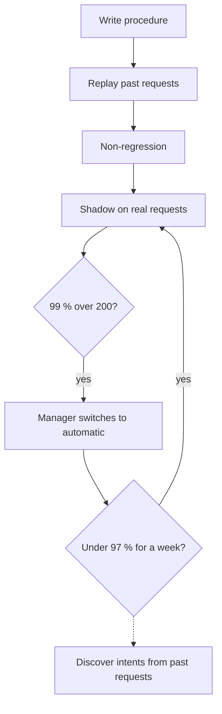

🏠 [Specs](../../../README.md) › 🧩 [Functional capabilities](../../README.md) ›
🎧 [F16 Customer support agents](../README.md) › 🔀 [Flows](README.md) › 🔀 FL-F16-02 Automate an intent

# 🔀 FL-F16-02 Automate an intent

**Status:** ✅ specified

## Summary

Covers UC-F16-02, UC-F16-03.

## Personas

See each use case.
- [U02 Manager](../../../01-users/personas/u02-manager.md)

## Flowchart

## Sequence diagram

See each use case.

## Steps

| Step | Persona | Screen | Use case | What happens |
|---|---|---|---|---|
| 1 | See [UC-F16-02](../use-cases/02-automate-an-intent/uc-f16-02-write-and-test-a-procedure.md) | [S-F16-02](../screens/02-automate-an-intent/s-f16-02-procedure-editor.md) | [UC-F16-02](../use-cases/02-automate-an-intent/uc-f16-02-write-and-test-a-procedure.md) | Write and test a procedure for an intent |
| 2 | See [UC-F16-03](../use-cases/02-automate-an-intent/uc-f16-03-roll-an-intent-out.md) | [S-F16-03](../screens/02-automate-an-intent/s-f16-03-intent-rollout.md) | [UC-F16-03](../use-cases/02-automate-an-intent/uc-f16-03-roll-an-intent-out.md) | Roll an intent out: shadow, then automatic |
| 5 | U02 | [S-F16-12](../screens/02-automate-an-intent/s-f16-12-intent-discovery.md) | [UC-F16-14](../use-cases/02-automate-an-intent/uc-f16-14-discover-intents-from-past-requests.md) | Discover intents from past requests |

### Entities and screens

| Entity | States in this flow | Shown at step and screen | Aggregated view |
|---|---|---|---|
| [E-F16-02 Intent](../data/e-f16-02-intent.md) | New, Accepted | 1 [S-F16-02](../screens/02-automate-an-intent/s-f16-02-procedure-editor.md); 2 [S-F16-03](../screens/02-automate-an-intent/s-f16-03-intent-rollout.md); 5 [S-F16-12](../screens/02-automate-an-intent/s-f16-12-intent-discovery.md) | Intents |
| [E-F16-01 Customer request](../data/e-f16-01-customer-request.md) | New, In progress, Resolved, Waiting, Escalated | Shown elsewhere: [S-F16-11 My requests](../screens/05-customer-side/s-f16-11-my-requests.md) | Customer requests |
| [E-F16-10 Intent candidate](../data/e-f16-10-intent-candidate.md) | Proposed, Accepted, Merged, Dismissed | 5 [S-F16-12](../screens/02-automate-an-intent/s-f16-12-intent-discovery.md) | Intent candidates |

## Errors

As each use case.

## Images

Every step and error, for each persona taking part, in light and dark mode (D120). Steps are numbered as in the Steps
table; E rows are the error cases.

| Step | Persona | Device | Light | Dark |
|---|---|---|---|---|
| 1 | U02 | desktop | [light](../images/02-automate-an-intent/u02-manager/1-procedure-desktop-light.png) | [dark](../images/02-automate-an-intent/u02-manager/1-procedure-desktop-dark.png) |
| 2 | U02 | desktop | [light](../images/02-automate-an-intent/u02-manager/2-rollout-desktop-light.png) | [dark](../images/02-automate-an-intent/u02-manager/2-rollout-desktop-dark.png) |
| E1 | U02 | desktop | [light](../images/02-automate-an-intent/u02-manager/e1-below-the-bar-desktop-light.png) | [dark](../images/02-automate-an-intent/u02-manager/e1-below-the-bar-desktop-dark.png) |
| E1 | U02 | phone | [light](../images/02-automate-an-intent/u02-manager/e1-below-the-bar-phone-light.png) | [dark](../images/02-automate-an-intent/u02-manager/e1-below-the-bar-phone-dark.png) |
| 5 | U02 | desktop | [light](../images/02-automate-an-intent/u02-manager/5-intent-discovery-desktop-light.png) | [dark](../images/02-automate-an-intent/u02-manager/5-intent-discovery-desktop-dark.png) |
| 5 | U02 | phone | [light](../images/02-automate-an-intent/u02-manager/5-intent-discovery-phone-light.png) | [dark](../images/02-automate-an-intent/u02-manager/5-intent-discovery-phone-dark.png) |

## Open questions

None.

---

⬅️ [FL-F16-01 Resolve a request](fl-f16-01-resolve-a-request.md) · ⬆️ [Up](README.md) ·
➡️ [FL-F16-03 Review and monitor](fl-f16-03-review-and-monitor.md)
