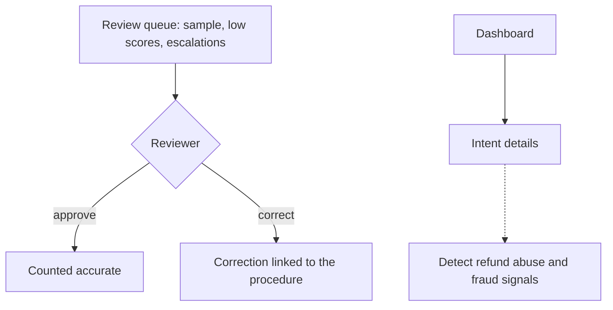

🏠 [Specs](../../../README.md) › 🧩 [Functional capabilities](../../README.md) ›
🎧 [F16 Customer support agents](../README.md) › 🔀 [Flows](README.md) › 🔀 FL-F16-03 Review and monitor

# 🔀 FL-F16-03 Review and monitor

**Status:** ✅ specified

## Summary

Covers UC-F16-04, UC-F16-05.

## Personas

See each use case.
- [U16 Office worker](../../../01-users/personas/u16-office-worker.md)
- [U02 Manager](../../../01-users/personas/u02-manager.md)

## Flowchart

## Sequence diagram

See each use case.

## Steps

| Step | Persona | Screen | Use case | What happens |
|---|---|---|---|---|
| 1 | See [UC-F16-04](../use-cases/03-review-and-monitor/uc-f16-04-review-correct-and-escalate.md) | [S-F16-04](../screens/03-review-and-monitor/s-f16-04-review-queue.md) | [UC-F16-04](../use-cases/03-review-and-monitor/uc-f16-04-review-correct-and-escalate.md) | Review, correct and escalate |
| 2 | See [UC-F16-05](../use-cases/03-review-and-monitor/uc-f16-05-monitor-resolution-and-accuracy.md) | [S-F16-05](../screens/03-review-and-monitor/s-f16-05-support-dashboard.md) | [UC-F16-05](../use-cases/03-review-and-monitor/uc-f16-05-monitor-resolution-and-accuracy.md) | Monitor resolution and accuracy |
| 4 | U16, U02 | [S-F16-13](../screens/03-review-and-monitor/s-f16-13-fraud-signals.md) | [UC-F16-15](../use-cases/03-review-and-monitor/uc-f16-15-detect-refund-abuse-and-fraud-signals.md) | Detect refund abuse and fraud signals |

### Entities and screens

| Entity | States in this flow | Shown at step and screen | Aggregated view |
|---|---|---|---|
| [E-F16-03 Resolution review](../data/e-f16-03-resolution-review.md) | Active | 1 [S-F16-04](../screens/03-review-and-monitor/s-f16-04-review-queue.md); 2 [S-F16-05](../screens/03-review-and-monitor/s-f16-05-support-dashboard.md) | Resolution reviews |
| [E-F16-02 Intent](../data/e-f16-02-intent.md) | New, Accepted | 2 [S-F16-05](../screens/03-review-and-monitor/s-f16-05-support-dashboard.md) | Intents |
| [E-F16-11 Fraud signal](../data/e-f16-11-fraud-signal.md) | Raised, Cleared, Confirmed | 4 [S-F16-13](../screens/03-review-and-monitor/s-f16-13-fraud-signals.md) | Fraud signals |

## Errors

As each use case.

## Images

Every step and error, for each persona taking part, in light and dark mode (D120). Steps are numbered as in the Steps
table; E rows are the error cases.

| Step | Persona | Device | Light | Dark |
|---|---|---|---|---|
| 1 | U16 | desktop | [light](../images/03-review-and-monitor/u16-office-worker/1-review-queue-desktop-light.png) | [dark](../images/03-review-and-monitor/u16-office-worker/1-review-queue-desktop-dark.png) |
| 1 | U16 | phone | [light](../images/03-review-and-monitor/u16-office-worker/1-review-queue-phone-light.png) | [dark](../images/03-review-and-monitor/u16-office-worker/1-review-queue-phone-dark.png) |
| 2 | U13 | desktop | [light](../images/03-review-and-monitor/u13-owner/2-dashboard-desktop-light.png) | [dark](../images/03-review-and-monitor/u13-owner/2-dashboard-desktop-dark.png) |
| E1 | U02 | desktop | [light](../images/03-review-and-monitor/u02-manager/e1-fallback-desktop-light.png) | [dark](../images/03-review-and-monitor/u02-manager/e1-fallback-desktop-dark.png) |
| E1 | U02 | phone | [light](../images/03-review-and-monitor/u02-manager/e1-fallback-phone-light.png) | [dark](../images/03-review-and-monitor/u02-manager/e1-fallback-phone-dark.png) |
| 4 | U16 | desktop | [light](../images/03-review-and-monitor/u16-office-worker/4-fraud-signals-desktop-light.png) | [dark](../images/03-review-and-monitor/u16-office-worker/4-fraud-signals-desktop-dark.png) |
| 4 | U16 | phone | [light](../images/03-review-and-monitor/u16-office-worker/4-fraud-signals-phone-light.png) | [dark](../images/03-review-and-monitor/u16-office-worker/4-fraud-signals-phone-dark.png) |
| 4 | U02 | desktop | [light](../images/03-review-and-monitor/u02-manager/4-fraud-signals-desktop-light.png) | [dark](../images/03-review-and-monitor/u02-manager/4-fraud-signals-desktop-dark.png) |
| 4 | U02 | phone | [light](../images/03-review-and-monitor/u02-manager/4-fraud-signals-phone-light.png) | [dark](../images/03-review-and-monitor/u02-manager/4-fraud-signals-phone-dark.png) |

## Open questions

None.

---

⬅️ [FL-F16-02 Automate an intent](fl-f16-02-automate-an-intent.md) · ⬆️ [Up](README.md) ·
➡️ [FL-F16-04 Human agent workspace](fl-f16-04-human-agent-workspace.md)
