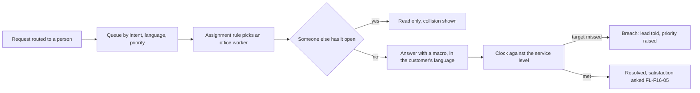
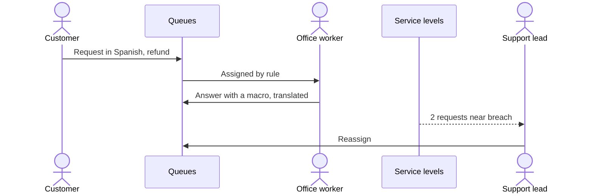

🏠 [Specs](../../../README.md) › 🧩 [Functional capabilities](../../README.md) ›
🎧 [F16 Customer support agents](../README.md) › 🔀 [Flows](README.md) › 🔀 FL-F16-04 Human agent workspace

# 🔀 FL-F16-04 Human agent workspace

**Status:** 🔄 waiting for the owner

## Summary

Requests the agents do not resolve reach people through queues with assignment rules and service-level targets; office
workers answer with macros in the customer's language, never two on the same request at once (D473).

## Personas

- [U16 Office worker](../../../01-users/personas/u16-office-worker.md)
- [U02 Manager](../../../01-users/personas/u02-manager.md)
- [U09 Customer](../../../01-users/personas/u09-customer.md)

## Flowchart

## Sequence diagram

## Steps

| Step | Persona | Screen | Use case | What happens |
|---|---|---|---|---|
| 1 | U02 | [S-F16-07](../screens/04-human-agent-workspace/s-f16-07-service-levels.md) | [UC-F16-07](../use-cases/04-human-agent-workspace/uc-f16-07-set-service-levels-and-follow-targets.md) | Set service levels and follow targets |
| 2 | U16, U02 | [S-F16-08](../screens/04-human-agent-workspace/s-f16-08-agent-workspace.md) | [UC-F16-08](../use-cases/04-human-agent-workspace/uc-f16-08-work-requests-in-the-agent-workspace.md) | Support requests in the agent workspace |
| 3 | U09, U16 | [S-F16-08](../screens/04-human-agent-workspace/s-f16-08-agent-workspace.md) | [UC-F16-11](../use-cases/04-human-agent-workspace/uc-f16-11-handle-a-request-in-the-customers-language.md) | Handle a request in the customer's language |

### Entities and screens

| Entity | States in this flow | Shown at step and screen | Aggregated view |
|---|---|---|---|
| [E-F16-01 Customer request](../data/e-f16-01-customer-request.md) | New, In progress, Resolved, Waiting, Escalated | 1 [S-F16-07](../screens/04-human-agent-workspace/s-f16-07-service-levels.md); 2, 3 [S-F16-08](../screens/04-human-agent-workspace/s-f16-08-agent-workspace.md) | Customer requests |
| [E-F16-06 Queue](../data/e-f16-06-queue.md) | Open, Paused | 2, 3 [S-F16-08](../screens/04-human-agent-workspace/s-f16-08-agent-workspace.md) | Queues |
| [E-F16-02 Intent](../data/e-f16-02-intent.md) | New, Accepted | Shown elsewhere: [S-F16-03 Intent rollout](../screens/02-automate-an-intent/s-f16-03-intent-rollout.md) | Intents |
| [E-F16-07 Macro](../data/e-f16-07-macro.md) | Active, Archived | 2, 3 [S-F16-08](../screens/04-human-agent-workspace/s-f16-08-agent-workspace.md) | Macros |
| [E-SC14-05 Service level](../../../08-sectors/sc14-it-and-software/data/e-sc14-05-service-level.md) | Active | Shown elsewhere: [S-SC14-05 Support levels](../../../08-sectors/sc14-it-and-software/screens/03-support-and-services/s-sc14-05-support-levels.md) | Service levels |
| [E-F16-05 Service-level policy](../data/e-f16-05-service-level-policy.md) | Active, Changed, Retired | 1 [S-F16-07](../screens/04-human-agent-workspace/s-f16-07-service-levels.md); 2, 3 [S-F16-08](../screens/04-human-agent-workspace/s-f16-08-agent-workspace.md) | Service-level policies |
| [E-F16-08 Satisfaction rating](../data/e-f16-08-satisfaction-rating.md) | Asked | Shown elsewhere: [S-F16-09 Satisfaction survey](../screens/05-customer-side/s-f16-09-satisfaction-survey.md) | Satisfaction ratings |
| [E-F20-01 Support request](../../f20-hosted-support-assistant/data/e-f20-01-support-request.md) | Active | Shown elsewhere: [S-F20-01 Support chat](../../f20-hosted-support-assistant/screens/01-talk-it-through/s-f20-01-support-chat.md) | Support requests |

## Errors

E1: a target is missed: the request is marked breached, its priority raised and the lead told; the flow resumes at step
2. E2: two people open the same request: the second sees it read-only (BR-F16-06). E3: the customer's language has no
translation available: the answer goes in the company's language with an apology line (Proposed).

## Images

Every step and error, for each persona taking part, in light and dark mode (D120). Steps are numbered as in the Steps
table; E rows are the error cases.

| Step | Persona | Device | Light | Dark |
|---|---|---|---|---|
| 1 | U02 | desktop | [light](../images/04-human-agent-workspace/u02-manager/1-service-levels-desktop-light.png) | [dark](../images/04-human-agent-workspace/u02-manager/1-service-levels-desktop-dark.png) |
| 1 | U02 | phone | [light](../images/04-human-agent-workspace/u02-manager/1-service-levels-phone-light.png) | [dark](../images/04-human-agent-workspace/u02-manager/1-service-levels-phone-dark.png) |
| 2 | U16 | desktop | [light](../images/04-human-agent-workspace/u16-office-worker/2-agent-workspace-desktop-light.png) | [dark](../images/04-human-agent-workspace/u16-office-worker/2-agent-workspace-desktop-dark.png) |
| 2 | U16 | phone | [light](../images/04-human-agent-workspace/u16-office-worker/2-agent-workspace-phone-light.png) | [dark](../images/04-human-agent-workspace/u16-office-worker/2-agent-workspace-phone-dark.png) |
| 2 | U02 | desktop | [light](../images/04-human-agent-workspace/u02-manager/2-agent-workspace-desktop-light.png) | [dark](../images/04-human-agent-workspace/u02-manager/2-agent-workspace-desktop-dark.png) |
| 2 | U02 | phone | [light](../images/04-human-agent-workspace/u02-manager/2-agent-workspace-phone-light.png) | [dark](../images/04-human-agent-workspace/u02-manager/2-agent-workspace-phone-dark.png) |
| 3 | U09 | phone | [light](../images/04-human-agent-workspace/u09-customer/3-agent-workspace-phone-light.png) | [dark](../images/04-human-agent-workspace/u09-customer/3-agent-workspace-phone-dark.png) |
| 3 | U16 | desktop | [light](../images/04-human-agent-workspace/u16-office-worker/3-agent-workspace-desktop-light.png) | [dark](../images/04-human-agent-workspace/u16-office-worker/3-agent-workspace-desktop-dark.png) |
| 3 | U16 | phone | [light](../images/04-human-agent-workspace/u16-office-worker/3-agent-workspace-phone-light.png) | [dark](../images/04-human-agent-workspace/u16-office-worker/3-agent-workspace-phone-dark.png) |
| E1 | U02 | desktop | [light](../images/04-human-agent-workspace/u02-manager/e1-service-levels-refused-desktop-light.png) | [dark](../images/04-human-agent-workspace/u02-manager/e1-service-levels-refused-desktop-dark.png) |
| E1 | U02 | phone | [light](../images/04-human-agent-workspace/u02-manager/e1-service-levels-refused-phone-light.png) | [dark](../images/04-human-agent-workspace/u02-manager/e1-service-levels-refused-phone-dark.png) |

## Open questions

None.

---

⬅️ [FL-F16-03 Review and monitor](fl-f16-03-review-and-monitor.md) · ⬆️ [Up](README.md) ·
➡️ [FL-F16-05 Customer side](fl-f16-05-customer-side.md)
