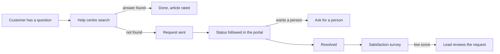
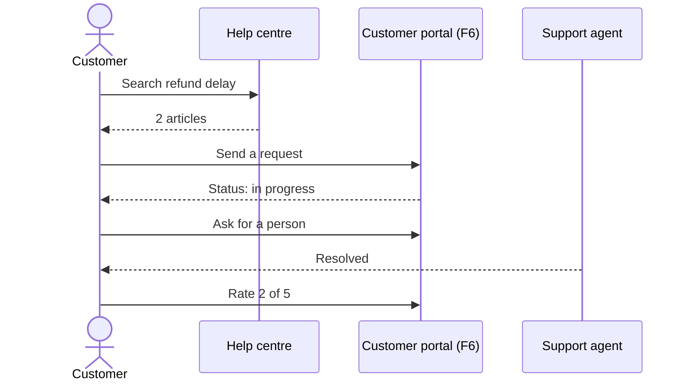

🏠 [Specs](../../../README.md) › 🧩 [Functional capabilities](../../README.md) ›
🎧 [F16 Customer support agents](../README.md) › 🔀 [Flows](README.md) › 🔀 FL-F16-05 Customer side

# 🔀 FL-F16-05 Customer side

**Status:** ✅ specified

## Summary

What the customer sees and does: find an answer in the public help centre, follow the status of a request, ask for a
person at any time, and rate the answer (D473).

## Personas

- [U09 Customer](../../../01-users/personas/u09-customer.md)
- [U02 Manager](../../../01-users/personas/u02-manager.md)
- [U16 Office worker](../../../01-users/personas/u16-office-worker.md)

## Flowchart

## Sequence diagram

## Steps

| Step | Persona | Screen | Use case | What happens |
|---|---|---|---|---|
| 1 | U02, U09 | [S-F16-10](../screens/05-customer-side/s-f16-10-help-centre.md) | [UC-F16-10](../use-cases/05-customer-side/uc-f16-10-publish-the-help-centre.md) | Publish the help centre |
| 2 | U09 | [S-F16-11](../screens/05-customer-side/s-f16-11-my-requests.md) | [UC-F16-12](../use-cases/05-customer-side/uc-f16-12-follow-a-requests-status.md) | Follow a request's status |
| 3 | U09, U16 | [S-F16-11](../screens/05-customer-side/s-f16-11-my-requests.md) | [UC-F16-13](../use-cases/05-customer-side/uc-f16-13-ask-for-a-person.md) | Ask for a person |
| 4 | U09, U02 | [S-F16-09](../screens/05-customer-side/s-f16-09-satisfaction-survey.md) | [UC-F16-09](../use-cases/05-customer-side/uc-f16-09-rate-the-answer-and-measure-satisfaction.md) | Rate the answer and measure satisfaction |

### Entities and screens

| Entity | States in this flow | Shown at step and screen | Aggregated view |
|---|---|---|---|
| [E-F16-09 Help-centre article](../data/e-f16-09-help-centre-article.md) | Draft, Published, Archived | 1 [S-F16-10](../screens/05-customer-side/s-f16-10-help-centre.md) | Help-centre articles |
| [E-F16-01 Customer request](../data/e-f16-01-customer-request.md) | New, In progress, Resolved, Waiting, Escalated | 2, 3 [S-F16-11](../screens/05-customer-side/s-f16-11-my-requests.md); 4 [S-F16-09](../screens/05-customer-side/s-f16-09-satisfaction-survey.md) | Customer requests |
| [E-F1-17 Portal account](../../f01-administration/data/e-f01-17-portal-account.md) | Invited, Active, Blocked, Deactivated | Shown elsewhere: [S-F1-19 Portal accounts](../../f01-administration/screens/12-portal-accounts-and-integrations/s-f01-19-portal-accounts.md) | Portal accounts |
| [E-SC03-13 Satisfaction survey](../../../08-sectors/sc03-services/data/e-sc03-13-satisfaction-survey.md) | Sent | Shown elsewhere: [S-SC03-12 Satisfaction](../../../08-sectors/sc03-services/screens/05-client-and-people/s-sc03-12-satisfaction.md) | Satisfaction surveys |
| [E-F16-08 Satisfaction rating](../data/e-f16-08-satisfaction-rating.md) | Asked, Expired | 4 [S-F16-09](../screens/05-customer-side/s-f16-09-satisfaction-survey.md) | Satisfaction ratings |

## Errors

E1: the help centre has no article for the search: the request form opens with the search text (step 2). E2: the survey
link has expired: the customer is told and nothing is recorded (step 4).

## Images

Every step and error, for each persona taking part, in light and dark mode (D120). Steps are numbered as in the Steps
table; E rows are the error cases.

| Step | Persona | Device | Light | Dark |
|---|---|---|---|---|
| 1 | U02 | desktop | [light](../images/05-customer-side/u02-manager/1-help-centre-desktop-light.png) | [dark](../images/05-customer-side/u02-manager/1-help-centre-desktop-dark.png) |
| 1 | U02 | phone | [light](../images/05-customer-side/u02-manager/1-help-centre-phone-light.png) | [dark](../images/05-customer-side/u02-manager/1-help-centre-phone-dark.png) |
| 1 | U09 | phone | [light](../images/05-customer-side/u09-customer/1-help-centre-phone-light.png) | [dark](../images/05-customer-side/u09-customer/1-help-centre-phone-dark.png) |
| 2 | U09 | phone | [light](../images/05-customer-side/u09-customer/2-my-requests-phone-light.png) | [dark](../images/05-customer-side/u09-customer/2-my-requests-phone-dark.png) |
| 3 | U09 | phone | [light](../images/05-customer-side/u09-customer/3-my-requests-phone-light.png) | [dark](../images/05-customer-side/u09-customer/3-my-requests-phone-dark.png) |
| 3 | U16 | desktop | [light](../images/05-customer-side/u16-office-worker/3-my-requests-desktop-light.png) | [dark](../images/05-customer-side/u16-office-worker/3-my-requests-desktop-dark.png) |
| 3 | U16 | phone | [light](../images/05-customer-side/u16-office-worker/3-my-requests-phone-light.png) | [dark](../images/05-customer-side/u16-office-worker/3-my-requests-phone-dark.png) |
| 4 | U09 | phone | [light](../images/05-customer-side/u09-customer/4-satisfaction-survey-phone-light.png) | [dark](../images/05-customer-side/u09-customer/4-satisfaction-survey-phone-dark.png) |
| 4 | U02 | desktop | [light](../images/05-customer-side/u02-manager/4-satisfaction-survey-desktop-light.png) | [dark](../images/05-customer-side/u02-manager/4-satisfaction-survey-desktop-dark.png) |
| 4 | U02 | phone | [light](../images/05-customer-side/u02-manager/4-satisfaction-survey-phone-light.png) | [dark](../images/05-customer-side/u02-manager/4-satisfaction-survey-phone-dark.png) |
| E1 | U02 | desktop | [light](../images/05-customer-side/u02-manager/e1-help-centre-refused-desktop-light.png) | [dark](../images/05-customer-side/u02-manager/e1-help-centre-refused-desktop-dark.png) |
| E1 | U02 | phone | [light](../images/05-customer-side/u02-manager/e1-help-centre-refused-phone-light.png) | [dark](../images/05-customer-side/u02-manager/e1-help-centre-refused-phone-dark.png) |

## Open questions

None.

---

⬅️ [FL-F16-04 Human agent workspace](fl-f16-04-human-agent-workspace.md) · ⬆️ [Up](README.md) ·
➡️ [FL-F16-06 Take in every request](fl-f16-06-take-in-every-request.md)
