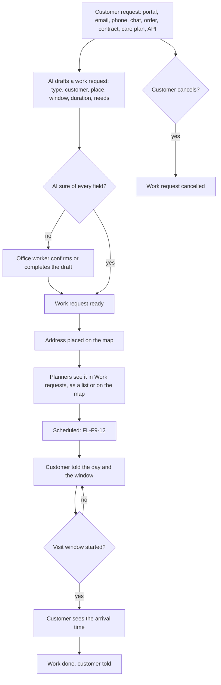
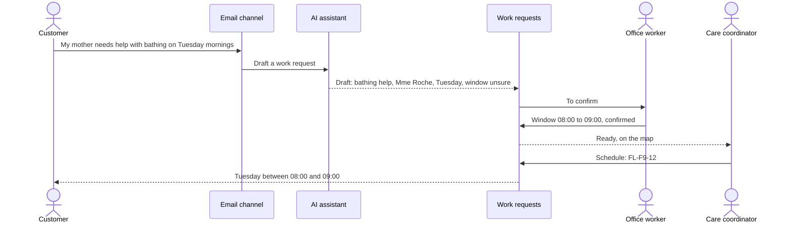

🏠 [Specs](../../../README.md) › 🧩 [Functional capabilities](../../README.md) ›
🎧 [F16 Customer support agents](../README.md) › 🔀 [Flows](README.md) › 🔀 FL-F16-06 Take in every request

# 🔀 FL-F16-06 Take in every request

**Status:** ✅ specified

## Summary

Every customer request, whatever its type and channel, becomes one schedulable work request: service and
interventions, orders to fulfil and deliver, projects and engagements, bookings and appointments. It arrives by the
portal, email, phone, chat, an order, a contract, a care plan or the API. The AI drafts the work request from the free
text; a person confirms it when the AI is unsure of a field. Planners then see every work request, its state, place and
window, and schedule it ([FL-F9-12](../../f09-hr-and-projects/flows/fl-f09-12-schedule-customer-requests.md)). The
customer follows their request, and during the visit's window sees the arrival time.

## Personas

- [U09 Customer](../../../01-users/personas/u09-customer.md)
- [U16 Office worker](../../../01-users/personas/u16-office-worker.md), who confirms the drafts the AI is unsure of
- [U29 Dispatcher](../../../01-users/personas/u29-dispatcher.md) and
  [U25 Care coordinator](../../../01-users/personas/u25-care-coordinator.md), as planners (D517)
- [U02 Manager](../../../01-users/personas/u02-manager.md)

## Flowchart

## Sequence diagram

## Steps

| Step | Persona | Screen | Use case | What happens |
|---|---|---|---|---|
| 1 | [U09](../../../01-users/personas/u09-customer.md) | [S-F16-11](../screens/05-customer-side/s-f16-11-my-requests.md) | [UC-F16-16](../use-cases/06-take-in-every-request/uc-f16-16-turn-any-request-into-a-work-request.md) | The customer sends a request on any channel; the portal is one of them |
| 2 | [U16](../../../01-users/personas/u16-office-worker.md) | [S-F16-14](../screens/06-take-in-every-request/s-f16-14-work-requests.md) | [UC-F16-16](../use-cases/06-take-in-every-request/uc-f16-16-turn-any-request-into-a-work-request.md) | The AI drafts the work request; the office worker confirms the drafts marked "to confirm" |
| 3 | [U29](../../../01-users/personas/u29-dispatcher.md) | [S-F16-14](../screens/06-take-in-every-request/s-f16-14-work-requests.md) | [UC-F16-16](../use-cases/06-take-in-every-request/uc-f16-16-turn-any-request-into-a-work-request.md) | The planner sees every ready work request, as a list or on the map, and schedules it (FL-F9-12) |
| 4 | [U02](../../../01-users/personas/u02-manager.md) | [S-F16-14](../screens/06-take-in-every-request/s-f16-14-work-requests.md) | [UC-F16-16](../use-cases/06-take-in-every-request/uc-f16-16-turn-any-request-into-a-work-request.md) | The manager follows the incoming work by state, type and area |
| 5 | [U09](../../../01-users/personas/u09-customer.md) | [S-F16-15](../screens/06-take-in-every-request/s-f16-15-arrival-of-your-visit.md) | [UC-F16-17](../use-cases/06-take-in-every-request/uc-f16-17-follow-the-arrival-of-a-visit.md) | The customer sees the day and the window, then the arrival time during the window |

### Entities and screens

| Entity | States in this flow | Shown at step and screen | Aggregated view |
|---|---|---|---|
| [E-F16-01 Customer request](../data/e-f16-01-customer-request.md) | New, in progress, resolved | 1 [S-F16-11](../screens/05-customer-side/s-f16-11-my-requests.md) | Customer requests |
| [E-F16-12 Work request](../data/e-f16-12-work-request.md) | Drafted, To confirm, Ready, Scheduled, In progress, Done, Cancelled | 2, 3, 4 [S-F16-14](../screens/06-take-in-every-request/s-f16-14-work-requests.md); 5 [S-F16-15](../screens/06-take-in-every-request/s-f16-15-arrival-of-your-visit.md) | Work requests |
| [E-F2-25 Request type](../../f02-no-code-configuration/data/e-f02-25-request-type.md) | Published (read only here) | 2, 3 [S-F16-14](../screens/06-take-in-every-request/s-f16-14-work-requests.md) | Request types |
| [E-F9-32 Live position](../../f09-hr-and-projects/data/e-f09-32-live-position.md) | Sharing (an arrival time only) | 5 [S-F16-15](../screens/06-take-in-every-request/s-f16-15-arrival-of-your-visit.md) | Live positions |
| [E-SC04-03 Care plan](../../../08-sectors/sc04-home-care/data/e-sc04-03-care-plan.md) | Active | Shown elsewhere: [S-SC04-02 Care plan](../../../08-sectors/sc04-home-care/screens/01-take-on-a-recipient/s-sc04-02-care-plan.md) | Care plans |

## Errors

- **E1 The AI cannot tell the request type.** The draft goes to "to confirm" with the types it hesitated between; the
  office worker chooses (step 2).
- **E2 The address cannot be placed.** Geocoding finds no place or several
  ([REQ-T13-02](../../../03-technical/t13-maps-and-geodata/requirements/req-t13-02-geocoding.md)): the work request
  stays "to confirm" with the candidates, and is shown in the list but not on the map (step 2).
- **E3 The same request arrives twice.** An email and a phone call for the same visit: the AI links the second to the
  first draft and asks the office worker to merge, step 2.
- **E4 The arrival link has expired.** After the visit, or outside its window: the customer sees the visit's state only,
  never a time or a place (step 5).

## Images

Every step and error, for each persona taking part, in light and dark mode (D120). Steps are numbered as in the Steps
table; E rows are the error cases.

| Step | Persona | Device | Light | Dark |
|---|---|---|---|---|
| 1 | U09 | phone | [light](../images/06-take-in-every-request/u09-customer/1-my-requests-phone-light.png) | [dark](../images/06-take-in-every-request/u09-customer/1-my-requests-phone-dark.png) |
| 2 | U16 | desktop | [light](../images/06-take-in-every-request/u16-office-worker/2-work-requests-desktop-light.png) | [dark](../images/06-take-in-every-request/u16-office-worker/2-work-requests-desktop-dark.png) |
| 2 | U16 | phone | [light](../images/06-take-in-every-request/u16-office-worker/2-work-requests-phone-light.png) | [dark](../images/06-take-in-every-request/u16-office-worker/2-work-requests-phone-dark.png) |
| 3 | U29 | desktop | [light](../images/06-take-in-every-request/u29-dispatcher/3-work-requests-desktop-light.png) | [dark](../images/06-take-in-every-request/u29-dispatcher/3-work-requests-desktop-dark.png) |
| 3 | U29 | phone | [light](../images/06-take-in-every-request/u29-dispatcher/3-work-requests-phone-light.png) | [dark](../images/06-take-in-every-request/u29-dispatcher/3-work-requests-phone-dark.png) |
| 3 | U25 | desktop | [light](../images/06-take-in-every-request/u25-care-coordinator/3-work-requests-desktop-light.png) | [dark](../images/06-take-in-every-request/u25-care-coordinator/3-work-requests-desktop-dark.png) |
| 4 | U02 | desktop | [light](../images/06-take-in-every-request/u02-manager/4-work-requests-desktop-light.png) | [dark](../images/06-take-in-every-request/u02-manager/4-work-requests-desktop-dark.png) |
| 4 | U02 | phone | [light](../images/06-take-in-every-request/u02-manager/4-work-requests-phone-light.png) | [dark](../images/06-take-in-every-request/u02-manager/4-work-requests-phone-dark.png) |
| 5 | U09 | phone | [light](../images/06-take-in-every-request/u09-customer/5-arrival-of-your-visit-phone-light.png) | [dark](../images/06-take-in-every-request/u09-customer/5-arrival-of-your-visit-phone-dark.png) |
| E1 | U16 | desktop | [light](../images/06-take-in-every-request/u16-office-worker/e1-the-ai-cannot-tell-the-request-type-desktop-light.png) | [dark](../images/06-take-in-every-request/u16-office-worker/e1-the-ai-cannot-tell-the-request-type-desktop-dark.png) |
| E1 | U16 | phone | [light](../images/06-take-in-every-request/u16-office-worker/e1-the-ai-cannot-tell-the-request-type-phone-light.png) | [dark](../images/06-take-in-every-request/u16-office-worker/e1-the-ai-cannot-tell-the-request-type-phone-dark.png) |
| E2 | U16 | desktop | [light](../images/06-take-in-every-request/u16-office-worker/e2-the-address-cannot-be-placed-desktop-light.png) | [dark](../images/06-take-in-every-request/u16-office-worker/e2-the-address-cannot-be-placed-desktop-dark.png) |
| E2 | U16 | phone | [light](../images/06-take-in-every-request/u16-office-worker/e2-the-address-cannot-be-placed-phone-light.png) | [dark](../images/06-take-in-every-request/u16-office-worker/e2-the-address-cannot-be-placed-phone-dark.png) |
| E3 | U16 | desktop | [light](../images/06-take-in-every-request/u16-office-worker/e3-the-same-request-arrives-twice-desktop-light.png) | [dark](../images/06-take-in-every-request/u16-office-worker/e3-the-same-request-arrives-twice-desktop-dark.png) |
| E3 | U16 | phone | [light](../images/06-take-in-every-request/u16-office-worker/e3-the-same-request-arrives-twice-phone-light.png) | [dark](../images/06-take-in-every-request/u16-office-worker/e3-the-same-request-arrives-twice-phone-dark.png) |
| E4 | U09 | phone | [light](../images/06-take-in-every-request/u09-customer/e4-the-arrival-link-has-expired-phone-light.png) | [dark](../images/06-take-in-every-request/u09-customer/e4-the-arrival-link-has-expired-phone-dark.png) |

## Open questions

None.

---

⬅️ [FL-F16-05 Customer side](fl-f16-05-customer-side.md) · ⬆️ [Up](README.md) ·
➡️ [FL-F16-07 Forum, live chat, voice and support contracts](fl-f16-07-live-chat-voice-and-contracts.md)
