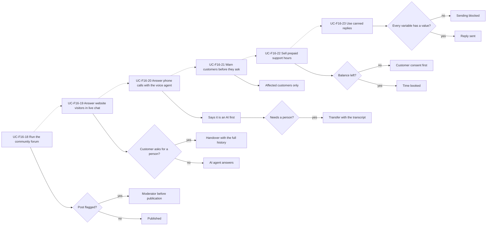
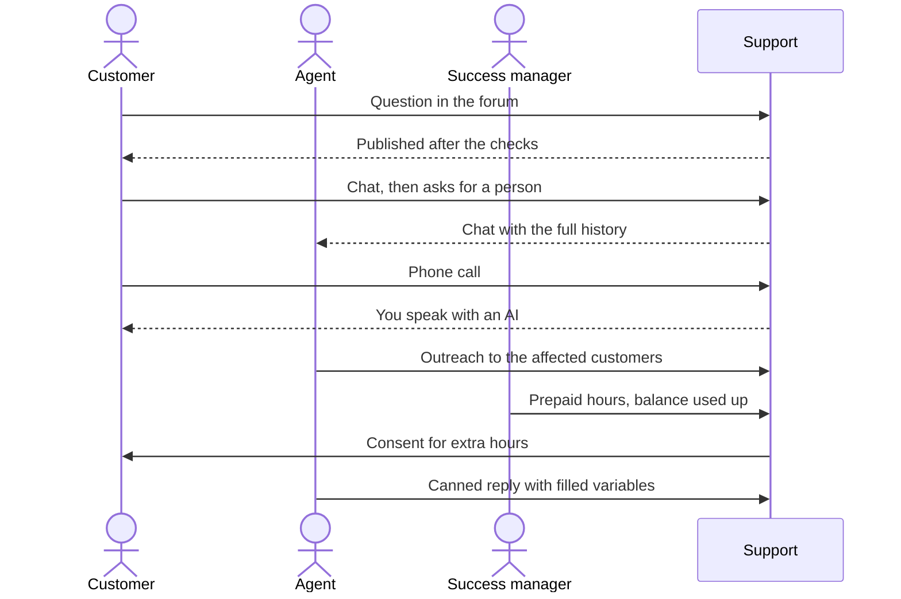

🏠 [Specs](../../../README.md) › 🧩 [Functional capabilities](../../README.md) ›
🎧 [F16 Customer support agents](../README.md) › 🔀 [Flows](README.md) ›
🔀 FL-F16-07 Forum, live chat, voice and support contracts

# 🔀 FL-F16-07 Forum, live chat, voice and support contracts

**Status:** ✅ specified

## Summary

Customers help each other in a moderated forum, chat with the AI agent and reach a person with the full history, and
call a voice agent that says it is an AI. Support warns the customers a known cause affects, sells prepaid support hours
that need consent beyond the balance, and answers with canned replies whose variables come from the records
([D535](../../../06-decisions/f16-customer-support-agents/d535-benchmark-gaps-f16-customer-support-agents.md)).

## Personas

- [U09 Customer](../../../01-users/personas/u09-customer.md), who asks, chats, calls and reads their balance
- [U16 Office worker](../../../01-users/personas/u16-office-worker.md), who moderates, answers and warns
- [U41 Customer success manager](../../../01-users/personas/u41-customer-success-manager.md), who sells the support
  hours

## Flowchart

## Sequence diagram

## Steps

| Step | Persona | Screen | Use case | What happens |
|---|---|---|---|---|
| 1 | [U09](../../../01-users/personas/u09-customer.md) | [S-F16-16](../screens/07-live-chat-voice-and-contracts/s-f16-16-forum.md) | [UC-F16-18](../use-cases/07-live-chat-voice-and-contracts/uc-f16-18-run-the-community-forum.md) | A customer posts in the forum and a moderator publishes what the checks held |
| 2 | [U16](../../../01-users/personas/u16-office-worker.md) | [S-F16-17](../screens/07-live-chat-voice-and-contracts/s-f16-17-live-chat.md) | [UC-F16-19](../use-cases/07-live-chat-voice-and-contracts/uc-f16-19-answer-website-visitors-in-live-chat.md) | A visitor chats with the AI agent, who hands over to an agent with the full history |
| 3 | [U09](../../../01-users/personas/u09-customer.md) | [S-F16-18](../screens/07-live-chat-voice-and-contracts/s-f16-18-voice-agent.md) | [UC-F16-20](../use-cases/07-live-chat-voice-and-contracts/uc-f16-20-answer-phone-calls-with-the-voice-agent.md) | A caller reaches the voice agent, who says it is an AI and transfers on request |
| 4 | [U16](../../../01-users/personas/u16-office-worker.md) | [S-F16-19](../screens/07-live-chat-voice-and-contracts/s-f16-19-proactive-outreach.md) | [UC-F16-21](../use-cases/07-live-chat-voice-and-contracts/uc-f16-21-warn-customers-before-they-ask.md) | Support selects the customers a known cause affects and warns only them |
| 5 | [U41](../../../01-users/personas/u41-customer-success-manager.md) | [S-F16-20](../screens/07-live-chat-voice-and-contracts/s-f16-20-support-contracts.md) | [UC-F16-22](../use-cases/07-live-chat-voice-and-contracts/uc-f16-22-sell-prepaid-support-hours.md) | The success manager sells prepaid hours and the customer's consent is asked beyond the balance |
| 6 | [U16](../../../01-users/personas/u16-office-worker.md) | [S-F16-21](../screens/07-live-chat-voice-and-contracts/s-f16-21-canned-replies.md) | [UC-F16-23](../use-cases/07-live-chat-voice-and-contracts/uc-f16-23-use-canned-replies.md) | An agent sends a canned reply whose variables come from the request |

### Entities and screens

| Entity | States in this flow | Shown at step and screen | Aggregated view |
|---|---|---|---|
| [E-F16-13 Forum post](../data/e-f16-13-forum-post.md) | Submitted, Published, Flagged, Removed, Hidden | 1 [S-F16-16](../screens/07-live-chat-voice-and-contracts/s-f16-16-forum.md) | Forum posts |
| [E-F16-14 Chat session](../data/e-f16-14-chat-session.md) | With AI, Waiting, With agent, Closed, Missed | 2 [S-F16-17](../screens/07-live-chat-voice-and-contracts/s-f16-17-live-chat.md) | Chat sessions |
| [E-F16-15 Outreach](../data/e-f16-15-outreach.md) | Draft, Approved, Sent, Cancelled, Closed | 4 [S-F16-19](../screens/07-live-chat-voice-and-contracts/s-f16-19-proactive-outreach.md) | Outreaches |
| [E-F16-16 Support contract](../data/e-f16-16-support-contract.md) | Offered, Active, Used up, Expired, Cancelled | 5 [S-F16-20](../screens/07-live-chat-voice-and-contracts/s-f16-20-support-contracts.md) | Support contracts |
| [E-F16-07 Macro](../data/e-f16-07-macro.md) | Active, Archived | 6 [S-F16-21](../screens/07-live-chat-voice-and-contracts/s-f16-21-canned-replies.md) | Canned replies |

## Errors

- **E1 The balance is used up.** No further hour is booked until the customer consents to a stated number of extra hours
  ([BR-F16-18](../business-rules/br-f16-18-work-beyond-the-prepaid-balance-needs-consent.md), step 5).

## Images

Every step and error, for each persona taking part, in light and dark mode (D120). Steps are numbered as in the Steps
table; E rows are the error cases.

| Step | Persona | Device | Light | Dark |
|---|---|---|---|---|
| 1 | U09 | phone | [light](../images/07-live-chat-voice-and-contracts/u09-customer/1-forum-phone-light.png) | [dark](../images/07-live-chat-voice-and-contracts/u09-customer/1-forum-phone-dark.png) |
| 1 | U16 | desktop | [light](../images/07-live-chat-voice-and-contracts/u16-office-worker/1-forum-desktop-light.png) | [dark](../images/07-live-chat-voice-and-contracts/u16-office-worker/1-forum-desktop-dark.png) |
| 2 | U16 | desktop | [light](../images/07-live-chat-voice-and-contracts/u16-office-worker/2-live-chat-desktop-light.png) | [dark](../images/07-live-chat-voice-and-contracts/u16-office-worker/2-live-chat-desktop-dark.png) |
| 2 | U09 | phone | [light](../images/07-live-chat-voice-and-contracts/u09-customer/2-live-chat-phone-light.png) | [dark](../images/07-live-chat-voice-and-contracts/u09-customer/2-live-chat-phone-dark.png) |
| 2 | U16 | phone | [light](../images/07-live-chat-voice-and-contracts/u16-office-worker/2-live-chat-phone-light.png) | [dark](../images/07-live-chat-voice-and-contracts/u16-office-worker/2-live-chat-phone-dark.png) |
| 3 | U09 | phone | [light](../images/07-live-chat-voice-and-contracts/u09-customer/3-voice-agent-phone-light.png) | [dark](../images/07-live-chat-voice-and-contracts/u09-customer/3-voice-agent-phone-dark.png) |
| 3 | U16 | desktop | [light](../images/07-live-chat-voice-and-contracts/u16-office-worker/3-voice-agent-desktop-light.png) | [dark](../images/07-live-chat-voice-and-contracts/u16-office-worker/3-voice-agent-desktop-dark.png) |
| 4 | U16 | desktop | [light](../images/07-live-chat-voice-and-contracts/u16-office-worker/4-proactive-outreach-desktop-light.png) | [dark](../images/07-live-chat-voice-and-contracts/u16-office-worker/4-proactive-outreach-desktop-dark.png) |
| 4 | U16 | phone | [light](../images/07-live-chat-voice-and-contracts/u16-office-worker/4-proactive-outreach-phone-light.png) | [dark](../images/07-live-chat-voice-and-contracts/u16-office-worker/4-proactive-outreach-phone-dark.png) |
| 5 | U41 | desktop | [light](../images/07-live-chat-voice-and-contracts/u41-customer-success-manager/5-support-contracts-desktop-light.png) | [dark](../images/07-live-chat-voice-and-contracts/u41-customer-success-manager/5-support-contracts-desktop-dark.png) |
| 5 | U09 | phone | [light](../images/07-live-chat-voice-and-contracts/u09-customer/5-support-contracts-phone-light.png) | [dark](../images/07-live-chat-voice-and-contracts/u09-customer/5-support-contracts-phone-dark.png) |
| 5 | U41 | phone | [light](../images/07-live-chat-voice-and-contracts/u41-customer-success-manager/5-support-contracts-phone-light.png) | [dark](../images/07-live-chat-voice-and-contracts/u41-customer-success-manager/5-support-contracts-phone-dark.png) |
| 6 | U16 | desktop | [light](../images/07-live-chat-voice-and-contracts/u16-office-worker/6-canned-replies-desktop-light.png) | [dark](../images/07-live-chat-voice-and-contracts/u16-office-worker/6-canned-replies-desktop-dark.png) |
| 6 | U16 | phone | [light](../images/07-live-chat-voice-and-contracts/u16-office-worker/6-canned-replies-phone-light.png) | [dark](../images/07-live-chat-voice-and-contracts/u16-office-worker/6-canned-replies-phone-dark.png) |
| E1 | U09 | phone | [light](../images/07-live-chat-voice-and-contracts/u09-customer/e1-the-balance-is-used-up-phone-light.png) | [dark](../images/07-live-chat-voice-and-contracts/u09-customer/e1-the-balance-is-used-up-phone-dark.png) |

## Open questions

None.

---

⬅️ [FL-F16-06 Take in every request](fl-f16-06-take-in-every-request.md) · ⬆️ [Up](README.md)
