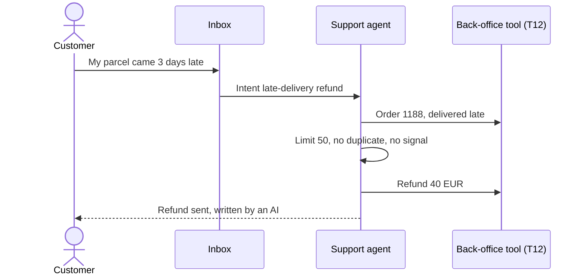

🏠 [Specs](../../../../README.md) › 🧩 [Functional capabilities](../../../README.md) ›
🎧 [F16 Customer support agents](../../README.md) › 📝 [Use cases](../README.md) ›
📝 [Use cases: FL-F16-01 Resolve a request](README.md) › 📝 UC-F16-01 Resolve a customer request automatically

# 📝 UC-F16-01 Resolve a customer request automatically

**Status:** ✅ specified

## Summary

A customer's request is classified into an intent and branch, the agent fetches the procedure and the customer's data,
checks limits, duplicates and fraud signals, acts and answers in the customer's language, or routes the request to a
person.

## Personas

- [U09 Customer](../../../../01-users/personas/u09-customer.md)
- [U16 Office worker](../../../../01-users/personas/u16-office-worker.md)

## Goal

The request resolved correctly at once, or handed to a person with everything needed.

## Trigger

A request by email, chat, voice, web form or the portal.

## Frequency

Hundreds a day in a busy shop.

## Preconditions

- The intent exists in automatic or shadow mode.

## Postconditions

- Success: the request resolved, the answer sent, actions logged.
- Failure: the request routed to a person with the reason.

## Main flow

1. A customer writes about a late delivery; the request arrives in the inbox (S-F16-01) or an outside helpdesk.
2. SimpleERP classifies it: intent "late-delivery refund", branch "delivered late".
3. The agent fetches the procedure and the customer's order (BR-F16-03).
4. It checks the refund limit (BR-F16-07), duplicates (BR-F16-08) and fraud signals (BR-F16-12), then refunds.
5. It answers in the customer's language, saying it is an AI (BR-F16-04, BR-F16-11), and resolves the request.

## Alternative flows

- 4a. Shadow mode: the agent drafts and dry-runs; a person sends.
- 4b. Above the limit or a fraud signal: the refund waits for a person (UC-F16-15).
- 5a. The customer asks for a person: UC-F16-13.

## Error flows

- 3e. A back-office tool fails: retries, then a person with the reason.
- 2e. No intent matches: routed to a human queue.
- Any step: a service does not answer; the call is retried first (BR-F3-32), then the message follows the error pattern
  (D122) and what was typed stays on the screen.

## Business rules

- [BR-F16-01 Automatic only above the bar](../../business-rules/br-f16-01-automatic-only-above-the-bar.md)
- [BR-F16-03 Agents act only as their procedure allows](../../business-rules/br-f16-03-agents-act-only-as-their-procedure-allows.md)
- [BR-F16-04 Customers know, and can reach a person](../../business-rules/br-f16-04-customers-know-and-can-reach-a-person.md)
- [BR-F16-07 Refund limits per intent](../../business-rules/br-f16-07-refund-limits-per-intent.md)
- [BR-F16-08 No duplicate action](../../business-rules/br-f16-08-no-duplicate-action.md)
- [BR-F16-12 Fraud signals stop automatic refunds](../../business-rules/br-f16-12-fraud-signals-stop-automatic-refunds.md)
- [BR-F16-11 Answers in the customer's language](../../business-rules/br-f16-11-answers-in-the-customers-language.md)

## Entities

- [E-F16-01 Customer request](../../data/e-f16-01-customer-request.md)
- [E-F16-08 Satisfaction rating](../../data/e-f16-08-satisfaction-rating.md)

## Permissions

Agents act within their intent (BR-F16-03); office workers take routed requests.

## Notifications

- The customer on the request's channel; office workers when escalated.

## Audit events

Classification, procedure version, data read, actions, answer, with the request.

## AI involvement

The agent follows the procedure only; it never acts outside the intent's allowed actions.

## API, MCP and A2A exposure

Connector actions (T12) through T5 and T6.

## Screens

- [S-F16-01 Request inbox](../../screens/01-resolve-a-request/s-f16-01-request-inbox.md)

## Flowchart

See [FL-F16-01 Resolve a request](../../flows/fl-f16-01-resolve-a-request.md#flowchart).

## Sequence diagram

## Acceptance criteria

1. **Given** order 1188 delivered 3 days late and a procedure refunding 40.00 EUR **when** the customer writes **then**
   40.00 EUR is refunded and the answer says it was written by an AI.
2. **Given** a refund of 180.00 EUR above a limit of 150.00 EUR **when** prepared **then** it waits for a person.
3. **Given** the same customer writes twice **when** the second arrives **then** no second refund is made.
4. **Given** the back-office tool down after retries **when** the agent acts **then** the request goes to a person with
   the reason.

## Non-functional notes

First answer within 2 minutes for automatic intents.

## Regulatory references

EU AI Act article 50 (customers told they deal with an AI, BR-F16-04); GDPR article 22 (a person on request); consumer
law for refunds and withdrawals.

## Related use cases

- [UC-F16-13 Ask for a person](../05-customer-side/uc-f16-13-ask-for-a-person.md)
- [UC-F16-15 Detect refund abuse and fraud signals](../03-review-and-monitor/uc-f16-15-detect-refund-abuse-and-fraud-signals.md)
- [UC-F16-09 Rate the answer and measure satisfaction](../05-customer-side/uc-f16-09-rate-the-answer-and-measure-satisfaction.md)
- [UC-F16-16 Turn any customer request into a work request](../06-take-in-every-request/uc-f16-16-turn-any-request-into-a-work-request.md)

## Open questions

None.

---

⬆️ [Up](README.md) · ➡️ [UC-F16-02](../02-automate-an-intent/uc-f16-02-write-and-test-a-procedure.md)
