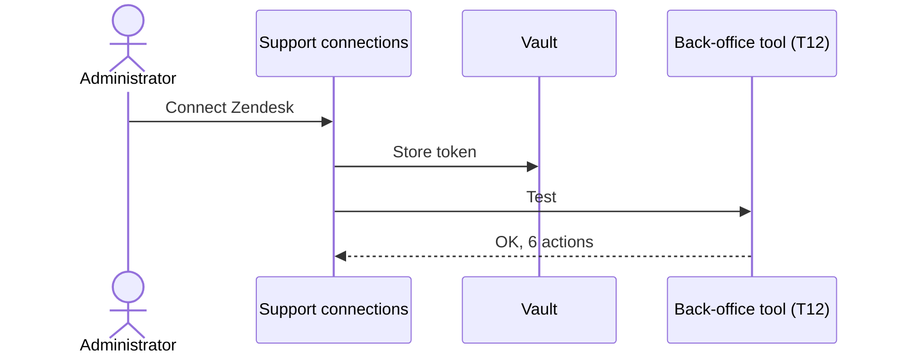

🏠 [Specs](../../../../README.md) › 🧩 [Functional capabilities](../../../README.md) ›
🎧 [F16 Customer support agents](../../README.md) › 📝 [Use cases](../README.md) ›
📝 [Use cases: FL-F16-01 Resolve a request](README.md) › 📝 UC-F16-06 Connect the helpdesk and back-office tools

# 📝 UC-F16-06 Connect the helpdesk and back-office tools

**Status:** ✅ specified

## Summary

The administrator connects outside helpdesks and the back-office tools the procedures need; credentials go to the vault
and each connection's actions become available to procedures.

## Personas

- [U07 Administrator](../../../../01-users/personas/u07-administrator.md)

## Goal

Agents can read and act in every tool the procedures name.

## Trigger

Setting up support; a new tool.

## Frequency

Rare.

## Preconditions

- Administrator role.

## Postconditions

- Success: connections working.
- Failure: the connection is not saved.

## Main flow

1. The administrator opens Support connections (S-F16-06).
2. They connect an outside helpdesk (Zendesk, Intercom, HubSpot, Freshdesk, Notion) or keep the built-in inbox.
3. They connect back-office tools, with or without an API (T12); credentials go to the vault (D240).
4. simple-ERP tests each connection and lists its actions.
5. The actions become available to procedures.

## Alternative flows

- 3a. A tool without an API: a connector is generated by the factory (REQ-T12-06) and reviewed.

## Error flows

- 4e. A login refused: the error message pattern.
- Any step: a service does not answer; the call is retried first (BR-F3-32), then the message follows the error pattern
  (D122) and what was typed stays on the screen.

## Business rules

- [BR-F16-03 Agents act only as their procedure allows](../../business-rules/br-f16-03-agents-act-only-as-their-procedure-allows.md)

## Entities

- [E-F16-04 Helpdesk connection](../../data/e-f16-04-helpdesk-connection.md)

## Permissions

Administrator.

## Notifications

- The administrator when a connection fails after retries.

## Audit events

Connections added, tested, removed.

## AI involvement

None.

## API, MCP and A2A exposure

Connector actions (T12) through T5 and T6.

## Screens

- [S-F16-06 Support connections](../../screens/01-resolve-a-request/s-f16-06-support-connections.md)

## Flowchart

See [FL-F16-01 Resolve a request](../../flows/fl-f16-01-resolve-a-request.md#flowchart).

## Sequence diagram

## Acceptance criteria

1. **Given** a valid Zendesk token **when** connected **then** its actions are listed.
2. **Given** a refused login **when** tested **then** the error message pattern shows.
3. **Given** a tool without an API **when** added **then** a generated connector waits for review.

## Non-functional notes

First answer within 2 minutes for automatic intents.

## Regulatory references

EU AI Act article 50 (customers told they deal with an AI, BR-F16-04); GDPR article 22 (a person on request); consumer
law for refunds and withdrawals.

## Related use cases

- [UC-F16-01 Resolve a customer request automatically](uc-f16-01-resolve-a-customer-request-automatically.md)
- [UC-F16-02 Write and test a procedure for an intent](../02-automate-an-intent/uc-f16-02-write-and-test-a-procedure.md)

## Open questions

None.

---

⬅️ [UC-F16-05 Monitor resolution and accuracy](../03-review-and-monitor/uc-f16-05-monitor-resolution-and-accuracy.md) ·
⬆️ [Up](README.md) · ➡️ [UC-F16-07](../04-human-agent-workspace/uc-f16-07-set-service-levels-and-follow-targets.md)
