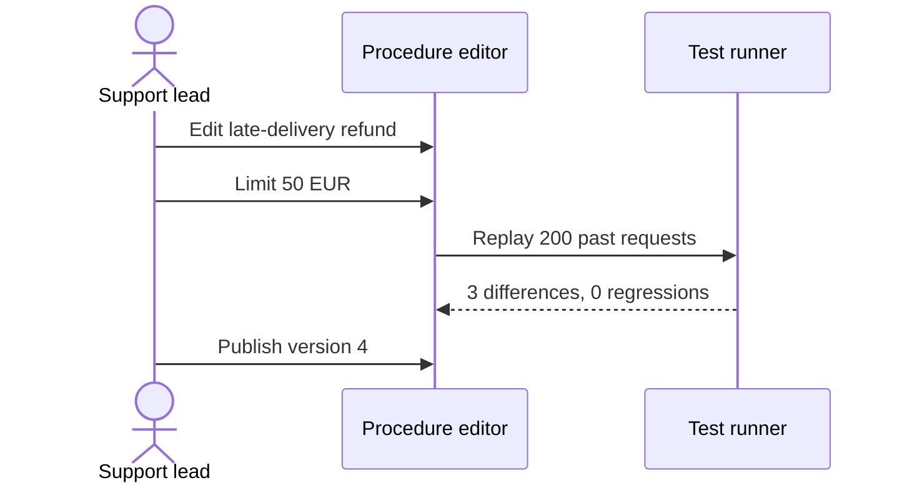

🏠 [Specs](../../../../README.md) › 🧩 [Functional capabilities](../../../README.md) ›
🎧 [F16 Customer support agents](../../README.md) › 📝 [Use cases](../README.md) ›
📝 [Use cases: FL-F16-02 Automate an intent](README.md) › 📝 UC-F16-02 Write and test a procedure for an intent

# 📝 UC-F16-02 Write and test a procedure for an intent

**Status:** ✅ specified

## Summary

The support lead writes an intent's procedure in plain language with its allowed actions, refund limits and the data it
reads, tests it on past requests and publishes a new version after the non-regression tests pass.

## Personas

- [U02 Manager](../../../../01-users/personas/u02-manager.md) (support lead)

## Goal

Each intent handled the way the company wants, proved on real cases.

## Trigger

A new intent (UC-F16-14) or a correction (UC-F16-04).

## Frequency

A few versions a month.

## Preconditions

- The intent exists.

## Postconditions

- Success: a new published version.
- Failure: the draft stays unpublished.

## Main flow

1. The lead picks an intent in the Procedure editor (S-F16-02).
2. They write the procedure, its allowed actions, refund limits (BR-F16-07) and data read.
3. They replay it on past requests; differences with what people did are shown.
4. Non-regression tests run on the intent's test cases.
5. The lead publishes the new version.

## Alternative flows

- 2a. The AI assistant drafts a procedure from past answers.
- 2b. Static mode: the intent runs as a fixed workflow (F2).

## Error flows

- 4e. A test case regresses: the version is not published.
- Any step: a service does not answer; the call is retried first (BR-F3-32), then the message follows the error pattern
  (D122) and what was typed stays on the screen.

## Business rules

- [BR-F16-03 Agents act only as their procedure allows](../../business-rules/br-f16-03-agents-act-only-as-their-procedure-allows.md)
- [BR-F16-07 Refund limits per intent](../../business-rules/br-f16-07-refund-limits-per-intent.md)

## Entities

- [E-F16-02 Intent](../../data/e-f16-02-intent.md)

## Permissions

Support lead and owner.

## Notifications

- None.

## Audit events

Versions, tests, publication.

## AI involvement

The AI assistant drafts procedures; the lead publishes.

## API, MCP and A2A exposure

Connector actions (T12) through T5 and T6.

## Screens

- [S-F16-02 Procedure editor](../../screens/02-automate-an-intent/s-f16-02-procedure-editor.md)

## Flowchart

See [FL-F16-02 Automate an intent](../../flows/fl-f16-02-automate-an-intent.md#flowchart).

## Sequence diagram

## Acceptance criteria

1. **Given** version 3 and a new limit of 50.00 EUR **when** replayed on 200 requests **then** the 3 differences are
   shown.
2. **Given** a regression on a test case **when** published **then** it is refused.
3. **Given** version 4 published **when** the next request comes **then** version 4 is used.

## Non-functional notes

First answer within 2 minutes for automatic intents.

## Regulatory references

EU AI Act article 50 (customers told they deal with an AI, BR-F16-04); GDPR article 22 (a person on request); consumer
law for refunds and withdrawals.

## Related use cases

- [UC-F16-03 Roll an intent out: shadow, then automatic](uc-f16-03-roll-an-intent-out.md)
- [UC-F16-14 Discover intents from past requests](uc-f16-14-discover-intents-from-past-requests.md)

## Open questions

None.

---

⬅️ [UC-F16-01](../01-resolve-a-request/uc-f16-01-resolve-a-customer-request-automatically.md) · ⬆️ [Up](README.md) ·
➡️ [UC-F16-03 Roll an intent out: shadow, then automatic](uc-f16-03-roll-an-intent-out.md)
