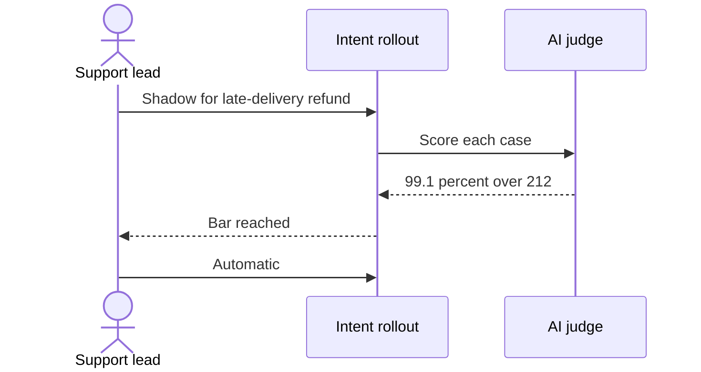

🏠 [Specs](../../../../README.md) › 🧩 [Functional capabilities](../../../README.md) ›
🎧 [F16 Customer support agents](../../README.md) › 📝 [Use cases](../README.md) ›
📝 [Use cases: FL-F16-02 Automate an intent](README.md) › 📝 UC-F16-03 Roll an intent out: shadow, then automatic

# 📝 UC-F16-03 Roll an intent out: shadow, then automatic

**Status:** ✅ specified

## Summary

An intent runs in shadow on real requests until it passes the bar of 99 % over 200 cases, then the lead switches it to
automatic; it falls back to shadow by itself when accuracy drops.

## Personas

- [U02 Manager](../../../../01-users/personas/u02-manager.md) (support lead)

## Goal

Only intents proven on real requests act alone.

## Trigger

A new or changed procedure.

## Frequency

A few a month.

## Preconditions

- The procedure is published.

## Postconditions

- Success: the intent automatic.
- Failure: it stays in shadow.

## Main flow

1. The lead switches the intent to shadow on Intent rollout (S-F16-03).
2. It runs on real requests without acting; people send the answers.
3. The AI judge and the human sample score each case; accuracy builds up.
4. At 99 % over 200 cases (BR-F16-01), the lead is told and switches it to automatic.
5. In automatic, the sample keeps being reviewed (BR-F16-02).

## Alternative flows

- 5a. Automatic below 97 % for a week: back to shadow by itself.

## Error flows

- 4e. The lead tries to switch below the bar: refused with the figures.
- Any step: a service does not answer; the call is retried first (BR-F3-32), then the message follows the error pattern
  (D122) and what was typed stays on the screen.

## Business rules

- [BR-F16-01 Automatic only above the bar](../../business-rules/br-f16-01-automatic-only-above-the-bar.md)

## Entities

- [E-F16-02 Intent](../../data/e-f16-02-intent.md)

## Permissions

Support lead and owner.

## Notifications

- The lead when the bar is reached or the intent falls back.

## Audit events

Mode changes with figures.

## AI involvement

The AI judge scores; people sample.

## API, MCP and A2A exposure

Connector actions (T12) through T5 and T6.

## Screens

- [S-F16-03 Intent rollout](../../screens/02-automate-an-intent/s-f16-03-intent-rollout.md)

## Flowchart

See [FL-F16-02 Automate an intent](../../flows/fl-f16-02-automate-an-intent.md#flowchart).

## Sequence diagram

## Acceptance criteria

1. **Given** 99.1 % over 212 cases **when** the lead switches **then** the intent goes automatic.
2. **Given** 98.4 % over 230 **when** the lead switches **then** it is refused with the figures.
3. **Given** automatic at 96.5 % for 7 days **when** computed **then** it falls back to shadow.

## Non-functional notes

First answer within 2 minutes for automatic intents.

## Regulatory references

EU AI Act article 50 (customers told they deal with an AI, BR-F16-04); GDPR article 22 (a person on request); consumer
law for refunds and withdrawals.

## Related use cases

- [UC-F16-02 Write and test a procedure for an intent](uc-f16-02-write-and-test-a-procedure.md)
- [UC-F16-04 Review, correct and escalate](../03-review-and-monitor/uc-f16-04-review-correct-and-escalate.md)

## Open questions

None.

---

⬅️ [UC-F16-02 Write and test a procedure for an intent](uc-f16-02-write-and-test-a-procedure.md) · ⬆️ [Up](README.md) ·
➡️ [UC-F16-04 Review, correct and escalate](../03-review-and-monitor/uc-f16-04-review-correct-and-escalate.md)
