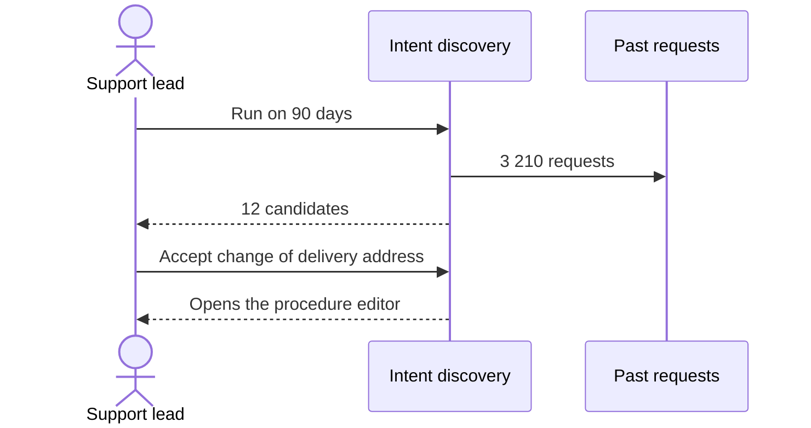

🏠 [Specs](../../../../README.md) › 🧩 [Functional capabilities](../../../README.md) ›
🎧 [F16 Customer support agents](../../README.md) › 📝 [Use cases](../README.md) ›
📝 [Use cases: FL-F16-02 Automate an intent](README.md) › 📝 UC-F16-14 Discover intents from past requests

# 📝 UC-F16-14 Discover intents from past requests

**Status:** 🔄 waiting for the owner

## Summary

The support lead runs the intent discovery on past requests; alike requests are grouped into candidates with their
volume and share handled by people, and the lead turns the best ones into intents.

## Personas

- [U02 Manager](../../../../01-users/personas/u02-manager.md)

## Goal

Automate the intents worth it, chosen from real volumes.

## Trigger

Setting up support; a monthly review.

## Frequency

Monthly.

## Preconditions

- At least (Proposed) 500 past requests.

## Postconditions

- Success: candidates accepted as intents or merged.
- Failure: no candidate; the lead is told why.

## Main flow

1. The support lead opens Intent discovery (S-F16-12) and runs it on the last 90 days.
2. SimpleERP groups alike requests and proposes candidates with a label, volume, examples and share handled by people.
3. The lead reads the examples of a candidate.
4. They accept it as a new intent, merge it into one, or dismiss it.
5. An accepted intent goes to the procedure editor (UC-F16-02).

## Alternative flows

- 4a. Merge into an existing intent: its examples become test cases.

## Error flows

- 1e. Too few requests: no discovery; the minimum is shown.
- Any step: a service does not answer; the call is retried first (BR-F3-32), then the message follows the error pattern
  (D122) and what was typed stays on the screen.

## Business rules

None.

## Entities

- [E-F16-10 Intent candidate](../../data/e-f16-10-intent-candidate.md)
- [E-F16-02 Intent](../../data/e-f16-02-intent.md)

## Permissions

Support lead and owner.

## Notifications

- None.

## Audit events

Discovery runs; candidates accepted, merged or dismissed.

## AI involvement

The AI assistant groups the requests and proposes labels; the lead decides.

## API, MCP and A2A exposure

Through the API (T5) and as AI assistant tools (T6), with the caller's rights (BR-F3-34).

## Screens

- [S-F16-12 Intent discovery](../../screens/02-automate-an-intent/s-f16-12-intent-discovery.md)

## Flowchart

See [FL-F16-02 Automate an intent](../../flows/fl-f16-02-automate-an-intent.md#flowchart).

## Sequence diagram

## Acceptance criteria

1. **Given** 3 210 requests in 90 days **when** discovery runs **then** candidates show with volume and examples.
2. **Given** "change of delivery address" with 186 requests, 92 % by people **when** accepted **then** it becomes an
   intent in the editor.
3. **Given** 300 requests **when** discovery runs **then** it is refused with the minimum.

## Non-functional notes

D408's targets ([Performance](../../../../05-non-functional/performance.md)): 95 % of screens within 1 second; lists
paged on the server, the first page within 1 second; reports within 5 seconds or in the background.

## Regulatory references

None.

## Related use cases

- [UC-F16-02 Write and test a procedure for an intent](uc-f16-02-write-and-test-a-procedure.md)
- [UC-F16-03 Roll an intent out: shadow, then automatic](uc-f16-03-roll-an-intent-out.md)

## Open questions

None.

---

⬅️ [UC-F16-13 Ask for a person](../05-customer-side/uc-f16-13-ask-for-a-person.md) · ⬆️ [Up](README.md) ·
➡️ [UC-F16-15](../03-review-and-monitor/uc-f16-15-detect-refund-abuse-and-fraud-signals.md)
