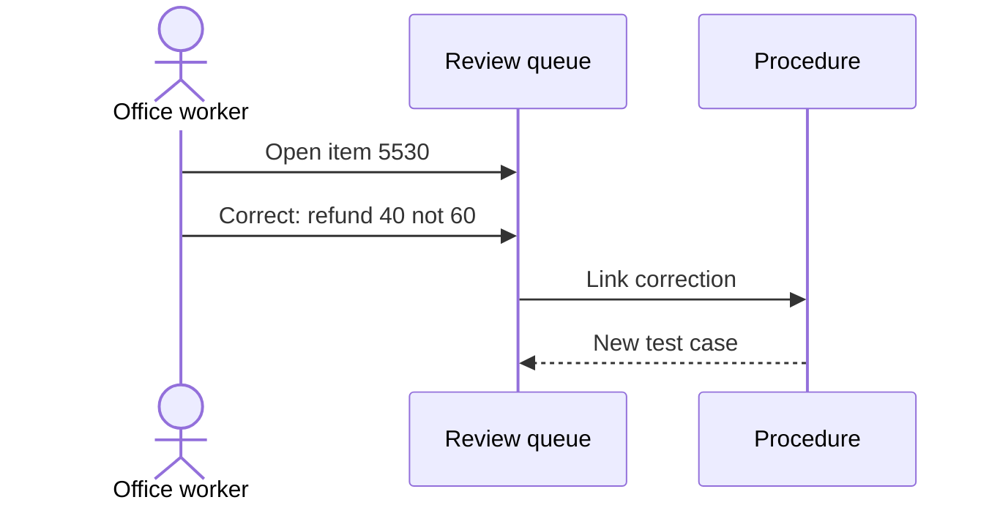

🏠 [Specs](../../../../README.md) › 🧩 [Functional capabilities](../../../README.md) ›
🎧 [F16 Customer support agents](../../README.md) › 📝 [Use cases](../README.md) ›
📝 [Use cases: FL-F16-03 Review and monitor](README.md) › 📝 UC-F16-04 Review, correct and escalate

# 📝 UC-F16-04 Review, correct and escalate

**Status:** ✅ specified

## Summary

Office workers and the lead review sampled, low-scored, low-rated and escalated resolutions, approve or correct them,
and take over escalated requests with the history.

## Personas

- [U16 Office worker](../../../../01-users/personas/u16-office-worker.md)
- [U02 Manager](../../../../01-users/personas/u02-manager.md) (support lead)

## Goal

Errors caught and fed back into the procedures.

## Trigger

Items in the review queue.

## Frequency

Daily.

## Preconditions

- Items are in the queue.

## Postconditions

- Success: each item approved or corrected; corrections linked to the procedure.
- Failure: items wait; the lead is told above 50.

## Main flow

1. The reviewer opens the Review queue (S-F16-04).
2. They read the request, the agent's answer and actions.
3. They approve or correct; a correction is linked to the procedure (BR-F16-02).
4. For an escalated request, they take it over with the history.
5. Corrections become test cases of the intent.

## Alternative flows

- 3a. A correction needing a customer apology: the reviewer writes it.

## Error flows

- 3e. An action already done in a back-office tool: the reviewer reverses it there, logged.
- Any step: a service does not answer; the call is retried first (BR-F3-32), then the message follows the error pattern
  (D122) and what was typed stays on the screen.

## Business rules

- [BR-F16-02 A sample is always reviewed](../../business-rules/br-f16-02-a-sample-is-always-reviewed.md)
- [BR-F16-04 Customers know, and can reach a person](../../business-rules/br-f16-04-customers-know-and-can-reach-a-person.md)
- [BR-F16-09 Satisfaction asked once per resolved request](../../business-rules/br-f16-09-satisfaction-asked-once-per-resolved-request.md)

## Entities

- [E-F16-01 Customer request](../../data/e-f16-01-customer-request.md)
- [E-F16-03 Resolution review](../../data/e-f16-03-resolution-review.md)
- [E-F16-08 Satisfaction rating](../../data/e-f16-08-satisfaction-rating.md)

## Permissions

Office workers and the lead.

## Notifications

- The lead daily above 50 items.

## Audit events

Reviews, corrections, reversals.

## AI involvement

The AI assistant may explain why the judge scored low.

## API, MCP and A2A exposure

Connector actions (T12) through T5 and T6.

## Screens

- [S-F16-04 Review queue](../../screens/03-review-and-monitor/s-f16-04-review-queue.md)

## Flowchart

See [FL-F16-03 Review and monitor](../../flows/fl-f16-03-review-and-monitor.md#flowchart).

## Sequence diagram

## Acceptance criteria

1. **Given** a resolution scored 72 by the judge **when** the queue opens **then** it is listed.
2. **Given** a correction "refund 40 EUR, not 60" **when** saved **then** it is linked to the procedure and becomes a
   test case.
3. **Given** a request rated 2 by the customer **when** rated **then** it enters the queue.

## Non-functional notes

First answer within 2 minutes for automatic intents.

## Regulatory references

EU AI Act article 50 (customers told they deal with an AI, BR-F16-04); GDPR article 22 (a person on request); consumer
law for refunds and withdrawals.

## Related use cases

- [UC-F16-03 Roll an intent out: shadow, then automatic](../02-automate-an-intent/uc-f16-03-roll-an-intent-out.md)
- [UC-F16-09 Rate the answer and measure satisfaction](../05-customer-side/uc-f16-09-rate-the-answer-and-measure-satisfaction.md)

## Open questions

None.

---

⬅️ [UC-F16-03 Roll an intent out: shadow, then automatic](../02-automate-an-intent/uc-f16-03-roll-an-intent-out.md) ·
⬆️ [Up](README.md) · ➡️ [UC-F16-05 Monitor resolution and accuracy](uc-f16-05-monitor-resolution-and-accuracy.md)
