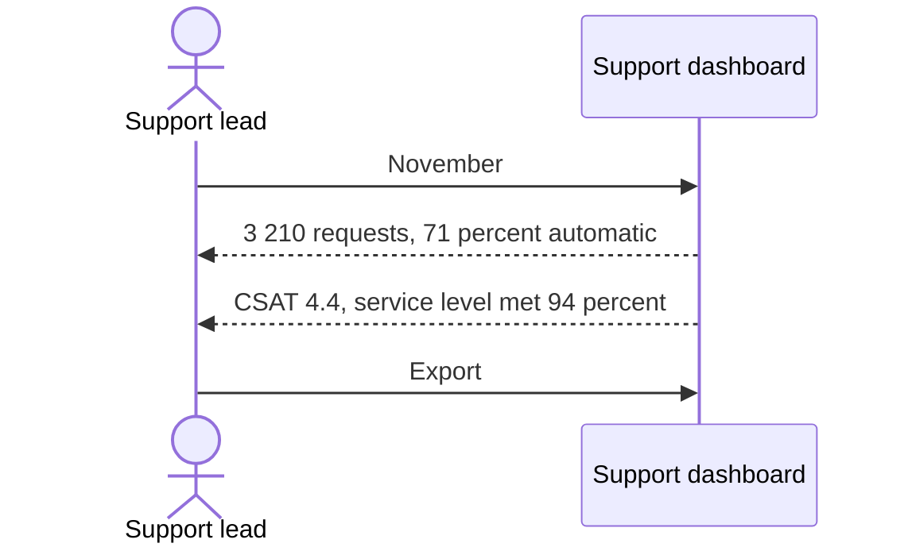

🏠 [Specs](../../../../README.md) › 🧩 [Functional capabilities](../../../README.md) ›
🎧 [F16 Customer support agents](../../README.md) › 📝 [Use cases](../README.md) ›
📝 [Use cases: FL-F16-03 Review and monitor](README.md) › 📝 UC-F16-05 Monitor resolution and accuracy

# 📝 UC-F16-05 Monitor resolution and accuracy

**Status:** ✅ specified

## Summary

The support lead and the owner follow volumes, the resolved share, automatic versus shadow versus human, accuracy per
intent, satisfaction, service levels met, time to resolve and costs, live.

## Personas

- [U02 Manager](../../../../01-users/personas/u02-manager.md) (support lead)
- [U13 Owner](../../../../01-users/personas/u13-owner.md)

## Goal

Know how support performs and where to act.

## Trigger

Any time; weekly review.

## Frequency

Daily for the lead.

## Preconditions

- Requests exist.

## Postconditions

- Success: figures seen or exported.
- Failure: none.

## Main flow

1. The lead opens the Support dashboard (S-F16-05).
2. They see volumes, resolved share and modes.
3. They see accuracy per intent, satisfaction and service levels met.
4. They open an intent to see its cases and corrections.
5. They export the figures.

## Alternative flows

- 1a. The owner reads a summary card on their home.

## Error flows

- 1e. No data yet: shown.
- Any step: a service does not answer; the call is retried first (BR-F3-32), then the message follows the error pattern
  (D122) and what was typed stays on the screen.

## Business rules

- [BR-F16-01 Automatic only above the bar](../../business-rules/br-f16-01-automatic-only-above-the-bar.md)
- [BR-F16-02 A sample is always reviewed](../../business-rules/br-f16-02-a-sample-is-always-reviewed.md)
- [BR-F16-05 Service levels per priority](../../business-rules/br-f16-05-service-levels-per-priority.md)
- [BR-F16-09 Satisfaction asked once per resolved request](../../business-rules/br-f16-09-satisfaction-asked-once-per-resolved-request.md)

## Entities

- [E-F16-02 Intent](../../data/e-f16-02-intent.md)
- [E-F16-03 Resolution review](../../data/e-f16-03-resolution-review.md)
- [E-F16-08 Satisfaction rating](../../data/e-f16-08-satisfaction-rating.md)
- [E-F16-05 Service-level policy](../../data/e-f16-05-service-level-policy.md)

## Permissions

Support lead and owner.

## Notifications

- None.

## Audit events

Exports.

## AI involvement

The AI assistant may explain a change.

## API, MCP and A2A exposure

Connector actions (T12) through T5 and T6.

## Screens

- [S-F16-05 Support dashboard](../../screens/03-review-and-monitor/s-f16-05-support-dashboard.md)

## Flowchart

See [FL-F16-03 Review and monitor](../../flows/fl-f16-03-review-and-monitor.md#flowchart).

## Sequence diagram

## Acceptance criteria

1. **Given** 3 210 requests in November **when** opened **then** the resolved share and modes show.
2. **Given** 1 200 ratings averaging 4.4 **when** opened **then** satisfaction shows 4.4 per intent.
3. **Given** 94 % of requests within target **when** opened **then** service levels met shows 94 %.

## Non-functional notes

First answer within 2 minutes for automatic intents.

## Regulatory references

EU AI Act article 50 (customers told they deal with an AI, BR-F16-04); GDPR article 22 (a person on request); consumer
law for refunds and withdrawals.

## Related use cases

- [UC-F16-07 Set service levels and follow targets](../04-human-agent-workspace/uc-f16-07-set-service-levels-and-follow-targets.md)
- [UC-F16-09 Rate the answer and measure satisfaction](../05-customer-side/uc-f16-09-rate-the-answer-and-measure-satisfaction.md)

## Open questions

None.

---

⬅️ [UC-F16-04 Review, correct and escalate](uc-f16-04-review-correct-and-escalate.md) · ⬆️ [Up](README.md) ·
➡️ [UC-F16-06](../01-resolve-a-request/uc-f16-06-connect-the-helpdesk-and-back-office-tools.md)
